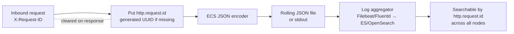

# Architecture: Logging and Observability

## Changes

- **v1.1** — ECS JSON logging and request-id correlation are live for the two klite Kotlin services
  (`edelivery`, `xml-mapper`), not via a custom MDC encoder as drafted below but via klite-slf4j's
  built-in `klite.slf4j.EcsJsonLogger` (`LOGGER_CLASS` env var, default now set in `.env`;
  `LOGGER_SERVICE_NAME` set per service in `compose.yml`) — every request already runs on a virtual
  thread named after its request id (`klite.Server`), and `EcsJsonLogger` emits that thread name as
  `trace.id` on every log line for free, so there's no separate MDC-put/clear step to maintain. SLF4J
  `MDC.put(...)` values (if a handler sets any) are merged into the same JSON line.
  **Not implemented**: shipping those JSON lines anywhere (Filebeat/Fluentd/aggregator below is still
  aspirational — this is MON-1, centralized log collection, not done), and the Ruuter DSL layer (guard
  denials, cross-gate broadcast/business-logic steps) still logs in Ruuter's own format, not ECS JSON.
- _Initial state. Change tracking begins at v1.0.0._

> Sub-architecture for the Logging and Observability surface. For overarching rules see [theme README](README.md). AC are in [`../../cfr/observability/logging_and_observability.md`](../../cfr/observability/logging_and_observability.md).

## Log pipeline at a glance

## Rationale

ECS-shaped JSON gives the operator one consistent schema to index, search, and alert against (regardless of which log-aggregator stack they run). The `efti.*` namespace keeps custom fields from colliding with ECS evolution. Mandatory `http.request.id` plus per-call outbound logging lets an on-call engineer reconstruct an end-to-end trace across the local gate, eDelivery hop, and peer-gate without distributed tracing infrastructure.

