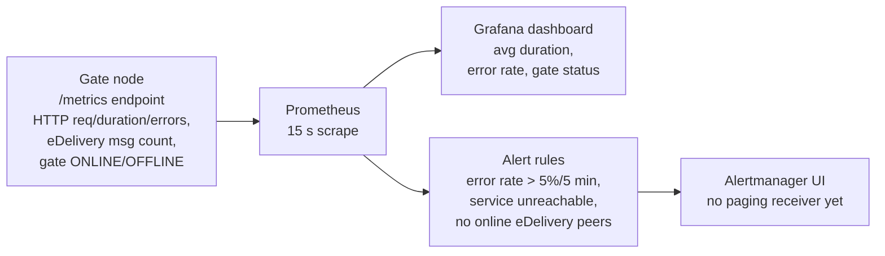

# Architecture: Monitoring and Alerting

## Changes

- **v1.1** — Implemented for the two klite Kotlin services (`edelivery`, `xml-mapper`): a `/metrics`
  endpoint (klite-server 2.0.7's built-in `Metrics`/`OpenMetricsRenderer`, wired up in
  `code/core/src/metrics/RequestMetrics.kt`) exposes HTTP request count by method/status-class, an error
  total, average request duration, JVM heap, `edelivery`'s inbound/outbound AS4 message counts
  (`code/edelivery/src/edelivery/EDeliveryMetrics.kt`) and its count of `ONLINE` gates/platforms
  (`code/edelivery/src/EDeliveryPartyRegistry.kt`). Prometheus, Grafana and Alertmanager are now compose
  services (`docker/prometheus/`, `docker/grafana/`, `docker/alertmanager/`; definitions in
  `compose.yml`, dev-only port bindings in `compose.override.yml`), with one provisioned Grafana
  dashboard (`docker/grafana/provisioning/dashboards/efti-gate-overview.json`) and three alert rules
  (`docker/prometheus/alert-rules.yml`: service-down, error rate, zero online eDelivery peers).
  **Not yet implemented**, unlike the diagram below originally implied: percentile latencies (the
  current duration metric is a running average, not histogram buckets — see the dashboard panel's own
  description), restart-loop detection, DB-down and disk alerts (all three need exporters — cAdvisor /
  node_exporter / postgres_exporter — that aren't deployed), Ruuter/ReSql/registry metrics (klite-only
  today), centralized log collection (MON-1, separate from this), and a real Alertmanager notification
  receiver (alerts are visible in its UI only, not paged anywhere yet). Runbooks referencing these panels
  live under `docs/runbooks/`.
- _Initial state. Change tracking begins at v1.0.0._

> Sub-architecture for the Monitoring and Alerting surface. For overarching rules see [theme README](README.md). AC are in [`../../cfr/observability/monitoring_and_alerting.md`](../../cfr/observability/monitoring_and_alerting.md).

## Monitoring pipeline at a glance

Restart-loop, DB-down and disk-usage alerts are not in this diagram on purpose — they need exporters
(cAdvisor, postgres_exporter, node_exporter) this stack doesn't run yet; see the Changes entry above.

## Rationale

The gate is regulator-facing; an outage during an inspection window has legal as well as operational consequences. Alerts are deliberately coarse (error rate, restart loop, DB failure, peer-gate stall, disk) — the long tail of issue-specific alerts emerges from operating the system, not from spec-writing. SLOs and the HPA contract live in one place (`non-functional.md`); this epic just wires them up to dashboards + alertmanager.

