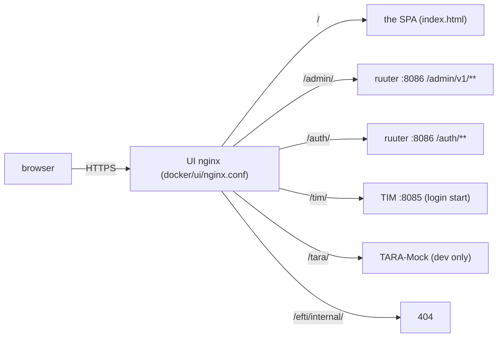
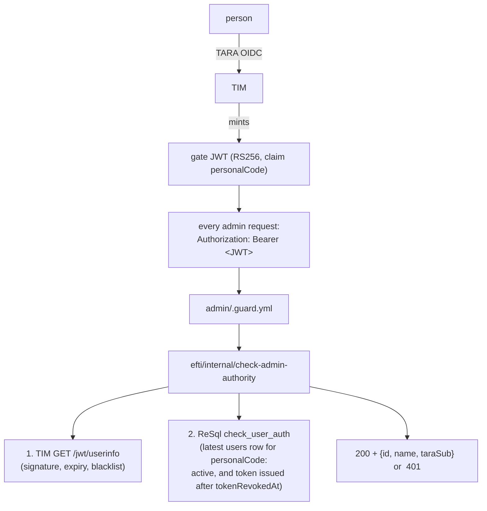

# Administrators

This part is for the people who run a gate: they look at the gate's own entry and its peers,
check which platforms and authorities are registered, manage who else may administer the gate,
look at registered consignments and read the audit log.

They do this in the **admin UI**, a Svelte single-page app (`code/ui`). The UI calls the API on
this page. Everything the UI can do, a script with a token can do too.

## How administrators reach the gate



- The admin API is served by the core ruuter under `/admin/v1` and `/auth`. Sources:
  `DSL/Ruuter/admin/**` and `DSL/Ruuter/auth/**`.
- In a deployment only the UI nginx is exposed. It sets `X-Forwarded-For`, which the gate copies
  into audit rows.
- The local two-gate stack has no UI container. Call ruuter directly: G1
  `http://127.0.0.1:27086`, G2 `http://127.0.0.1:28086`. See
  [Ports and credentials](../../reference/ports-and-credentials.md).

## Identity model



- **TARA** proves who the person is. **TIM** (Bürokratt Token & Identity Manager) runs the TARA
  code exchange and mints the gate's own JWT. The gate never handles the TARA client secret.
- **The `users` table is the list of administrators.** There are no roles: an active row for the
  person's personal code (`taraSub`) is full access to every admin route. A valid TARA login with
  no row gets 401 everywhere. Nobody is created automatically.
- **The first administrator** of a deployment is inserted by hand (`docs/specs/deploy/first-admin.md`).
  Locally the seed has the dev admin `11111111-1111-1111-1111-111111111111`, personal code
  `60001019906`.
- **Locally**, [`POST /auth/dev-login`](./auth.md#post-authdev-login) replaces the TARA round trip.
  It mints a token for any valid personal code; the `users` row is still required.
- The check runs on **every request**. A change to a user row (delete, new personal code, token
  revocation) applies on the next request, not at token expiry.

## The admin guard

`DSL/Ruuter/admin/.guard.yml` protects every method and path under `/admin/**`. It calls
`POST /efti/internal/check-admin-authority` over loopback, forwarding `Authorization`,
`X-Forwarded-For` and `X-Request-Id`.

| Outcome | Status | Body |
|---|---|---|
| token valid, active user | – | request continues; the handler sees the caller as `${caller}` |
| no or non-Bearer header, empty token, TIM rejects it, no `personalCode` claim, `loginExpireDate` in the past, no active user row, token older than `tokenRevokedAt` | 401 | RFC 7807 `unauthorized` |
| TIM or ReSql unreachable or 5xx | 503 | RFC 7807 `service-unavailable` |

```http
HTTP/1.1 401 Unauthorized
content-type: application/problem+json
content-length: 173

{"detail":"Token is missing, invalid, expired, or the user has no active gate account.","status":401,"title":"Unauthorized","type":"https://api.efti.ee/errors/unauthorized"}
```

Every refusal writes an `admin.auth_denied` audit row. The 401 is the same for all reasons, so a
caller cannot tell an unknown person from an expired token.

`check-admin-authority` and `check-user-authority` (used by `GET /auth/user`) are the same check;
the admin one additionally refuses a `loginExpireDate` in the past. The UI nginx returns 404 for
`/efti/internal/`. Locally ruuter's port is published, so the route answers on
`http://127.0.0.1:27086/efti/internal/check-admin-authority`. See
[Auth helpers](../internal/auth-helpers.md).

Paths that do not exist answer 404 `{"error":"Not Found"}` with or without a token. Write methods
on read-only paths answer 405 before the guard runs.

## Revocation

| Mechanism | Ends | Route |
|---|---|---|
| Logout | the one presented token (TIM blacklist) | [`POST /auth/logout`](./auth.md#post-authlogout) |
| Token revocation | every token the user holds that was issued before now | [`POST /admin/v1/users/revoke-token/{id}`](./users.md#post-adminv1usersrevoke-tokenid) |
| Personal code change | every token issued for the old code | [`PUT /admin/v1/users/{id}`](./users.md#put-adminv1usersid) |
| Soft delete | all tokens, and no new login works | [`DELETE /admin/v1/users/{id}`](./users.md#delete-adminv1usersid) |

Tokens also expire: 60 minutes from dev-login, 480 minutes from the TARA callback.

## Audit of admin actions

Every admin read and write writes an `audit_log` row with the acting admin's id
(`userId`), the action (`user.create`, `consignment.delete`, `gate.list`, …), the resource id and
small JSON details. User writes record the row before and after. Logins and refused calls are
recorded too. Writes are best-effort: a failed audit insert never fails the request. Read them
with [`GET /admin/v1/audit`](./audit.md), which lists every action.

## Registries are read-only

Gates, platforms and authorities live in YAML files in `registry/` and are converted by `registry-build` from
mounted sources and served by the `registry` service (ADR-011, `registry/README.md`; no image contains them). The admin API only reads them:
`POST`, `PUT` and `DELETE` on these paths answer 405. To change an entry, edit the YAML, open a
PR and re-run `docker compose up -d registry-build`. Users are the only thing an administrator can change through the API,
apart from soft-deleting a consignment.

## Common conventions

**Headers**

| Header | Required | Value |
|---|---|---|
| `Authorization` | yes, except `/auth/callback`, `/auth/dev-login`, `/auth/logout` | `Bearer <gate JWT>` |
| `Content-Type` | on `POST`/`PUT` with a body | `application/json` |
| `X-Forwarded-For` | no | set by the UI nginx; copied into audit rows |
| `X-Request-Id` | no | forwarded to the internal auth check for log correlation |

**Pagination.** List routes take `limit` and `offset` as query parameters. `offset` defaults to 0
and negative values count as 0. `limit` is clamped to 0..1000; the default is 20 for users,
audit and the registries, 100 for consignments, counts and the summary. There is no total count
in the response; ask for the next page until it comes back shorter than `limit`. On the
ReSql-backed lists a non-numeric `limit` answers 502; on the registry lists it gives an empty page.

**Errors.** The guard's 401 and 503 are RFC 7807 problem documents with
`Content-Type: application/problem+json`. Validation errors (400) use the same shape with
`code: "BAD_REQUEST_GENERAL"` but are sent as `application/json`. Handler errors are short objects
such as `{"error":"Not Found"}` (404), `{"error":"Conflict","detail":…}` (409) and
`{"error":"Data layer unavailable"}` (502, the ReSql or registry call failed). See
[Error catalogue](../../data/errors.md).

**204 responses.** `DELETE /admin/v1/users/{id}`, `DELETE /admin/v1/consignments/{id}`,
`POST /admin/v1/users/revoke-token/{id}` and `POST /admin/v1/js-error` answer `204` with
`content-length: 2` and no body. curl copes; Postman and Newman can hang. See
[Known issues](../../reference/known-issues.md).

**Credentials on these pages.** The dev admin personal code `60001019906`, the platform key
`mock-secret-key` and the ops token `dev-archive-ops-token-change-me` are public in the
repository and only valid on the local stack.

## All endpoints

| Method | Path | Purpose | Page |
|---|---|---|---|
| `POST` | `/auth/callback` | Exchange a TARA code for a gate JWT | [Login and session](./auth.md#post-authcallback) |
| `POST` | `/auth/dev-login` | Mint a JWT without TARA (local only) | [Login and session](./auth.md#post-authdev-login) |
| `POST` | `/auth/logout` | Blacklist the presented JWT | [Login and session](./auth.md#post-authlogout) |
| `GET` | `/auth/user` | The caller's own identity | [Login and session](./auth.md#get-authuser) |
| `GET` | `/admin/v1/users` | List active users | [Users](./users.md#get-adminv1users) |
| `GET` | `/admin/v1/users/{id}` | One user | [Users](./users.md#get-adminv1usersid) |
| `POST` | `/admin/v1/users` | Create a user | [Users](./users.md#post-adminv1users) |
| `PUT` | `/admin/v1/users/{id}` | Change name or personal code | [Users](./users.md#put-adminv1usersid) |
| `DELETE` | `/admin/v1/users/{id}` | Soft-delete a user | [Users](./users.md#delete-adminv1usersid) |
| `POST` | `/admin/v1/users/revoke-token/{id}` | Invalidate a user's tokens | [Users](./users.md#post-adminv1usersrevoke-tokenid) |
| `GET` | `/admin/v1/gates` | List gates | [Registries](./registries.md#get-adminv1gates) |
| `GET` | `/admin/v1/gates/{id}` | One gate | [Registries](./registries.md#get-adminv1gatesid) |
| `GET` | `/admin/v1/gates/own` | This gate's entry | [Registries](./registries.md#get-adminv1gatesown) |
| `GET` | `/admin/v1/platforms` | List platforms (no `apiKey`) | [Registries](./registries.md#get-adminv1platforms) |
| `GET` | `/admin/v1/platforms/{id}` | One platform (no `apiKey`) | [Registries](./registries.md#get-adminv1platformsid) |
| `GET` | `/admin/v1/authorities` | List authorities | [Registries](./registries.md#get-adminv1authorities) |
| `GET` | `/admin/v1/authorities/{id}` | One authority | [Registries](./registries.md#get-adminv1authoritiesid) |
| `GET` | `/admin/v1/consignments` | Current datasets | [Consignments](./consignments.md#get-adminv1consignments) |
| `DELETE` | `/admin/v1/consignments/{id}?platformId&gateId` | Soft-delete a dataset | [Consignments](./consignments.md#delete-adminv1consignmentsid) |
| `GET` | `/admin/v1/consignment-history?datasetId` | All versions of a dataset | [Consignments](./consignments.md#get-adminv1consignment-history) |
| `GET` | `/admin/v1/consignment-counts` | Counts per gate, platform, status | [Consignments](./consignments.md#get-adminv1consignment-counts) |
| `GET` | `/admin/v1/consignment-summary?authorityId` | Counts an authority may see | [Consignments](./consignments.md#get-adminv1consignment-summary) |
| `GET` | `/admin/v1/audit` | Read the audit log | [Audit log](./audit.md) |
| `POST` | `/admin/v1/js-error` | Log a frontend error | [Frontend error reports](./js-error.md) |

## A typical session

1. The UI has no token, so it starts the TARA login through TIM. TARA sends the browser back to
   `/callback`; the UI posts the code to `POST /auth/callback` and stores the token. (Locally:
   `POST /auth/dev-login`.)
2. `GET /auth/user` – show who is logged in.
3. `GET /admin/v1/gates/own`, `GET /admin/v1/gates`, `/platforms`, `/authorities` – check the
   registries.
4. `POST /admin/v1/users` – add a colleague; `POST /admin/v1/users/revoke-token/{id}` or
   `DELETE /admin/v1/users/{id}` when needed.
5. `GET /admin/v1/consignments`, `/consignment-counts`, `/consignment-history` – look at the data.
6. `GET /admin/v1/audit` – check what happened.
7. `POST /auth/logout`.

The whole sequence with real requests and responses is in
[An administrator manages the gate](../../use-cases/administrator.md). Who may call what across
the whole gate is in the [Permissions matrix](../../data/permissions.md).

## Notes

- `docs/specs/permissions-matrix.md` §3.3 lists the admin API under `/api/v1/…`, with registry
  write routes, `…/ping` routes and a break-glass `/api/v1/auth/local-token`. The served paths are
  `/admin/v1/…` and `/auth/…`; the registry writes, pings and break-glass login do not exist.
- Postman: folder **6. Administrators**. It logs in with dev-login by itself. Creating, revoking
  and deleting a user are in the separate known-issues collection, because revoke and delete answer
  the broken 204 ([Known issues](../../reference/known-issues.md), H1).
