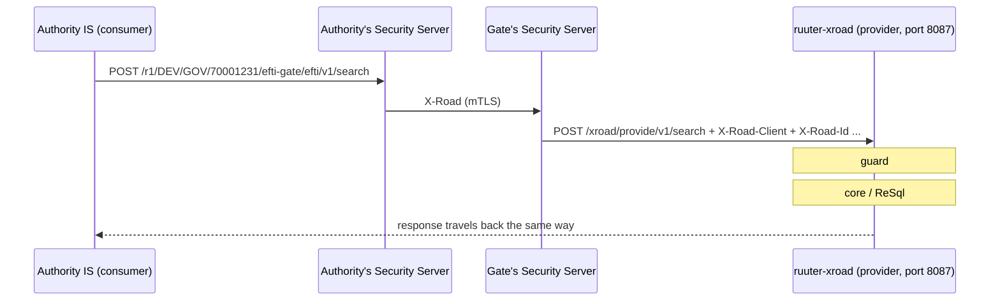

# Competent authorities (X-Road)

A competent authority (police, customs, the transport administration) asks the gate about
consignments: is this vehicle known, which consignments match these criteria, show me the
dataset, send the platform a follow-up question. It does this over X-Road. The gate is the
service provider; the authority's information system is the consumer.

This chapter documents the provider side: the routes under `/xroad/provide/**` that the gate's
X-Road Ruuter (`ruuter-xroad`) serves. Locally they are on G1 `http://127.0.0.1:27087/xroad`
and G2 `http://127.0.0.1:28087/xroad`.

## How a call reaches the gate



| Part | Value |
|---|---|
| Gate's X-Road member and subsystem | `DEV/GOV/70001231/efti-gate` |
| Service code | `efti` (the whole API is one X-Road OpenAPI service) |
| Service URL registered at the gate's Security Server | `<gate host>/xroad/provide` |
| Consumer URL | `POST /r1/DEV/GOV/70001231/efti-gate/efti/v1/<operation>` on the consumer's own Security Server |
| Provider path at the gate | `/xroad/provide/v1/<operation>` |

`/r1/` is the X-Road REST protocol version. The consumer's Security Server consumes it; it never
reaches the gate. `/v1` in the path is the gate's own contract version.

The consumer's Security Server authenticates the organisation (mTLS) and the gate's Security
Server forwards the call with `X-Road-*` headers. The gate trusts `X-Road-Client` without further
checks. So `ruuter-xroad` must not be reachable by anyone except the gate's Security Server
(ADR-006). The local stack publishes port 27087/28087 on `127.0.0.1` for development only, and
there is no Security Server: you set the `X-Road-*` headers yourself.

## Headers

| Header | Required | Value | What the gate does with it |
|---|---|---|---|
| `X-Road-Client` | yes | `instance/memberClass/memberCode[/subsystemCode]`, 3 or 4 non-empty parts | The credential. Part 3 (`memberCode`, the business registry code) must match the `registryCode` of exactly one authority in `registry/authorities/*.yml`. |
| `X-Road-Id` | yes | UUID, 8-4-4-4-12 hex, any case | Becomes the gate's internal `x-request-id`. For `search` and `transport-means` it is also the `searchId` of a fan-out. `dataset` and `follow-up` reject a repeated id (`409`). |
| `X-Road-UserId` | no | the end user, e.g. `DEV30101010007` | Echoed by `echo`. Not authenticated by X-Road, so it never grants access and is not used elsewhere. |
| `X-Road-Issue` | no | case or issue reference | Accepted. No DSL reads it; it is not echoed or stored. |
| `X-Road-Represented-Party` | no | represented party | Accepted. No DSL reads it; it is not echoed or stored. |
| `X-Request-Id` | no | correlation id | Logged by the guard as `rid=` and passed to the registry lookup. |
| `Content-Type` | for POST | `application/json` | A body that is not valid JSON is rejected by the engine with `400 {"error":"invalid JSON body: …"}`. |

Local dev clients (from `registry/authorities/*.yml`, public in the repo):

| `X-Road-Client` | Authority id | `subsets` | Use for |
|---|---|---|---|
| `DEV/GOV/70000099/testSubsystem` | `auth-xroad-test` | `EU01` | search, dataset with EU01, the EU02 denial |
| `DEV/GOV/70000093/ants` | `auth-xroad-tm` | `EU01`, `EU02` | transport means, dataset with EU02 |
| `DEV/GOV/70000097/…` | `auth-xroad-subsets` | `EU01`, `EU05` | |
| `DEV/GOV/70000094/…` | `auth-xroad-fwd` | `EU01`, `EU02` | a second authority (poll ownership) |
| `DEV/GOV/70000092/…` | `auth-xroad-tm-no-eu02` | `EU01` | |
| `DEV/GOV/70000096/…` | `auth-xroad-empty` | none | a registered authority without entitlement |
| `DEV/GOV/70000091/…` | `auth-xroad-ambig-a` and `-b` | | the ambiguous-registry 403 |

Both gates load the same authority files.

## The guard

Every route under `/xroad/**` runs `DSL/Ruuter-xroad/xroad/.guard.yml` first (and its copy
`xroad/GET/provide/v1/.guard.yml` for the GET routes). Exceptions: `GET /xroad/provide/openapi`
and `GET /xroad/health/ready` are public. The checks run in this order; the first failure answers:

| Order | Check | Failure |
|---|---|---|
| 1 | `X-Road-Client` present and not empty | `401 UNAUTHORIZED` |
| 2 | 3 or 4 parts, none empty (a trailing `/` fails) | `401 UNAUTHORIZED` |
| 3 | `X-Road-Id` present | `400 MISSING_REQUIRED_HEADER` |
| 4 | `X-Road-Id` is UUID-shaped | `400 INVALID_REQUEST_ID` |
| 5 | registry `authorities.json` answers 200 | `403 FORBIDDEN` (fails closed) |
| 6 | `memberCode` matches no `registryCode` | `403 FORBIDDEN` |
| 7 | `memberCode` matches more than one | `403 FORBIDDEN` (registry misconfiguration) |
| 8 | exactly one match with an `id` | pass; the row is bound as `${authority}` |

The client check comes first on purpose: a caller with a bad credential gets `401`, not a
complaint about another header. Every denial writes an `xroad.auth_denied` row to the audit log
with the reason. The guard checks identity only. It does not look at subsets; `dataset` and
`transport-means` do that themselves (see below).

The guard error bodies are sent as `application/problem+json`. Errors from the route handlers
are sent as `application/json`. The body shape is the same.

## Subsets

An authority's `subsets` in the registry decides what content it may see. The codes are
`EU01`…`EU07` ([eFTI subsets](../../data/subsets.md)).

| Route | Subset rule |
|---|---|
| `echo`, `subsets`, `search`, `follow-up` | none |
| `transport-means` | `EU02` must be in the authority's `subsets`, for every scope and for polls |
| `dataset` | every requested subset must be in the authority's `subsets`; one missing denies the whole request |

A denial is `403 FORBIDDEN_SUBSET` with `authorityId`, `deniedSubsets` and `permittedSubsets`.
Ask [`subsets`](./subsets.md) once and answer your own yes/no questions from the list.

## Error shape

Errors follow RFC 7807 with a stable `code`. Switch on `code`, not on `title` or `detail`.

```json
{
  "type": "https://api.efti.ee/errors/forbidden-subset",
  "code": "FORBIDDEN_SUBSET",
  "title": "Subset Access Denied",
  "status": 403,
  "detail": "…",
  "authorityId": "auth-xroad-tm",
  "deniedSubsets": ["EU06"],
  "permittedSubsets": ["EU01", "EU02"]
}
```

| Status | `code` | Raised by |
|---|---|---|
| 400 | `MISSING_REQUIRED_HEADER` | guard |
| 400 | `INVALID_REQUEST_ID` | guard |
| 400 | `BAD_REQUEST_GENERAL` | route body checks |
| 400 | `MISSING_SUBSET` | `dataset` |
| 401 | `UNAUTHORIZED` | guard |
| 403 | `FORBIDDEN` | guard; `dataset` and `transport-means` residual denial |
| 403 | `FORBIDDEN_SUBSET` | `dataset`, `transport-means` |
| 409 | `DUPLICATE_REQUEST_ID` | `dataset`, `follow-up` |
| 502 | `GATEWAY_UNAVAILABLE` | any upstream failure (core, ReSql, xml-mapper, peer gate) |

A `502` carries extension members that say what failed: `failedStep`, `coreStatus` and
`coreResponse` (core's own answer), `resqlStatus`, `mapperStatus` or `transportError`. Branch on
those, not on the HTTP status.

Two kinds of `400` come from the Ruuter engine before the route runs and are not RFC 7807:
invalid JSON (`{"error":"invalid JSON body: …"}`) and a body field of the wrong type where the
route declares one (`{"error":"Field type mismatch in body: … expected string, got number"}`).
A wrong method answers `405 {"allow":["POST"],"error":"Method Not Allowed"}`.

The full catalogue is in [Error catalogue](../../data/errors.md).

## Local first, then the other gates

`search`, and `transport-means` with `scope: allgates`, ask this gate's own register first.

- **Local hit**: the answer comes at once with `x-poll-more: false`. The other gates are not asked,
  even if they also hold matches. This is by design: the gate is authoritative for its own
  consignments.
- **Local miss**: the gate registers the search, starts a fan-out to every `ONLINE` peer gate in
  the registry (FTI019 over AS4, in the background), and answers at once with an empty result,
  `x-poll-more: true` and `x-search-id: <the X-Road-Id of this call>`.

Collect the peers' answer with a poll: the same route, a **new** `X-Road-Id`, and the body
`{"poll": true, "searchId": "<x-search-id>"}`.

| Poll situation | Answer |
|---|---|
| results are in | the rows, `x-poll-more: false` |
| results not in yet | the gate waits up to about 30 s, then answers empty with `x-poll-more: true`; poll again |
| unknown, expired or another authority's `searchId` | empty, `x-poll-more: false` (the three cannot be told apart) |
| `searchId` missing or not a UUID | `400 BAD_REQUEST_GENERAL` |

A poll can be repeated; it returns the same stored rows. Only the authority that started the
search can collect it (the gate stores an owner record `owner:<searchId>`). Rows from a peer
gate carry only `uil` and `mainTransportId`; every other field is `null` or `[]`.

On the local stack the fan-out to the other gate takes well under a second, so the first poll
already has the result.

## Endpoints

| Method and path | Purpose | Page |
|---|---|---|
| `GET /xroad/provide/openapi` | The OpenAPI document of this API. Public. | [openapi](./openapi.md) |
| `POST /xroad/provide/v1/echo` | Connectivity test; shows the resolved authority. | [echo](./echo.md) |
| `GET /xroad/provide/v1/subsets` | The caller's own permitted subsets. | [subsets](./subsets.md) |
| `POST /xroad/provide/v1/search` | Consignments by identifier criteria, local first, then the other gates. | [search](./search.md) |
| `POST /xroad/provide/v1/transport-means` | What is known about one plate, IMO, aircraft or container id. Needs EU02. | [transport-means](./transport-means.md) |
| `POST /xroad/provide/v1/dataset` | The dataset content for a UIL, filtered to subsets. | [dataset](./dataset.md) |
| `POST /xroad/provide/v1/follow-up` | A message to the platform that holds a dataset. | [follow-up](./follow-up.md) |

`GET /xroad/health/ready` (readiness for the Security Server) is described in
[Health and diagnostics](../operations/health.md). A public sandbox with canned answers is
described in [Developer mock](./developer-mock.md).

## Typical call sequence

```text
1. echo                 once, when you set up the connection: is my registry code right?
2. subsets              once, cache it: which subsets may I request?
3. transport-means      at the roadside: is this plate known? (existence, then local)
   or search            by criteria; on x-poll-more: true, poll with {poll, searchId}
4. dataset              for a UIL from step 3, with subsets from step 2
5. follow-up            optional: ask the platform, referenceIds = the X-Road-Id of step 4
```

The use cases walk through this with real requests:
[checks a transport means](../../use-cases/authority-checks-transport-means.md),
[searches](../../use-cases/authority-searches.md),
[retrieves a dataset](../../use-cases/authority-retrieves-dataset.md),
[sends a follow-up](../../use-cases/authority-follow-up.md).

## Notes

- Behind the routes is the gate's core authority API (`/efti/api/v1/authority/*` on the main
  Ruuter), see [Core authority API](../internal/core-authority.md). The X-Road routes add the
  identity guard, the subset checks, the request-id dedup and the curated response shape.
- Postman: folder **1. CA -> Gate (X-Road provider)** of the collection, run with a gate's environment
  ([The Postman collection](../../reference/collection.md)).
- Contract documents in the repo: `docs/developer/x_road_openapi.yaml`,
  `docs/developer/x_road_authority_integration_guide.md` (Estonian). Where they differ from the
  DSL, the pages in this chapter follow the DSL and say so.
