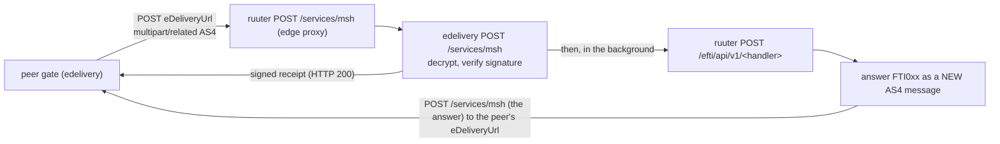
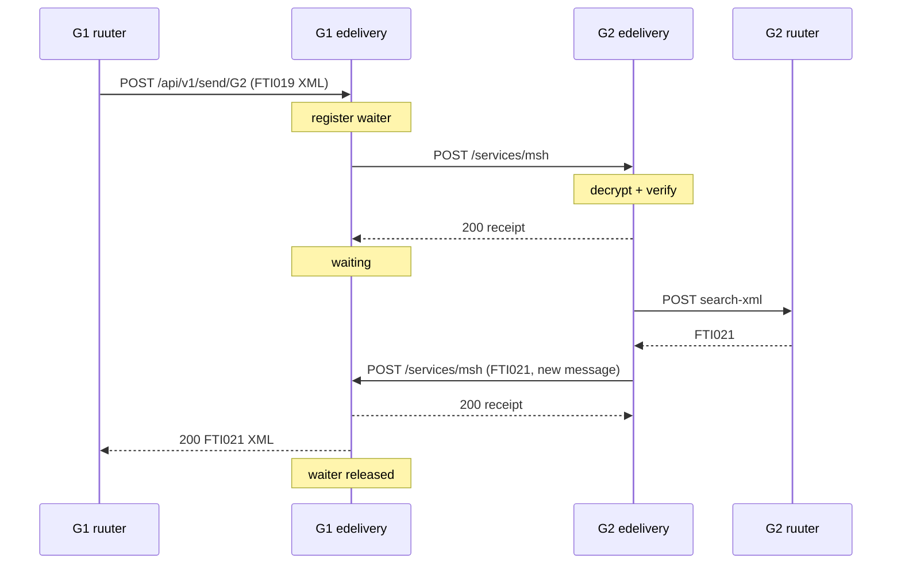

# Peer gates (AS4)

This section is for the operators and developers of other member states' gates. It describes how
a peer gate talks to this gate: the AS4 message model, the security profile, the registry entry a
peer needs, and the three request/response pairs the gate answers.

Inside the gate the same machinery is used in the other direction: when an authority at G1 asks
for data held at G2, the G1 gate becomes the peer that sends. Both directions are shown here,
because a gate is always both.

## How a peer reaches the gate



- Transport is HTTP POST of an AS4 user message, `multipart/related` with a SOAP 1.2 envelope and
  one encrypted attachment. See [AS4 endpoint](./as4-endpoint.md).
- The public entry point is Ruuter's `POST /services/msh`, a byte-for-byte pass-through proxy to
  edelivery's own `/services/msh`. It checks the `Content-Type`, the body size and the
  `Content-Encoding` and nothing else.
- Authentication is the AS4 signature, not the network: the gate accepts a message only if it
  decrypts with the gate's own key and the signature verifies against the sender's
  `eDeliveryCert` in the registry. There is no API key, token or client certificate on this hop.
- In the local stack the registry `eDeliveryUrl` of both gates points straight at edelivery
  (`http://g1-edelivery:8081/services/msh`, `http://g2-edelivery:8081/services/msh`), so gate-to-gate
  traffic does not pass through the Ruuter proxy there. The proxy is still running and can be called
  on `:27086` / `:28086`.

## The registry entry of a peer

A gate knows a peer only from its registry file `registry/gates/<id>.yml`
(see `registry/README.md` and [Registry documents](../internal/registry.md)). edelivery reads
`/gates.json` and `/platforms.json` from the registry every 10 seconds (`REGISTRY_REFRESH_SECONDS`)
and builds its party map from them.

| Field | Used by edelivery for |
|---|---|
| `id` | The ebMS `PartyId` (`From` / `To`) and the path parameter of the [send API](./send-api.md). Compared case-insensitively. |
| `eDeliveryUrl` | Where outbound messages and answers to this peer are POSTed. If the URL has no path, `/services/msh` is added. |
| `eDeliveryCert` | Encrypting the AES key for this peer, and verifying this peer's signatures. A gate without one is left out of the party map. |
| `tlsCert` | Added to the trust store of the outbound HTTPS client, next to the JVM's default CAs. Neither local gate has one (plain HTTP). |
| `status` | `DISABLED` gates are left out of the party map: no messages to or from them. |

The local entries:

```bash
curl -s http://127.0.0.1:27080/gates/g2.json
```

```json
{
  "id": "G2",
  "countryCode": "XB",
  "eDeliveryUrl": "http://g2-edelivery:8081/services/msh",
  "status": "ONLINE",
  "eDeliveryCert": "-----BEGIN CERTIFICATE-----\nMIIDATCCAemgAwIBAgIUKm2w4e+qkq0vfRIbTAToIo2OpeAw…\n-----END CERTIFICATE-----\n"
}
```

The party map of edelivery also holds every platform that has an `eDeliveryCert` (here
`mock-edelivery`), because platforms can send FTI004 uploads over the same endpoint
(see [Upload identifiers (eDelivery)](../platforms/upload-edelivery.md)). How the certificates are
made and exchanged is in [Create and exchange gate certificates](../../getting-started/certificates.md).

## Security profile

This is what edelivery does in `TURVIS_INTEGRATION_MODE=legacy`, the mode the local stack runs
(read from `EDeliveryMessageGenerator.kt`, `EDeliveryRoutes.kt`, `SignatureValidator.kt`,
`KeyManager.kt`, and checked on a captured message, see [AS4 endpoint](./as4-endpoint.md)).

| Item | Value |
|---|---|
| ebMS | ebMS 3.0 / AS4, SOAP 1.2 (`http://www.w3.org/2003/05/soap-envelope`) |
| Message packaging | `multipart/related; type="application/soap+xml"`, part 1 = SOAP envelope, part 2 = attachment `Content-ID: <message>` |
| Payload | The FTI XML, gzip-compressed (`CompressionType` = `application/gzip`, `MimeType` = `text/xml`), then encrypted |
| Payload encryption | AES-128-GCM with a 16-byte key, 12-byte random IV prepended to the ciphertext, 128-bit tag. URI `http://www.w3.org/2009/xmlenc11#aes128-gcm` |
| Key transport | RSA-OAEP with SHA-256 and MGF1-SHA-256 (`http://www.w3.org/2009/xmlenc11#rsa-oaep`), key referenced by the receiver certificate's Subject Key Identifier |
| Signature | RSA-SHA256 (`http://www.w3.org/2001/04/xmldsig-more#rsa-sha256`), exclusive C14N, SHA-256 digests |
| Signed parts | `#MSG-ID` (the `eb:Messaging` header), `#BODY-ID` (the empty SOAP body), `cid:message` (the compressed payload before encryption, SwA Attachment-Content-Signature-Transform) |
| Signer reference | `wsse:KeyIdentifier` with the sender certificate's SKI |
| Receipt | A signed `eb:SignalMessage` with `eb:Receipt` / `ebbp:NonRepudiationInformation` repeating the three references of the received signature |
| Service / Action | `bdx:noprocess` (type `tc1`) / `eftiGateAction` |
| PartyId type | `urn:oasis:names:tc:ebcore:partyid-type:unregistered` |
| Message properties | `originalSender` and `finalRecipient`, `iso6523-actorid-upis::9915:<gate id>` |

On receipt, a message is accepted only if the `KeyIdentifier` (or `X509SerialNumber`) of the
`EncryptedKey` names this gate's own certificate, the key and payload decrypt, and the signature
uses exclusive C14N, RSA-SHA256 and SHA-256 and verifies against the sender's registered
certificate. An unexpected key or data encryption URI is only logged as a warning.

### With Turvis (`TURVIS_INTEGRATION_MODE=turvis`)

Turvis does the cryptography (compose profile `turvis`). The legacy in-process path above is due for
removal once Turvis is the default. Outbound messages are unchanged on the wire. Inbound and receipts
differ:

- **Key references.** The signer and the `EncryptedKey` recipient may be named by SKI
  `KeyIdentifier`, by `X509IssuerSerial` (issuer and serial), or by a `wsse:Reference` to a
  `BinarySecurityToken`. The token form (`X509v3` or `X509PKIPathv1`) is Domibus's `DirectReference`,
  the EFTI4EU reference gate setting; the legacy path answers it with `EBMS:0004`.
- **Algorithms.** Any algorithm URI other than the ones in the table, and an AES key that is not
  16 bytes, are refused (`ALGO_UNSUPPORTED`, `EBMS:0003`).
- **Attachment.** It must be gzip.
- **Signed parts.** The signature must cover `eb:Messaging`, the body and `cid:message`.
- **Receiver.** The signed `To/PartyId` must be this gate. Any other value is refused with
  `RECEIVER_MISMATCH` (`EBMS:0003`, *Message not addressed to this gate*).
- **ConversationId.** It may be any string up to 255 characters without control characters (ebMS3).
  - A canonical UUID is used as the request id.
  - Any other value maps to a stable name-based UUID internally, and the answer repeats the peer's
    own value.
- **Receipt sent.** It repeats the received `ds:Reference` elements verbatim (not just three, and not
  rebuilt). A repeat of an accepted MessageId gets the stored receipt and is not dispatched again.
- **Receipt received.** A 2xx answer to an outbound message is a delivery only if Turvis verifies it
  as the peer's signed receipt for exactly that message. The signer must be the peer, the receipt
  must sign its `eb:Messaging` and body, and `RefToMessageId` must equal the sent `MessageId`.
  - An empty answer, an ebMS `Error` signal sent with a 2xx, or a receipt that fails these checks is
    a failed send.
  - The failure is logged as `eDelivery receipt invalid`, with only a fingerprint of the answer.

Verified against Domibus 5.2.1 in both directions, with `IssuerSerial` and with `DirectReference`.

## Two HTTP exchanges per request

AS4 here is asynchronous. A request and its answer are two separate AS4 user messages, each with
its own HTTP POST and its own receipt:

1. The requesting gate POSTs the request (FTI019, FTI009 or FTI025) to the peer. The peer checks
   it and answers the HTTP request at once with a signed receipt (HTTP 200) or a SOAP fault.
2. After that answer, the peer runs the handler in the background, builds the FTI answer and POSTs
   it to the requesting gate's `eDeliveryUrl` as a new user message. The requesting gate answers
   that POST with its own receipt.

Both messages carry the same `ConversationId`. On the requesting side,
[`POST /api/v1/send/{partyId}`](./send-api.md) registers a waiter under the key
`<peer>:<ConversationId>:<own id>` before it sends, and blocks until the answer with that key
arrives. edelivery's `DbAsyncResponseProvider` also stores an answer in the database if the waiter
is on another node, and the waiting node polls for it (`claim_async_response`).

The key prints as `receiverId:requestId:senderId` from the point of view of a reply. That is why the
receiving gate logs `Handling 'FTI019SearchIdentifierRequest' from G1:<id>:G2`: `G1` is
the gate the answer goes to, `G2` is the gate itself. See
[Known issues](../../reference/known-issues.md).

## Timeouts and retries

| Setting | Default | Effect |
|---|---|---|
| `EDELIVERY_TIMEOUT_SECONDS` | 60 | HTTP timeout of each outbound AS4 POST, and how long `send` waits for the answer. After it the send API answers `504`. |
| Retry of an outbound POST | 5 attempts | On a connection error edelivery waits 1, 2, 3, 4 s between attempts. A timeout is not retried. |
| `RUUTER_TIMEOUT_SECONDS` | 90 | Timeout of edelivery's call to the inbound handler in Ruuter. |
| Ruuter proxy `request_timeout_ms` | 65000 | Timeout of the edge proxy towards edelivery. |
| Ruuter callers of the send API | 62000-65000 ms | `authority/search` (62 s per peer), `authority/dataset`, `authority/follow-up`, `dataset-local`, `follow-up-local` (65 s). |

A peer that accepts the request but never sends an answer (handler failed, answer rejected,
unknown message type that has no answer) leaves the requesting caller waiting for the full 60 s.

## Legacy, shadow and turvis mode

`TURVIS_INTEGRATION_MODE` selects who does the AS4 cryptography:

| Mode | Inbound | Outbound |
|---|---|---|
| `legacy` (default, used by this stack) | edelivery parses, decrypts and verifies in-process with `own.p12` | edelivery encrypts and signs in-process |
| `shadow` | as legacy; Turvis also checks every inbound message and differences are counted (`edelivery_turvis_shadow_*` metrics) | as legacy |
| `turvis` | Turvis decrypts and verifies; the sender is the identity Turvis verified, never the envelope `From`; repeats of an accepted `MessageId` are answered from a shared store (duplicate elimination); Turvis down → HTTP 503 without a fault | Turvis encrypts and signs |

Only `legacy` was run for this book. See [Turvis](../internal/turvis.md) for the other modes.

## Message pairs

| Request | Answer | Handler on the receiving gate | Page |
|---|---|---|---|
| `FTI019SearchIdentifierRequest` | `FTI021SearchIdentifierResponse` | `POST /efti/api/v1/consignments/search-xml?gateId=<own id>` | [Identifier search](./search-fti019.md) |
| `FTI009GetCmdsRequest` | `FTI010GetCmdsResponse` | `POST /efti/api/v1/dataset-xml` | [Dataset](./dataset-fti009.md) |
| `FTI025LodgeFollowUpCommRequest` | `FTI030LodgeFollowUpCommResponse` | `POST /efti/api/v1/follow-up-xml` | [Follow-up](./follow-up-fti025.md) |
| `FTI004UploadIdentifierRequest` (from a platform) | `FTI029UploadIdentifierResponse` | `POST /platforms/v1/consignments-xml` | [Upload identifiers (eDelivery)](../platforms/upload-edelivery.md) |

edelivery also accepts a root element `hello`, which is acknowledged and then dropped. Any other
root element is answered with the fault `EBMS:0002` `UNSUPPORTED_MESSAGE`.

## Endpoints on this page's audience

| Endpoint | Service | Who calls it | Page |
|---|---|---|---|
| `POST /services/msh` | ruuter (edge proxy) and edelivery | peer gates, eDelivery platforms | [AS4 endpoint](./as4-endpoint.md) |
| `GET /services/msh` | edelivery | anyone (liveness text) | [AS4 endpoint](./as4-endpoint.md) |
| `POST /api/v1/send/{partyId}` | edelivery | Ruuter of the own gate | [edelivery send API](./send-api.md) |
| `GET /health`, `GET /metrics` | edelivery | operations | [edelivery send API](./send-api.md) |
| `POST /efti/api/v1/consignments/search-xml` | ruuter | edelivery of the own gate | [Inbound handlers](./inbound-handlers.md) |
| `POST /efti/api/v1/dataset-xml` | ruuter | edelivery of the own gate | [Inbound handlers](./inbound-handlers.md) |
| `POST /efti/api/v1/follow-up-xml` | ruuter | edelivery of the own gate | [Inbound handlers](./inbound-handlers.md) |

## Typical sequence



The full run with real requests, answers and log lines is in
[A peer gate asks this gate](../../use-cases/peer-gate-request.md).

## Notes

- The dev keystore password (`changeit`) and the internal service token used on these pages are
  public in the repository. They are for the local stack only.
- The receipt a peer returns is not verified by the sender: `EDeliveryClient.send` treats any 2xx
  as delivered and does not check the receipt's signature or references.
- The ebMS `MessageId` of a request is `<ConversationId>@<own id>`, so it is the same for every
  peer of one fan-out and is reused if a caller repeats the same `X-Request-Id`.
