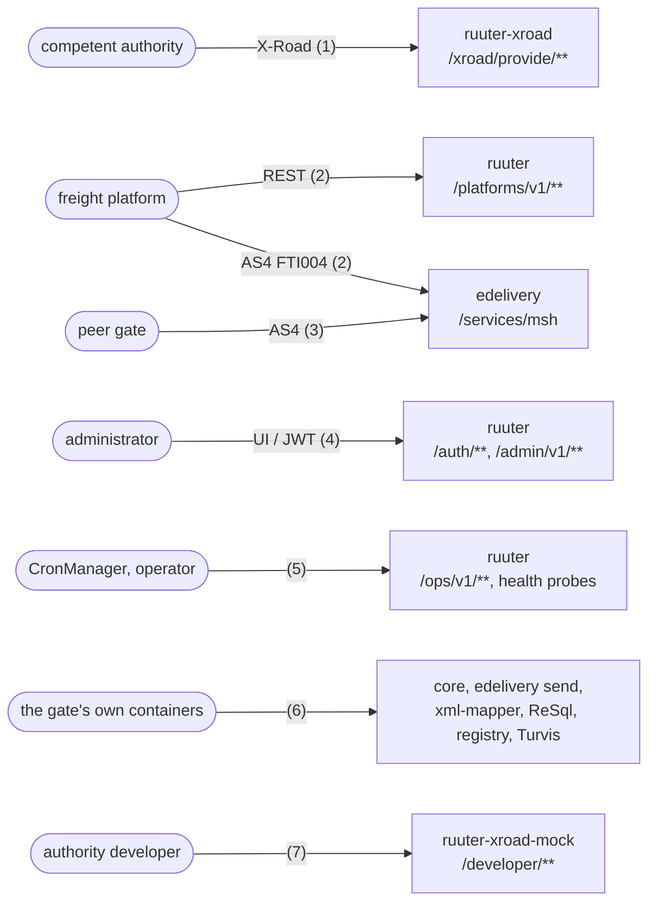

# Endpoint map

Every HTTP endpoint of the gate, grouped by who calls it. Each row links to the page that documents
it with parameters, every status code and real examples.

Ports are the local G1 host ports; G2 is the same on 28xxx
([Ports and credentials](../reference/ports-and-credentials.md)). Credentials are explained in the
[Permissions matrix](../data/permissions.md); shared rules (ids, errors, paging, dates) in
[Conventions](./conventions.md).

## Who calls what


```

## 1. Competent authorities: X-Road provider API

On ruuter-xroad (`:27087`). Credential: `X-Road-Client` + `X-Road-Id` (set by the Security Server).
Overview: [Competent authorities (X-Road)](./authorities/index.md).

| Method | Path | Purpose | Page |
|---|---|---|---|
| `GET` | `/xroad/provide/openapi` | OpenAPI document of this API (public) | [openapi](./authorities/openapi.md) |
| `POST` | `/xroad/provide/v1/echo` | Connectivity test; shows the resolved authority | [echo](./authorities/echo.md) |
| `GET` | `/xroad/provide/v1/subsets` | The caller's permitted eFTI subsets | [subsets](./authorities/subsets.md) |
| `POST` | `/xroad/provide/v1/search` | Consignments by criteria; local first, then other gates; poll | [search](./authorities/search.md) |
| `POST` | `/xroad/provide/v1/transport-means` | What is known about one plate, IMO, aircraft or container (EU02) | [transport-means](./authorities/transport-means.md) |
| `POST` | `/xroad/provide/v1/dataset` | Dataset content for a UIL, filtered to subsets | [dataset](./authorities/dataset.md) |
| `POST` | `/xroad/provide/v1/follow-up` | Message to the platform that holds a dataset | [follow-up](./authorities/follow-up.md) |
| `GET` | `/xroad/health/ready` | Readiness for the Security Server (public) | [Health](./operations/health.md) |

## 2. Freight platforms

On ruuter (`:27086`). Credential: `X-Api-Key`. Overview: [Freight platforms](./platforms/index.md).

| Method | Path | Purpose | Page |
|---|---|---|---|
| `POST` | `/platforms/v1/consignments/{datasetId}` | Register identifiers, short form (`ParameterIDSetCriteria`) | [Upload (REST)](./platforms/upload-rest.md) |
| `POST` | `/platforms/v1/consignments` | Register identifiers, full `FTI004UploadIdentifierRequest` | [Upload (REST)](./platforms/upload-rest.md) |
| AS4 | `FTI004` → `/services/msh` (edelivery `:27081`) | Register identifiers over eDelivery; answer `FTI029` | [Upload (eDelivery)](./platforms/upload-edelivery.md) |
| `POST` | `/platforms/v1/consignments-xml` | Gate-internal: edelivery hands over an AS4 upload | [Upload (eDelivery)](./platforms/upload-edelivery.md) |

What the platform must implement, because the gate calls it:

| Method | Path on the platform | Purpose | Page |
|---|---|---|---|
| `GET` | `<baseUrl>/v1/dataset/{datasetId}?subsets=…` | Return the dataset (FTI010 content) | [What the gate calls on a platform](./platforms/platform-side-api.md) |
| `POST` | `<baseUrl>/v1/dataset/{datasetId}/follow-up` | Receive an authority's follow-up | [What the gate calls on a platform](./platforms/platform-side-api.md) |
| AS4 | `FTI009` / `FTI025` | The same for AS4 platforms | [What the gate calls on a platform](./platforms/platform-side-api.md) |

The development stand-in for a platform, served by the gate's own Ruuter:

| Method | Path | Purpose | Page |
|---|---|---|---|
| `GET` | `/mock-platform/v1/dataset/{datasetId}` | Canned FTI010 dataset | [Mock platform](./platforms/mock-platform.md) |
| `POST` | `/mock-platform/v1/dataset/{datasetId}/follow-up` | Accepts a follow-up | [Mock platform](./platforms/mock-platform.md) |
| `GET` | `/mock-platform/v1/dataset-edelivery` | Canned full FTI010 for the AS4 mock | [Mock platform](./platforms/mock-platform.md) |
| `POST` | `/mock-platform/v1/dataset-edelivery/{requestId}/follow-up` | Canned FTI030 for the AS4 mock | [Mock platform](./platforms/mock-platform.md) |
| `POST` | `/mock-platform/health` | `"OK"` | [Mock platform](./platforms/mock-platform.md) |

## 3. Peer gates: AS4 (eDelivery)

Credential: the AS4 signature, checked against the peer's certificate in the registry.
Overview: [Peer gates (AS4)](./gates/index.md).

| Method | Path | Service | Purpose | Page |
|---|---|---|---|---|
| `POST` | `/services/msh` | ruuter (edge proxy, `:27086`) → edelivery | AS4 user messages and receipts | [AS4 endpoint](./gates/as4-endpoint.md) |
| `POST`, `GET` | `/services/msh` | edelivery (`:27081`) | AS4 MSH; `GET` answers a liveness text | [AS4 endpoint](./gates/as4-endpoint.md) |
| AS4 | `FTI019` → `FTI021` | | Identifier search | [Identifier search](./gates/search-fti019.md) |
| AS4 | `FTI009` → `FTI010` | | Dataset | [Dataset](./gates/dataset-fti009.md) |
| AS4 | `FTI025` → `FTI030` | | Follow-up | [Follow-up](./gates/follow-up-fti025.md) |

## 4. Administrators

On ruuter (`:27086`), behind the admin UI's nginx in a deployment. Credential: `Authorization:
Bearer <gate JWT>` from TIM. Overview: [Administrators](./admin/index.md).

| Method | Path | Purpose | Page |
|---|---|---|---|
| `POST` | `/auth/callback` | Exchange a TARA code for a gate JWT | [Login and session](./admin/auth.md) |
| `POST` | `/auth/dev-login` | Mint a JWT without TARA (dev only) | [Login and session](./admin/auth.md) |
| `POST` | `/auth/logout` | Blacklist the presented JWT | [Login and session](./admin/auth.md) |
| `GET` | `/auth/user` | The caller's identity | [Login and session](./admin/auth.md) |
| `GET` | `/admin/v1/users[/{id}]` | List users / one user | [Users](./admin/users.md) |
| `POST` | `/admin/v1/users` | Create a user | [Users](./admin/users.md) |
| `PUT` | `/admin/v1/users/{id}` | Change a user | [Users](./admin/users.md) |
| `DELETE` | `/admin/v1/users/{id}` | Soft-delete a user | [Users](./admin/users.md) |
| `POST` | `/admin/v1/users/revoke-token/{id}` | Invalidate a user's tokens | [Users](./admin/users.md) |
| `GET` | `/admin/v1/gates[/{id}]`, `/admin/v1/gates/own` | Gates (read-only) | [Registries](./admin/registries.md) |
| `GET` | `/admin/v1/platforms[/{id}]` | Platforms (read-only) | [Registries](./admin/registries.md) |
| `GET` | `/admin/v1/authorities[/{id}]` | Authorities (read-only) | [Registries](./admin/registries.md) |
| `GET` | `/admin/v1/consignments` | Current datasets | [Consignments](./admin/consignments.md) |
| `DELETE` | `/admin/v1/consignments/{id}?platformId&gateId` | Soft-delete a dataset | [Consignments](./admin/consignments.md) |
| `GET` | `/admin/v1/consignment-history?datasetId` | All versions of a dataset | [Consignments](./admin/consignments.md) |
| `GET` | `/admin/v1/consignment-counts` | Counts per gate, platform, status | [Consignments](./admin/consignments.md) |
| `GET` | `/admin/v1/consignment-summary?authorityId` | Counts an authority may see | [Consignments](./admin/consignments.md) |
| `GET` | `/admin/v1/audit` | Audit log | [Audit log](./admin/audit.md) |
| `POST` | `/admin/v1/js-error` | Frontend error report | [Frontend error reports](./admin/js-error.md) |

## 5. Operations

Overview: [Operations](./operations/index.md).

| Method | Path | Service | Credential | Page |
|---|---|---|---|---|
| `GET` | `/efti/health/live`, `/efti/health/ready` | ruuter | none | [Health](./operations/health.md) |
| `GET` | `/health` | ruuter, ruuter-xroad, ruuter-xroad-mock, edelivery, xml-mapper, resql | none | [Health](./operations/health.md) |
| `GET` | `/metrics` | edelivery, xml-mapper | none | [Health](./operations/health.md) |
| `GET` | `/health.json` | registry | none | [Health](./operations/health.md) |
| `GET` | `/efti/api/v1/test/baasikontoroll`, `/test/lubatud`, `/test/piiratud` | ruuter | none / cookie | [Health](./operations/health.md) |
| `POST` | `/ops/v1/archive-consignments` | ruuter | ops token | [Scheduled jobs](./operations/jobs.md) |
| `POST` | `/ops/v1/expire-identifiers` | ruuter | ops token | [Scheduled jobs](./operations/jobs.md) |
| `POST` | `/ops/v1/purge-archive` | ruuter | ops token | [Scheduled jobs](./operations/jobs.md) |
| `POST` | `/ops/v1/purge-async-responses` | ruuter | ops token | [Scheduled jobs](./operations/jobs.md) |
| `POST` | `/ops/v1/purge-inbound-messages` | ruuter | ops token | [Scheduled jobs](./operations/jobs.md) |
| `POST` | `/ops/v1/purge-search-results` | ruuter | ops token | [Scheduled jobs](./operations/jobs.md) |
| `POST` | `/ops/v1/refresh-read-models` | ruuter | ops token | [Scheduled jobs](./operations/jobs.md) |

## 6. Gate internals

Called only by the gate's own containers. Overview: [Gate internals](./internal/index.md).

| Method | Path | Service | Credential | Page |
|---|---|---|---|---|
| `POST` | `/efti/api/v1/authority/search` | ruuter | internal token | [Core authority API](./internal/core-authority.md) |
| `POST` | `/efti/api/v1/authority/dataset` | ruuter | internal token | [Core authority API](./internal/core-authority.md) |
| `GET` | `/efti/api/v1/authority/dataset/{gateId}/{platformId}/{datasetId}` | ruuter | internal token | [Core authority API](./internal/core-authority.md) |
| `POST` | `/efti/api/v1/authority/follow-up` | ruuter | internal token | [Core authority API](./internal/core-authority.md) |
| `GET` | `/efti/api/v1/follow-up/{datasetId}` | ruuter | internal token | [Core authority API](./internal/core-authority.md) |
| `GET` | `/efti/api/v1/status/{datasetId}` | ruuter | internal token | [Core authority API](./internal/core-authority.md) |
| `POST` | `/efti/api/v1/consignments/search-xml` | ruuter | internal token | [Inbound handlers](./gates/inbound-handlers.md) |
| `POST` | `/efti/api/v1/dataset-xml` | ruuter | internal token | [Inbound handlers](./gates/inbound-handlers.md) |
| `POST` | `/efti/api/v1/follow-up-xml` | ruuter | internal token | [Inbound handlers](./gates/inbound-handlers.md) |
| `POST` | `/efti/api/v1/dataset-local` | ruuter | internal token | [Local platform handlers](./internal/local-handlers.md) |
| `POST` | `/efti/api/v1/follow-up-local` | ruuter | internal token | [Local platform handlers](./internal/local-handlers.md) |
| `POST` | `/efti/api/v1/ping` | ruuter | internal token | [Local platform handlers](./internal/local-handlers.md) |
| `POST` | `/efti/internal/check-admin-authority`, `/check-user-authority` | ruuter | Bearer JWT (network isolation) | [Auth helpers](./internal/auth-helpers.md) |
| `POST` | `/api/v1/send/{partyId}` | edelivery | internal token | [edelivery send API](./gates/send-api.md) |
| `POST` | `/api/v1/upload/*`, `/search/*`, `/dataset/*`, `/followup/*`, `/transport-means/normalize` | xml-mapper | internal token | [xml-mapper](./internal/xml-mapper.md) |
| `POST` | `/efti/<query>`, `/archive/<query>` (48 queries) | resql | ReSql bearer | [ReSql endpoints](./internal/resql.md) |
| `GET` | `/gates.json`, `/platforms.json`, `/authorities.json`, `/<type>/<id>.json` | registry | none (network) | [Registry documents](./internal/registry.md) |
| `POST` | `/turvis/v1/{decryptions,encryptions}/xmlenc`, `/turvis/v1/{signatures,verifications}/xmldsig` | Turvis | Turvis token / mTLS | [Turvis](./internal/turvis.md) |

## 7. Authority developers: the developer mock

On ruuter-xroad-mock (`:27088`). Same headers as the X-Road API, canned answers, no database.
Page: [Developer mock](./authorities/developer-mock.md).

| Method | Path |
|---|---|
| `GET` | `/developer/health/ready` |
| `POST` | `/developer/v1/echo` |
| `GET` | `/developer/v1/subsets` |
| `POST` | `/developer/v1/search` |
| `POST` | `/developer/v1/transport-means` |
| `POST` | `/developer/v1/dataset` |
| `POST` | `/developer/v1/follow-up` |

## Machine-readable

- `docs/specs/openapi.generated.yaml`: generated from the routes Ruuter serves (`scripts/generate-openapi.py`, checked in CI).
- `GET /xroad/provide/openapi`: the X-Road provider contract, also in `docs/developer/x_road_openapi.yaml`.
- `local/postman/eFTI-Gate.postman_collection.json`: runnable requests for one gate, with one environment per gate ([The Postman collection](../reference/collection.md)).
