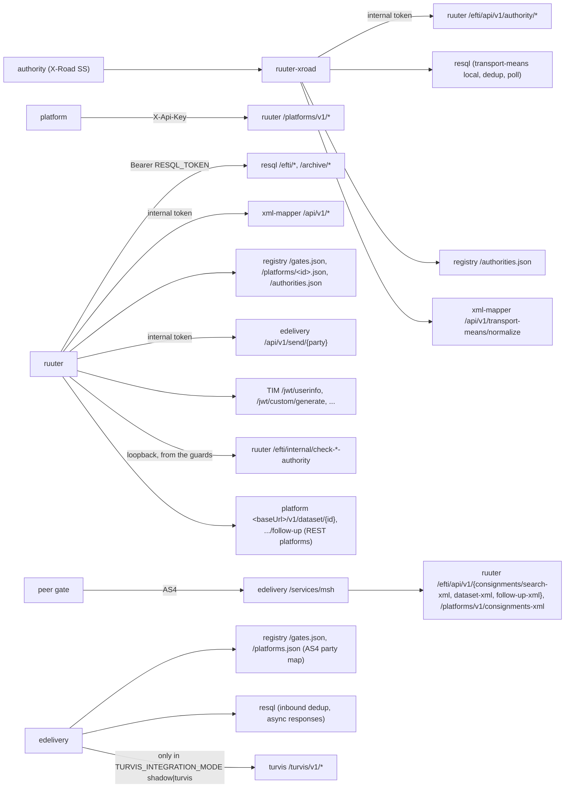

# Gate internals

This part describes the APIs the gate's containers use to call each other. No external party calls
them. You need them to debug a gate, to write a new DSL route, or to replace one component.

## The containers

One gate is one Compose project (`efti-g1`, `efti-g2` locally). The containers:

| Container | Image / source | Inside port | Role |
|---|---|---|---|
| `ruuter` | Ruuter, `DSL/Ruuter/**`, `constants.ini` | 8086 | core: authority API, platform API, admin, auth, ops, G2G handlers |
| `ruuter-xroad` | Ruuter, `DSL/Ruuter-xroad/**`, `constants-xroad.ini` | 8087 | X-Road provider adapter (`/xroad/**`) |
| `ruuter-xroad-mock` | Ruuter, `DSL/Ruuter-xroad-mock/**` | 8088 | public developer mock (`/developer/**`) |
| `edelivery` | Kotlin, `code/edelivery` | 8081 | AS4 access point: send API and MSH |
| `xml-mapper` | Kotlin, `code/xml-mapper` | 8082 | FTI XML ↔ JSON |
| `resql` | ReSql 0.5.1, `DSL/Resql/**`, `resql.yaml` | 8090 | named SQL over HTTP, datasources `efti` and `archive` |
| `registry` | stock nginx (`docker/registry`, config only) serving the output of the `registry-build` one-shot | 8080 | static JSON of `registry/**` |
| `database`, `archive-database` | PostgreSQL | 5432 | live and archive data |
| `tim`, `tim-database` | TIM | 8085 | JWT issue and validation |
| `tara-mock` | TARA mock | 8080 | dev OIDC login (not in the local stack; use `/auth/dev-login`) |
| `cronmanager` | CronManager 0.2.3 | 8080 | timers for `/ops/v1/*` (not in the local stack) |
| `test-scheduler` | Newman + CronManager 0.2.3, `local/test-scheduler.Dockerfile` | 8080 | local stack only, profile `test-schedule`: runs the Postman collection on a timer |
| `turvis-mock` | Ruuter, `DSL/Ruuter-turvis-mock/**` | 8091 | signing/encryption contract mock (not in the local stack) |

## Who calls whom

The service URLs come from `constants.ini` (ruuter) and `constants-xroad.ini` (ruuter-xroad):
`RUUTER_URL=http://ruuter:8086`, `RESQL_URL=http://resql:8090`,
`REGISTRY_URL=http://registry:8080`, `EDELIVERY_URL=http://edelivery:8081`,
`XML_MAPPER_URL=http://xml-mapper:8082`, `TIM_URL=http://tim:8085`. edelivery reads `RUUTER_URL`
and `INTERNAL_SERVICE_TOKEN` from its environment (`code/edelivery/src/RuuterClient.kt`).

## The gate-internal token

One shared secret, `INTERNAL_SERVICE_TOKEN`, sent as `X-Internal-Service-Token`:

| Checked by | Where | On failure |
|---|---|---|
| ruuter | `efti/{GET,POST}/api/v1/.guard.yml`, `…/authority/.guard.yml` (`/efti/api/v1/**` except `test/`) | `401` problem+json, `UNAUTHORIZED`, plus an `efti-internal.auth_denied` audit row |
| ruuter | `platforms/.guard.yml`, for the eDelivery upload path `consignments-xml` | see [Platforms](../platforms/index.md) |
| edelivery | `InternalServiceTokenAuth` before `/api/v1/**` (constant-time compare) | `401` `Missing or invalid X-Internal-Service-Token` |
| xml-mapper | `InternalServiceTokenAuth` before `/api/v1/**` | `401` `Missing or invalid X-Internal-Service-Token` |

The local value is `dev-internal-service-token-change-me`. It is a development value that is
public in the repository.

Other internal credentials:

| Credential | Header | Between |
|---|---|---|
| `RESQL_TOKEN` (`RESQL_INTERNAL_TOKEN` in ReSql) | `Authorization: Bearer …` | ruuter, ruuter-xroad, edelivery → resql. Local: `dev-resql-internal-token-change-me` |
| `TIM_ADMIN_TOKEN` | `X-TIM-Admin-Token` | ruuter → TIM (`/jwt/custom/generate`) |
| `TURVIS_INTERNAL_TOKEN` | `X-Internal-Service-Token` | edelivery → Turvis. Must differ from `INTERNAL_SERVICE_TOKEN` |
| none | — | ruuter → registry, ruuter → `/efti/internal/*` (network isolation only) |

## Correlation headers

| Header | Set by | Read by |
|---|---|---|
| `X-Request-Id` | the caller; ruuter-xroad sets it to the `X-Road-Id` | every DSL route forwards it; edelivery and xml-mapper log it as `trace.id`; core search uses it as the search id |
| `traceparent` | Ruuter (generated, or taken from the request) | ruuter, resql (`trace_id=`) |
| `x-trace-id` | Ruuter and ReSql response header | the 32-hex trace id of `traceparent` |

## What is internal-only in a deployment

`compose.yml` publishes no port at all. The public entry is the `ui` nginx
(`docker/ui/nginx.conf`), which proxies only `/admin/`, `/auth/`, `/platforms/v1/`,
`/efti/api/v1/authority/`, `/developer/`, `/tim/` and `/tara/`, and answers `404` for
`/efti/internal/`.

| Port | Must stay internal because |
|---|---|
| ruuter 8086 (except the proxied paths) | `/efti/api/v1/**` is the G2G and authority core; `/ops/**`; `/efti/internal/**` has no credential |
| ruuter-xroad 8087 | trusts `X-Road-Client` unconditionally; only the Security Server may reach it (ADR-006) |
| edelivery 8081 `/api/v1` | send API (the MSH `/services/msh` is the AS4 entry and is reached through the perimeter) |
| xml-mapper 8082 | mapping API |
| resql 8090 | runs SQL with the app's database role |
| registry 8080 | serves the platforms' live `apiKey` |
| turvis 8091 | sign/decrypt oracle |
| postgres 5432 | data |

In the local two-gate stack all of them are published on `127.0.0.1` for testing
([Ports and credentials](../../reference/ports-and-credentials.md)).

## Endpoints

| Endpoint | Service (G1 port) | Auth | Page |
|---|---|---|---|
| `POST /efti/api/v1/authority/search` | ruuter (27086) | internal token | [Core authority API](./core-authority.md#post-eftiapiv1authoritysearch) |
| `POST /efti/api/v1/authority/dataset` | ruuter (27086) | internal token | [Core authority API](./core-authority.md#post-eftiapiv1authoritydataset) |
| `GET /efti/api/v1/authority/dataset/{gateId}/{platformId}/{datasetId}` | ruuter (27086) | internal token | [Core authority API](./core-authority.md#get-eftiapiv1authoritydatasetgateidplatformiddatasetid) |
| `POST /efti/api/v1/authority/follow-up` | ruuter (27086) | internal token | [Core authority API](./core-authority.md#post-eftiapiv1authorityfollow-up) |
| `GET /efti/api/v1/follow-up/{datasetId}` | ruuter (27086) | internal token | [Core authority API](./core-authority.md#get-eftiapiv1follow-updatasetid) |
| `GET /efti/api/v1/status/{datasetId}` | ruuter (27086) | internal token | [Core authority API](./core-authority.md#get-eftiapiv1statusdatasetid) |
| `POST /efti/api/v1/dataset-local` | ruuter (27086) | internal token | [Local handlers](./local-handlers.md#post-eftiapiv1dataset-local) |
| `POST /efti/api/v1/follow-up-local` | ruuter (27086) | internal token | [Local handlers](./local-handlers.md#post-eftiapiv1follow-up-local) |
| `POST /efti/api/v1/ping` | ruuter (27086) | internal token | [Local handlers](./local-handlers.md#post-eftiapiv1ping) |
| `POST /efti/internal/check-admin-authority` | ruuter (27086) | Bearer JWT, network isolation | [Auth helpers](./auth-helpers.md) |
| `POST /efti/internal/check-user-authority` | ruuter (27086) | Bearer JWT, network isolation | [Auth helpers](./auth-helpers.md) |
| `POST /api/v1/{upload,search,dataset,followup,transport-means}/*` | xml-mapper (27082) | internal token | [xml-mapper](./xml-mapper.md) |
| `POST /efti/<query>`, `POST /archive/<query>` | resql (27090) | ReSql bearer | [ReSql endpoints](./resql.md) |
| `GET /gates.json`, `/platforms.json`, `/authorities.json`, `/<type>/<id>.json`, `/health.json` | registry (27080) | none | [Registry documents](./registry.md) |
| `POST /turvis/v1/{verifications,signatures}/xmldsig`, `/{encryptions,decryptions}/xmlenc` | turvis (8091) | Turvis token or mTLS | [Turvis](./turvis.md) |

The G2G handlers that edelivery calls (`consignments/search-xml`, `dataset-xml`, `follow-up-xml`,
`/platforms/v1/consignments-xml`) are on [Inbound handlers](../gates/inbound-handlers.md). The
edelivery send API is on [edelivery send API](../gates/send-api.md).

## Notes

- `constants.ini` says `/efti/api/v1/authority/**` must not be publicly reachable ("isolation is a
  PATH constraint at the ingress"). `docker/ui/nginx.conf` proxies exactly that path. The routes
  still require the internal token, so the token is the only barrier on that path.
