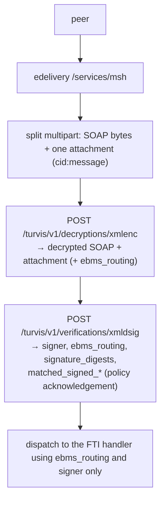
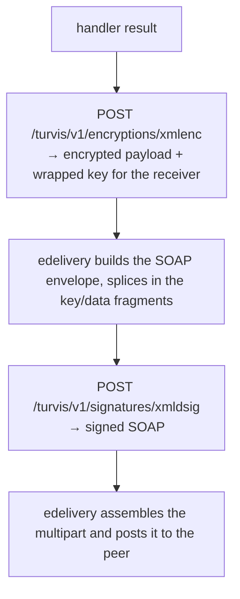

# Turvis

Turvis is a separate Bürostack service for the security operations of AS4: XML signature
verification and creation, and XML encryption and decryption. edelivery is its only caller. With
Turvis, edelivery holds no private key and parses no peer XML itself.

Phase 1 is a contract plus a mock. The contract is `docs/specs/turvis/SPEC.md`; the mock is
`DSL/Ruuter-turvis-mock/turvis/**` (a Ruuter project, port 8091, `constants-turvis-mock.ini`).

**Not run locally.** The turvis-mock is not part of the local two-gate stack, and edelivery there
runs with `TURVIS_INTEGRATION_MODE=legacy` (checked with `docker exec efti-g1-edelivery env`), so
Turvis is never called. This page is written from the SPEC, the mock DSL and
`code/edelivery/src/edelivery/Turvis*.kt`. No example on this page was run.

## What it does for edelivery

Inbound AS4 (SPEC §2.2):



Outbound AS4 (SPEC §2.3):



Turvis reads the trust view `turvis-trust.json` (the gates' certificates and the trust anchors),
built from `registry/` by the same converter ([Registry documents](./registry.md#the-turvis-trust-view)).
The private key stays inside Turvis (`key_handle`).

## Integration modes

`TURVIS_INTEGRATION_MODE` on edelivery (`code/edelivery/src/edelivery/TurvisConfig.kt`, SPEC §13.0):

| Mode | Behaviour |
|---|---|
| `legacy` (default) | in-process crypto only; Turvis is not called |
| `shadow` | in-process crypto is authoritative; Turvis is called in parallel, bounded and isolated; results are compared and discrepancies counted (`edelivery_turvis_shadow_*` metrics) |
| `turvis` | Turvis is authoritative; the legacy path is not called |

Related settings, checked at start-up (edelivery refuses to start on a bad value):

| Variable | Meaning |
|---|---|
| `TURVIS_URL` | absolute http(s) URL; required in `shadow`/`turvis`. Pointing at the `turvis-mock` host with `ENVIRONMENT`/`APP_ENV`/`DEPLOY_ENV` = `prod` or `staging` is refused |
| `TURVIS_INTERNAL_TOKEN` | required in `shadow`/`turvis`; must **not** equal `INTERNAL_SERVICE_TOKEN` |
| `TURVIS_SHADOW_MAX_INFLIGHT` | 1–64, default 8 |
| `TURVIS_MAX_PAYLOAD_MIB` | 1–256, default 40 in compose |

Rollback is a configuration flip `turvis` → `shadow` → `legacy`. Promotion criteria (≥ 14 days,
≥ 10 000 compared inbound messages, zero security discrepancies) are in SPEC §13.0.

## Authentication

SPEC §11 and `DSL/Ruuter-turvis-mock/turvis/.guard.yml`. `AUTH_MODE`:

| `AUTH_MODE` | Accepts |
|---|---|
| `mtls` (target) | a verified client certificate whose SAN URI is `spiffe://cluster.local/ns/efti-gate/sa/edelivery` |
| `shared-token` (interim; the mock's default) | `X-Internal-Service-Token: <TURVIS_INTERNAL_TOKEN>` |
| `mtls-or-token` | either; the token path expires at `AUTH_MODE_TOKEN_EXPIRY` (real Turvis) |

A failure answers:

```json
{"type":"https://efti.example/problem/turvis-authentication-failed","title":"Authentication required","status":401,"detail":"Turvis rejects: client did not authenticate per AUTH_MODE=shared-token"}
```

with `application/problem+json`. The token is dedicated to Turvis: whoever holds it has a sign and
decrypt oracle.

## Endpoints

All four are `POST`, `application/json` in and out, problem+json for a reject. Every request must
name the response fields it wants in `return_fields`; the answer holds the always-returned fields
plus exactly those (SPEC §4.0). An unknown name is `422 UNKNOWN_RETURN_FIELD`.

### POST /turvis/v1/verifications/xmldsig

Verifies the inbound XMLDSig and the signed-subtree policy. Source
`DSL/Ruuter-turvis-mock/turvis/POST/v1/verifications/xmldsig.yml`, SPEC §4.1.

| Body field | Required | Type | Meaning |
|---|---|---|---|
| `soap_xml_b64` | yes | string | the (decrypted) SOAP envelope, base64 |
| `attachments` | yes | array | ≤ 10 × `{cid, bytes_b64}`, `cid` matches `^cid:[-a-zA-Z0-9._]+$` |
| `required_signed_xpaths` | yes | array | subtrees that must be in `SignedInfo` |
| `required_signed_cid_refs` | yes | array | attachments that must be signed |
| `return_fields` | yes | array, ≥ 1 | from `signer`, `matched_signed_xpaths`, `matched_signed_cid_refs`, `signature_digests`, `ebms_routing` |
| `claimed_signer_id` | no | string | expected sender; a mismatch is `SIGNER_IDENTITY_MISMATCH` |
| `trust_store_version` | no | string | the mock accepts only `mock` |
| `trace_id` | no | string | 32 lower-case hex |

Always returned: `verdict`, `audit_ref`.

### POST /turvis/v1/signatures/xmldsig

Signs an outbound SOAP envelope. Source `…/signatures/xmldsig.yml`, SPEC §4.2.

| Body field | Required | Type | Meaning |
|---|---|---|---|
| `soap_xml_b64` | yes | string | envelope to sign |
| `sign_xpaths` | yes | array | subtrees to sign |
| `sign_cid_refs` | yes | array | attachments to sign |
| `key_handle` | yes | string | the gate's key; the mock knows only its `OWN_GATE_ID` |
| `return_fields` | yes | array | from `signatures` |
| `attachment_bytes_b64` | no | array | attachment bytes for the cid references |
| `trace_id` | no | string | |

Always returned: `signed_xml_b64`, `audit_ref`.

### POST /turvis/v1/encryptions/xmlenc

Encrypts an outbound payload for one receiver. Source `…/encryptions/xmlenc.yml`, SPEC §4.3.

| Body field | Required | Type | Meaning |
|---|---|---|---|
| `plaintext_bytes_b64` | yes | string | the payload |
| `receiver_party_id` | yes | string | must be in the trust view and ONLINE |
| `profile` | yes | string | `wss-encrypted` or `plaintext` |
| `return_fields` | yes | array | from `wrapped_key_xml`, `encrypted_data_xml`, `wrapped_key_b64` |
| `trace_id` | no | string | |

Always returned: `encrypted_payload_b64`, `audit_ref`. Not idempotent in `wss-encrypted` (a fresh
AES key per call), so edelivery retries it only on a 503 with a reason code (SPEC §13.3).

### POST /turvis/v1/decryptions/xmlenc

Decrypts an inbound envelope and attachment with the gate's private key. Turvis reads the wrapped
key and the recipient SKI from the envelope itself. Source `…/decryptions/xmlenc.yml`, SPEC §4.4.

| Body field | Required | Type | Meaning |
|---|---|---|---|
| `soap_xml_b64` | yes | string | the received envelope |
| `key_handle` | yes | string | the gate's key |
| `return_fields` | yes | array, ≥ 1 | from `decrypted_soap_xml_b64`, `decrypted_attachment_b64`, `ebms_routing` |
| `encrypted_attachment_b64` | no | string | the received attachment |
| `trace_id` | no | string | |

Always returned: `audit_ref`.

### Health and metrics

| SPEC §3.1 | Mock |
|---|---|
| `GET /healthz` (liveness) | — |
| `GET /readyz` (trust store and key handle loaded) | `GET /turvis/health/ready` → `200 "OK"`, public (`turvis/GET/health/.guard.yml` overrides the guard) |
| `GET /metrics` | — |

The compose healthcheck of `turvis-mock` calls `/turvis/health/ready`.

## Responses

| Status | Reason codes (endpoint) |
|---|---|
| 200 | accept |
| 400 | malformed request: missing field, bad base64, empty `return_fields` on verify/decrypt, bad `trace_id` |
| 401 | authentication (above) |
| 413 | `PAYLOAD_TOO_LARGE` (encryptions) |
| 422 | `XML_PARSE_FAIL` (verify, sign), `XML_ATTACK_DETECTED`, `SIG_MISSING`, `SIG_CRYPTO_FAIL`, `SIG_POLICY_FAIL`, `SIG_ALGO_UNSUPPORTED`, `SIGNER_UNTRUSTED`, `SIGNER_IDENTITY_MISMATCH` (verify); `SIG_BUILD_FAIL` (sign); `KEY_HANDLE_UNKNOWN` (sign, decrypt); `WRAPPED_KEY_MALFORMED`, `SKI_MISMATCH`, `AES_UNWRAP_FAIL`, `PAYLOAD_DECRYPT_FAIL` (decrypt); `RECEIVER_UNKNOWN`, `RECEIVER_CERT_EXPIRED`, `RECEIVER_CERT_UNTRUSTED` (encrypt); `UNKNOWN_RETURN_FIELD`, `ALGO_UNSUPPORTED` (all) |
| 500 | `TURVIS_INTERNAL` (all; never retried) |
| 503 | `KEY_UNAVAILABLE` (sign, decrypt), `TRUST_STORE_UNAVAILABLE` (all); retried twice (100 ms, 300 ms) |

The full table with meanings is SPEC §5. edelivery treats an unknown code like `SIG_CRYPTO_FAIL`.

## What the mock does and does not do

- **No cryptography.** No signature is checked, nothing is decrypted, no certificate is looked up.
  An accept proves nothing about a real message.
- Real behaviour, so that a consumer fails against the mock first: the `return_fields` rules and
  projection, base64 and attachment checks, `ebms_routing` and the sender read from the envelope,
  `SIGNER_IDENTITY_MISMATCH` against the envelope's `From/PartyId`, `SIG_POLICY_FAIL` for more than
  one `<eb:Messaging>` or an uncovered required reference, `SIG_ALGO_UNSUPPORTED` for a non-SHA-256
  digest, `KEY_HANDLE_UNKNOWN` for a key other than `OWN_GATE_ID`.
- Test headers: `X-Mock-Verdict: reject-<code>` forces a reject (e.g. `reject-sig-crypto-fail`,
  `reject-unknown-return-field`, `reject-trust-store-unavailable`; each endpoint lists its own set),
  `X-Mock-Audit-Ref` fixes `audit_ref`.
- Scenarios: `DSL-turvis-mock-tests/`; contract cross-check: `scripts/validate-turvis-contract.py`.

## Notes

- SPEC §3.1 names the probes `/healthz`, `/readyz` and `/metrics`; the mock serves
  `/turvis/health/ready` only.
- The mock guard answers a successful authentication with `204` and `""`; that is a guard result,
  never a client response.
- In legacy mode `edelivery_turvis_shadow_*` metrics still exist on `/metrics` with value 0
  ([Health](../operations/health.md#metrics)).
