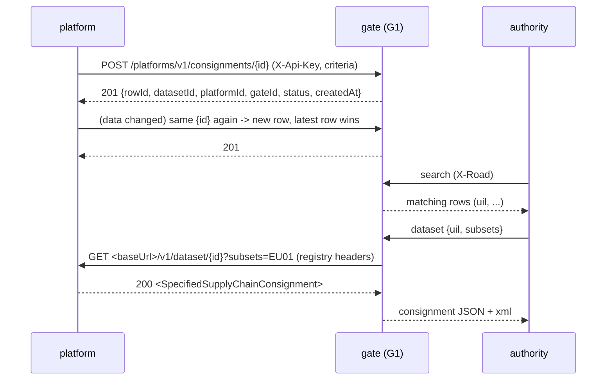

# Freight platforms

A freight platform holds the eFTI data of its consignments. The gate does not store that data. It
stores only an identifier row per dataset, so that authorities can find the consignment. When an
authority asks for the dataset, the gate fetches it from the platform.

This section is for the developers of a platform and for the gate operator who registers it.

## Two ways in

| | REST | AS4 (eDelivery) |
|---|---|---|
| Who | Any registered platform with an `apiKey` | A platform with its own AS4 access point and an `eDeliveryCert` in the registry |
| Upload endpoint | `POST /platforms/v1/consignments[/{datasetId}]` on ruuter (G1 `:27086`) | AS4 `UserMessage` with an `FTI004UploadIdentifierRequest` to edelivery `/services/msh` (G1 `:27081`) |
| Credential | `X-Api-Key` header | AS4 signature, checked against `eDeliveryCert`; edelivery then calls the gate-internal route [`consignments-xml`](./upload-edelivery.md) |
| Answer | `201` JSON with the stored row | `FTI029UploadIdentifierResponse`, sent back to the platform as a new AS4 message |
| Gate calls the platform with | REST: `GET <baseUrl>/v1/dataset/{id}`, `POST <baseUrl>/v1/dataset/{id}/follow-up` | AS4: `FTI009` and `FTI025` messages through edelivery |
| Pages | [Upload identifiers (REST)](./upload-rest.md) | [Upload identifiers (eDelivery)](./upload-edelivery.md) |

What the gate calls on the platform, for both kinds, is on
[What the gate calls on a platform](./platform-side-api.md).

## How a platform is registered

There is no API that creates a platform. Platforms are files in the repository,
`registry/platforms/<id>.yml`. `registry-build` reads that folder (mounted; in production `platforms/` comes from a Secret) and the
`registry` service serves the result inside the Compose network (`/platforms.json`, `/platforms/<id lower>.json`). To add or change a platform,
commit the file and re-run `docker compose up -d registry-build` (no image rebuild). See `registry/README.md`.

| Field | Required | Type | Meaning |
|---|---|---|---|
| `id` | yes | string | Platform id. Must equal the file name. It is the `PlatformID` of every UIL the platform owns. |
| `baseUrl` | yes | string | REST platforms: the base URL the gate calls (`<baseUrl>/v1/dataset/…`). AS4 platforms: the platform's AS4 endpoint (MSH URL). |
| `headers` | no | object | Headers the gate sends **to** the platform on every REST call, e.g. the platform's own API key. `{}` for none. |
| `apiKey` | no | string | The `X-Api-Key` the platform sends **to** the gate. Plaintext. Unique across platforms; `registry-build` fails on a duplicate. No `apiKey` means the platform cannot use the REST upload. |
| `eDeliveryCert` | no | PEM | Public AS4 certificate. If set, the platform is an AS4 party for edelivery, and the gate sends dataset and follow-up requests to it over AS4 instead of REST. |
| `tlsCert` | no | PEM | Public TLS certificate (AS4 transport). |
| `status` | yes | `ONLINE` / `DISABLED` | `DISABLED` stops everything: the key no longer authenticates, dataset and follow-up requests answer "Platform Not Found", edelivery drops the party. |

The two dev platforms (both gates use the same ones):

```yaml
# registry/platforms/mock.yml - REST platform, served by the gate's own Ruuter
id: mock
baseUrl: http://ruuter:8086/mock-platform
headers:
  X-Api-Key: mock-secret-key
status: ONLINE
apiKey: mock-secret-key
```

```yaml
# platforms/mock-edelivery.yml as G1's registry serves it (derived by the local `registry-build` from `network/G1.yml`) - AS4 platform
id: mock-edelivery
baseUrl: http://g1-edelivery:8081/services/msh
headers: {}
eDeliveryCert: |
  -----BEGIN CERTIFICATE-----
  …
  -----END CERTIFICATE-----
status: ONLINE
```

`mock-edelivery` points back at the gate's own edelivery and uses the gate's own certificate, so
the gate talks AS4 to itself. See [Mock platform](./mock-platform.md).

The registry contains the plaintext `apiKey`. It must stay inside the Compose network. The
`mock-secret-key` value is public in the repository; never use it outside your machine.

## The platform guard

Every request to `/platforms/v1/**` passes `DSL/Ruuter/platforms/.guard.yml` first.

1. If `X-Internal-Service-Token` equals the gate's internal token **and** `X-Platform-Id` is set,
   the request is accepted as that platform. This is the path edelivery uses after an AS4 upload.
   The platform id is not looked up in the registry on this path.
2. Otherwise `X-Api-Key` is required. The guard loads `/platforms.json` from the registry and
   looks for platforms with `apiKey == X-Api-Key` and `status == ONLINE`.
3. Exactly one match: accepted. The platform object (without `apiKey`) is passed to the route.
4. No match, no header, or the registry is not reachable: `401`, and an audit row
   `platform.auth_denied` is written.
5. More than one match: `403` `forbidden-multi-platform`. `registry-build` rejects shared keys,
   so this cannot happen with a registry that passed it.

```http
HTTP/1.1 401 Unauthorized
content-type: application/problem+json

{"detail":"X-Api-Key is missing or does not match a registered platform.","status":401,"title":"Unauthorized","type":"https://api.efti.ee/errors/unauthorized"}
```

## The UIL ownership rule

A dataset is addressed by its [UIL](../../data/uil.md): `gateId` + `platformId` + `datasetId`.
A platform can only register UILs that it owns at this gate:

- `PlatformID` of the upload must equal the authenticated platform id, and
- `GateID` must equal this gate's own id (`G1` or `G2`).

Both are compared case-insensitively. Anything else is `403`
`Consignment UIL must belong to the authenticated platform and this gate`. In the short REST form
the gate fills in both values itself, so the rule always holds there.

## Endpoints

Called by the platform:

| Endpoint | Who calls it | Page |
|---|---|---|
| `POST /platforms/v1/consignments/{datasetId}` | REST platform, short form (bare `ParameterIDSetCriteria`) | [Upload identifiers (REST)](./upload-rest.md) |
| `POST /platforms/v1/consignments` | REST platform, full `FTI004UploadIdentifierRequest` | [Upload identifiers (REST)](./upload-rest.md) |
| AS4 `FTI004` to `/services/msh` | AS4 platform | [Upload identifiers (eDelivery)](./upload-edelivery.md) |
| `POST /platforms/v1/consignments-xml` | edelivery (gate-internal), after an AS4 upload | [Upload identifiers (eDelivery)](./upload-edelivery.md) |

Called by the gate (the platform implements them):

| Endpoint | When | Page |
|---|---|---|
| `GET <baseUrl>/v1/dataset/{datasetId}?subsets=…` | An authority asks for the dataset | [What the gate calls on a platform](./platform-side-api.md) |
| `POST <baseUrl>/v1/dataset/{datasetId}/follow-up` | An authority sends a follow-up | [What the gate calls on a platform](./platform-side-api.md) |
| AS4 `FTI009` / `FTI025` | Same, for AS4 platforms | [What the gate calls on a platform](./platform-side-api.md) |

Development only:

| Endpoint | Page |
|---|---|
| `/mock-platform/v1/dataset[/…]`, `/mock-platform/v1/dataset-edelivery[/…]`, `/mock-platform/health` | [Mock platform](./mock-platform.md) |

## Typical sequence



The whole flow, with real requests, is on
[A platform registers a consignment](../../use-cases/platform-registers-consignment.md).

## Notes

- The gate never checks whether the dataset id it fetches is in its identifier store. The store is
  for search only.
- `docs/developer/platform_api_integration_guide.md` (Estonian) says the operator registers the
  platform in the admin UI and generates the key there. Since ADR-011 that is no longer true:
  platforms are files in `registry/platforms/` and the admin UI only reads them.
- Postman: folder **5. Platform -> Gate**, run with the environment of the gate you upload to.
