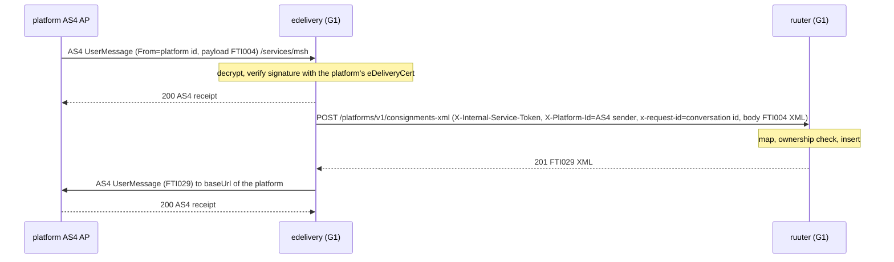

# Upload identifiers (eDelivery)

A platform with its own AS4 access point uploads identifiers as an AS4 message instead of a REST
call. edelivery receives the message, hands the FTI004 to Ruuter on
`POST /platforms/v1/consignments-xml`, and sends the `FTI029UploadIdentifierResponse` back to the
platform as a new AS4 message.

`POST /platforms/v1/consignments-xml` · on ruuter (G1 `:27086`) · gate-internal:
`X-Internal-Service-Token` + `X-Platform-Id` (also accepts `X-Api-Key`) · source
`DSL/Ruuter/platforms/POST/v1/consignments-xml.yml`, which runs `consignments.yml` as a template;
edelivery side `code/edelivery/src/EftiMessageHandlers.kt`, `RuuterClient.kt`,
`edelivery/EDeliveryRoutes.kt`

The internal token `dev-internal-service-token-change-me` is a dev value, public in the repository.

## The flow



1. The platform sends an AS4 `UserMessage` to the gate's `/services/msh`. The payload is an
   `FTI004UploadIdentifierRequest`. `From` is the platform id; the signing certificate must be the
   `eDeliveryCert` of that platform in `registry/platforms/<id>.yml`.
2. edelivery answers the HTTP request at once with an AS4 receipt. The upload is handled after that.
3. edelivery calls `consignments-xml` with `X-Platform-Id` = the AS4 sender and `x-request-id` =
   the AS4 conversation id.
4. Ruuter stores the identifier exactly as for the [REST upload](./upload-rest.md) (same mapper,
   same ownership rule, same row) and turns the result into an FTI029.
5. edelivery sends the FTI029 as a new AS4 message to the platform's `baseUrl` (its MSH URL).
   Its `RequestedSpecifiedQuery/ID` is the conversation id of the upload.
6. If Ruuter answers anything but `2xx`, edelivery logs `handler-dispatch failure` and sends
   **nothing** back. The platform gets the AS4 receipt from step 2 but no FTI029.

## What the platform implements

| Part | Platform side |
|---|---|
| AS4 access point | Sends signed and encrypted `UserMessage`s to the gate's `/services/msh`, receives messages on its own MSH URL (`baseUrl` in the registry). Same AS4 profile as gate-to-gate, see [AS4 endpoint](../gates/as4-endpoint.md). |
| Certificates | Gives the gate operator its public AS4 certificate (`eDeliveryCert`) and, if used, TLS certificate (`tlsCert`). Trusts the gate's certificate. |
| Upload | Builds the `FTI004UploadIdentifierRequest` (`GateID` = the gate, `PlatformID` = its own id, `DatasetID`, `ParameterIDSetCriteria`; fields in [Upload identifiers (REST)](./upload-rest.md#parameteridsetcriteria)). |
| Answer | Receives the `FTI029UploadIdentifierResponse` asynchronously and matches it by conversation id. No FTI029 within its own timeout means the upload failed. |
| Dataset and follow-up | Answers `FTI009` with `FTI010` and `FTI025` with `FTI030`, see [What the gate calls on a platform](./platform-side-api.md). |

The platform never calls `consignments-xml` itself. That route is for edelivery.

## Request (`consignments-xml`)

| Header | Required | Value |
|---|---|---|
| `X-Internal-Service-Token` | yes (or `X-Api-Key`) | the gate's `INTERNAL_SERVICE_TOKEN` |
| `X-Platform-Id` | yes, with the token | the platform the upload is for. Not checked against the registry. |
| `X-Api-Key` | alternative | a platform key; then `X-Platform-Id` is not needed (same as the REST route) |
| `Content-Type` | yes | `text/xml` (or JSON `{"xml": "…"}`) |
| `X-Request-Id` | no | becomes `RequestedSpecifiedQuery/ID` of the FTI029. Missing: xml-mapper uses a random UUID. |

| Body | Required | Meaning |
|---|---|---|
| raw XML | yes | a full `FTI004UploadIdentifierRequest`. A bare `ParameterIDSetCriteria` has no `datasetId` here and gives `502`. |

## Responses

| Status | When | Body |
|---|---|---|
| `201` | Stored | `FTI029UploadIdentifierResponse` XML, `content-type: text/xml`: `TypeCode` `029`, `StatusCode` `C`, `RequestedSpecifiedQuery/ID` = `X-Request-Id`, the UIL |
| `400` | Body missing / wrong content type | `{"error":"Field missing: xml"}` |
| `400` | xml-mapper rejected a value (UUID, country code, integer) | `{"error":"Invalid consignment XML","status":400}` |
| `401` | No valid token + `X-Platform-Id` pair and no valid `X-Api-Key` | RFC 7807 `…/errors/unauthorized`, `detail` mentions `X-Api-Key` also for a wrong token |
| `403` | `GateID` not this gate, or `PlatformID` ≠ `X-Platform-Id` | `{"error":"Consignment UIL must belong to the authenticated platform and this gate","status":403}` |
| `500` | ReSql insert or read-back failed | `{"error":"Failed to insert consignment","status":500}` / `…could not be verified…` |
| `502` | xml-mapper unreachable or `5xx` (malformed XML, bad date format) | `{"error":"XML mapper unavailable","status":502}` |
| `502` | Stored, but the FTI029 could not be rendered | `{"error":"Upload response could not be rendered"}` |

## Examples

### Upload as edelivery does it

```bash
U=$(cat /proc/sys/kernel/random/uuid)
sed -e "s/550e8400-e29b-41d4-a716-446655440000/$U/" \
    -e 's#<PlatformID>mock<#<PlatformID>mock-edelivery<#' \
    docs/developer/examples/platforms/full-upload.xml > /tmp/as4-upload.xml
curl -i -X POST http://127.0.0.1:27086/platforms/v1/consignments-xml \
  -H 'Content-Type: text/xml' \
  -H 'X-Internal-Service-Token: dev-internal-service-token-change-me' \
  -H 'X-Platform-Id: mock-edelivery' \
  -H "X-Request-Id: $(cat /proc/sys/kernel/random/uuid)" \
  --data-binary @/tmp/as4-upload.xml
```

```http
HTTP/1.1 201 Created
content-type: text/xml
content-length: 1165
<rsm:FTI029UploadIdentifierResponse xmlns:rsm="urn:eu:move:eFTI:data:standard:FTI029UploadIdentifierResponse:1" xmlns="urn:eu:move:eFTI:data:standard:ReusableAggregateBusinessInformationEntity:34" xmlns:udt="urn:eu:move:eFTI:data:standard:UnqualifiedDataType:34"><rsm:ExchangedDocumentContext><MessageStandardSpecifiedDocumentContextParameter><ID>eFTI</ID><SpecifiedDocumentVersion><ID>1.0</ID></SpecifiedDocumentVersion></MessageStandardSpecifiedDocumentContextParameter></rsm:ExchangedDocumentContext><rsm:ExchangedDocument><ID schemeID="RFC 9562-4">19cb4414-99b3-4306-bad6-ce10e6b02d02</ID><TypeCode>029</TypeCode><StatusCode>C</StatusCode><IssueDateTime><udt:DateTimeString format="207">20261103160338Z</udt:DateTimeString></IssueDateTime><RequestedSpecifiedQuery><ID schemeID="RFC 9562-4">5a423166-c5f2-4457-9806-d8ffbaeceb17</ID></RequestedSpecifiedQuery></rsm:ExchangedDocument>
    <rsm:EFTIIDInformation><UniqueIDSetUniqueIDSet><GateID>G1</GateID><PlatformID>mock-edelivery</PlatformID><DatasetID schemeID="RFC 9562-4">5a313ebf-25f6-4a97-bfc7-b951fe70da38</DatasetID></UniqueIDSetUniqueIDSet></rsm:EFTIIDInformation>
  </rsm:FTI029UploadIdentifierResponse>
```

`5a423166-…` is the `X-Request-Id` that was sent. The FTI004's own query id is not echoed.

### `X-Platform-Id` does not match the `PlatformID`

Same body, `X-Platform-Id: mock`:

```http
HTTP/1.1 403 Forbidden
content-type: application/json
content-length: 96

{"error":"Consignment UIL must belong to the authenticated platform and this gate","status":403}
```

### No credentials, token without `X-Platform-Id`, wrong token

```bash
curl -i -X POST http://127.0.0.1:27086/platforms/v1/consignments-xml -H 'Content-Type: text/xml' --data-binary @/tmp/as4-upload.xml
curl -i -X POST http://127.0.0.1:27086/platforms/v1/consignments-xml -H 'Content-Type: text/xml' \
  -H 'X-Internal-Service-Token: dev-internal-service-token-change-me' --data-binary @/tmp/as4-upload.xml
curl -i -X POST http://127.0.0.1:27086/platforms/v1/consignments-xml -H 'Content-Type: text/xml' \
  -H 'X-Internal-Service-Token: nope' -H 'X-Platform-Id: mock-edelivery' --data-binary @/tmp/as4-upload.xml
```

All three:

```http
HTTP/1.1 401 Unauthorized
content-type: application/problem+json
content-length: 159

{"detail":"X-Api-Key is missing or does not match a registered platform.","status":401,"title":"Unauthorized","type":"https://api.efti.ee/errors/unauthorized"}
```

### With `X-Api-Key` instead of the token

`full-upload.xml` (platform `mock`) with `-H 'X-Api-Key: mock-secret-key'` and no token:

```http
HTTP/1.1 201 Created
content-type: text/xml
content-length: 1155
<rsm:FTI029UploadIdentifierResponse …><RequestedSpecifiedQuery><ID schemeID="RFC 9562-4">38c5bcb2-1795-4158-9409-0b2dbae45250</ID></RequestedSpecifiedQuery>…<GateID>G1</GateID><PlatformID>mock</PlatformID><DatasetID schemeID="RFC 9562-4">1f86eecd-dec7-4644-8531-649682b1157c</DatasetID>…
```

### Malformed XML

```http
HTTP/1.1 502 Bad Gateway
content-type: application/json
content-length: 47

{"error":"XML mapper unavailable","status":502}
```

### The whole AS4 round trip through the local loopback

There is no separate AS4 platform in the local stack. `mock-edelivery` is the gate itself (same
certificate, `baseUrl` = the gate's own MSH). The send API of edelivery
([edelivery send API](../gates/send-api.md)) can push an FTI004 to it:

```bash
R=$(cat /proc/sys/kernel/random/uuid)
curl -i -X POST http://127.0.0.1:27081/api/v1/send/mock-edelivery \
  -H 'Content-Type: text/xml' \
  -H 'X-Internal-Service-Token: dev-internal-service-token-change-me' \
  -H "X-Request-Id: $R" --data-binary @/tmp/as4-upload.xml
```

In this loopback the AS4 sender is the gate (`G1`), so edelivery calls `consignments-xml` with
`X-Platform-Id: G1`. A real platform is its own sender, so there `X-Platform-Id` is the
platform id.

With `<PlatformID>mock-edelivery</PlatformID>` the upload is refused, no FTI029 comes back, and the
send API gives up after one minute:

```http
HTTP/1.1 504 Gateway Timeout
Content-type: application/json; charset=UTF-8

{"detail":"No data received after 1m","instance":"/api/v1/send/mock-edelivery","message":"No data received after 1m","status":504,"title":"Gateway Timeout"}
```

edelivery log (`docker logs efti-g1-edelivery`, shortened):

```text
16:05:19.363 warn  EDeliveryRoutes  Unknown receiver: mock-edelivery
16:05:19.370 info  EDeliveryRoutes  Handling 'FTI004UploadIdentifierRequest' from G1:6bdbb3cf-…:mock-edelivery
16:05:19.374 info  RequestLogger    <G1> 172.23.0.2 POST /services/msh: 200 in 11 ms
16:05:19.404 info  HttpClient       POST http://ruuter:8086/platforms/v1/consignments-xml in 32ms - 403
16:05:19.407 error AsyncHandlers    handler-dispatch failure: audit_ref=f93cf3d7-… name=handler reason=UNAVAILABLE klite.http.HttpException
16:06:19.379 error RequestLogger    <null> 172.24.0.1 POST /api/v1/send/mock-edelivery: 504 in 60030 ms
```

With `<PlatformID>G1</PlatformID>` (matching the loopback sender) the FTI029 comes back over
AS4 within 0.2 s:

```http
HTTP/1.1 200 OK
Content-type: text/xml; charset=UTF-8
Content-length: 1153
<rsm:FTI029UploadIdentifierResponse …><TypeCode>029</TypeCode><StatusCode>C</StatusCode>…<RequestedSpecifiedQuery><ID schemeID="RFC 9562-4">3ea16732-16ce-4bdd-a6ea-2472f5a6250c</ID></RequestedSpecifiedQuery>…<GateID>G1</GateID><PlatformID>G1</PlatformID><DatasetID schemeID="RFC 9562-4">3da0f1f4-f436-4bc3-95f6-0279536a3cb6</DatasetID>…
```

```text
16:06:33.564 info EDeliveryRoutes Handling 'FTI004UploadIdentifierRequest' from G1:3ea16732-…:mock-edelivery
16:06:33.668 info HttpClient      POST http://ruuter:8086/platforms/v1/consignments-xml in 96ms - 201
16:06:33.669 info EDeliveryClient Sending message to http://g1-edelivery:8081/services/msh: conversationId=G1:3ea16732-…:mock-edelivery payload_size_bytes=1159
16:06:33.700 info EDeliveryRoutes Handling 'FTI029UploadIdentifierResponse' from mock-edelivery:3ea16732-…:G1
```

The test row (platform `G1`) was deleted afterwards through the admin API.

### Not run locally

- An upload from a real, separate AS4 platform: the stack has none.
- `500` from ReSql and the `502` "Upload response could not be rendered": would need a stopped
  container.

## Notes

- With the internal token, the guard accepts any `X-Platform-Id`, also one that is not in the
  registry (run: `X-Platform-Id: ghost-platform` with `<PlatformID>ghost-platform</PlatformID>`
  gave `201`). The protection is that only edelivery holds the token and edelivery only passes
  the verified AS4 sender.
- The FTI029 `IssueDateTime` is written as `format="207"` with a `Z` suffix
  (`20261103160338Z`), not the `+0000` offset that format 207 describes.
- An upload with a failed result has no negative FTI029. The platform only sees the missing answer.
- Postman: **5. Platform -> Gate / upload over eDelivery path - consignments-xml (FTI004 -> FTI029)**.
