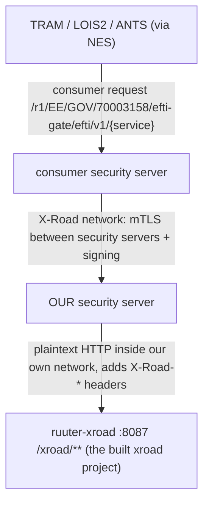

# ADR-006: X-Road identity model and subset permissions

**Decision (deciders unspecified, 01.09.2026):**

> **Change (29.10.2026, supersedes the 02.09 change below):** The X-Road surface is again a separate
> Ruuter: `DSL/Ruuter-xroad/xroad/` (container `ruuter-xroad`, port 8087, `ruuter-xroad.yaml`,
> `constants-xroad.ini`). Reasons: `/xroad/**` trusts the `X-Road-Client` header unconditionally, so it
> must not share a port with the public API; a separate `constants-xroad.ini` keeps `TIM_ADMIN_TOKEN`
> and `ARCHIVE_OPS_TOKEN` out of the xroad container; `internal_requests.allowed_urls` limits outgoing
> calls to four origins (registry, resql, main Ruuter, xml-mapper). Forwarding routes call the main
> Ruuter's `efti/api/v1/authority/*` over HTTP with `INTERNAL_SERVICE_TOKEN`. There must be no ingress.
>
> **Change (02.09.2026, obsolete):** The X-Road surface is no longer a separate container.
> `DSL/Ruuter/xroad/` moved into the main Ruuter project as `DSL/Ruuter/xroad/` and is served under
> `/xroad/` on port 8086. The separate `ruuter-xroad` container, port 8087, `constants-xroad.ini` and
> `ruuter-xroad.yaml` have been deleted. The network-isolation requirement does **not change in
> substance**, but is now an explicit **ingress restriction**: the public reverse proxy / ingress must
> not route the `/xroad/**` path, and only the security server may reach it. The two method-level guards
> were replaced with a single project-level `xroad/.guard.yml` (`xroad/GET/health/.guard.yml` with
> `override_ancestors` keeps the health probe public).

## Decision

### 1. The X-Road interface is REST, not SOAP

We use the X-Road v7 **REST message protocol**. Errors are returned in RFC 7807 form
(`docs/specs/errors.json`), not as a SOAP fault. There is no WSDL (`efti-xroad.wsdl`) and there will
not be one.

It follows that **there is no `protocolVersion` check**: in the REST protocol the version is the
`/r1/` prefix in the *consumer's* URL, which the consumer's own security server consumes and which is
not forwarded to the service provider. Our own contract version is the `/v1` in the route.

### 2. The caller's identity is an ORGANISATION, not a person

The X-Road security server identifies the caller with mTLS and forwards the result in the
`X-Road-Client` header as `instance/memberClass/memberCode[/subsystemCode]`. `memberCode` is the
Business Registry code, which is matched against the `authorities.registry_code` value. The gate only
needs to trust the header — the security server has already done the identification.

### 2a. The gate has only the provider side; there is no client

Topology:



The `xroad` project is a **service-provider adapter** called by *our own* security server. The
consumer (client) side is not built — the gate does not itself call any X-Road service.

> ### ⚠ Security requirement: `/xroad/**` must be reachable ONLY from our own security server
>
> `X-Road-Client` is an **ordinary HTTP header** that the gate trusts unconditionally, because
> identification has already happened in the security server. It follows that **the whole
> authentication model relies on network isolation**: anyone who can reach the `/xroad/**` path
> directly can send `X-Road-Client: EE/GOV/<any-registry-code>/x` and impersonate **any registered
> authority** — which immediately exposes all of that authority's subset permissions and, later, once
> the `core` forwarding is connected, full data access too. `/xroad/**` is on a separate Ruuter
> (`ruuter-xroad`, port 8087), not on the public-API (8086) port, but even so this is an **ingress and
> network-rule** problem: not publishing the port is not enough.
>
> On deployment it is therefore **mandatory**:
> - the public ingress / reverse proxy **must not** route the `/xroad/**` path — respond 404 to that path;
> - the network rule (NetworkPolicy / security group) must allow `/xroad/**` traffic **only** from our
>   own security server's address (e.g. a separate internal listener or proxy that only the security
>   server can reach).
>
> **TLS between the security server and the gate.** TLS terminates at the ingress; from the ingress to
> `ruuter-xroad` the traffic is plain HTTP and `ruuter-xroad` itself does not check the client
> certificate. Whether the ingress requires mutual TLS from the security server (PR-REST §4.7) is set by
> the environment configuration (devops repo), not this repo; access is restricted by the source
> restriction / NetworkPolicy above.
>
> `compose.override.yml` exposes 8087 on `localhost`, but that file is **for local development only**.
>
> An alternative that would escape this dependency would be mTLS between the security server and the
> adapter too, but the X-Road deployment model does not assume it and RIA does not require it.

### 2b. The adapter calls `core` with an internal service token

The adapter must reach `core`'s authority routes, but `efti/POST/api/v1/authority/.guard.yml` requires
a TIM JWT, which the adapter has no way to obtain, and a cross-project `template:` does not work
(*inside* a Ruuter project it works — `dataset-local.yml:18` and `authority/search.yml:47` use it — but
not across the `efti` / `xroad` boundary).

Solution: `core`'s authority guard gets a **second credential** — if the header
`X-Internal-Service-Token` matches a constant, allow.
>
> **Change (04.09.2026, permissions-matrix v1.6):** the JWT path has been removed entirely from
> `efti/api/v1/*` (the whole authority surface, not just POST) — it was not an alternative, it was the
> only path that remained. `efti/api/v1/*` is now purely gate-internal: the guard of every route under
> it requires `X-Internal-Service-Token`, and the failure branch (missing, empty or wrong header)
> returns 401 directly, without contacting TIM. At the same time the orphaned `efti/PUT/api/v1/.guard.yml`
> and `efti/DELETE/api/v1/.guard.yml` disappear (there were no handlers under them), and the same token
> is now placed behind the G2G inbound surface (`efti/POST/api/v1/.guard.yml`, previously public) —
> edelivery now sends it on every call.

This is a **general internal-service credential**, not an X-Road one: `core` knows nothing about
X-Road and the module-boundary requirement still holds. The same token is also needed by G2G inbound
traffic (`AGENTS.md` already notes this).

**Why this is enough:** `core`'s authority handlers **do not use the caller's identity at all** —
`authority/dataset.yml` reads only `body.uil` and `body.subsets`, `authority/follow-up.yml:12` writes
`requestingUserId: ""`, `authority/consignments-search.yml` forwards the body straight to ReSQL,
`authority/search.yml` does not touch the caller. Identity matters only in the guard, and there only
as the question "is this ADMIN or AUTHORITY". So the adapter does not need to impersonate a user — it
does the authorisation itself (organisation from `X-Road-Client`, subsets from `authorities.subsets`)
before forwarding.

**Why not a TIM service account:** it would model a machine as a person, require credential rotation
and add a TIM round-trip to every request; the resolved identity would be a user, not an X-Road
organisation. **Why not mTLS between the adapter and core:** Ruuter's `http.post` has no sign of any
client-certificate support, and the hop is already inside the trust zone.

**Header mapping.** `X-Road-Id` → `x-request-id`. This is not cosmetic: all three of `core`'s
authority handlers read `x-request-id` and `authority/search.yml` uses it as the multiplexer polling key.

> ### `X-Road-Id` must be a UUID — this is a consumer contract
>
> `core` passes `x-request-id` on to **typed UUID parameters**: the multiplexer's
> `@POST("/first/:searchId") fun multiplex(..., @PathParam searchId: UUID)` (`MultiplexerRoutes.kt:21`,
> same on line 43) and edelivery's `RequestKey(partyId, e.requestId.uuid)` (`InternalRoutes.kt:20`).
> Both throw an exception on anything else.
>
> **The X-Road REST protocol does not guarantee this:** the security server generates a UUID only if
> the consumer omits it — the consumer's information system may set any unique string, which the
> security server forwards unchanged. Not checking means that a perfectly valid message id breaks the
> whole gate-to-gate path, and in the worst case **silently**: `core`'s `search.yml` does not check
> the multiplexer's status and `respond_first` does not set `status`, so the gate would respond 200
> with a wrong body.
>
> Therefore the guard checks the shape and returns **400 `INVALID_REQUEST_ID`**. The check is
> **shape-only** (5 parts of length 8-4-4-4-12): validating hexadecimal characters would require a
> regular expression, and no DSL file in the repo uses `.match` / `.test` / `RegExp`, so that support
> is unproven. The shape check catches the real case (`ITSYS-2026-000123` yields 3 parts), although a
> non-hex string of the same shape would reach `core`.
>
> The requirement holds across **the whole X-Road surface**, including `subsets` and `echo`, which do
> not forward to `core`. One single contract is simpler for the consumer than a per-route matrix, and
> this way a caller cannot discover its subsets with an id that would fail on the next request.

> ### Known limitation: the polling key is shared
>
> `core`'s `poll_remaining` (`authority/search.yml:15-19`) does
> `GET multiplexer/api/v1/rest/${requestId}` **without an ownership check**, and
> `MultiplexerRoutes.kt:43` drains the queue for the id it is given. Since `X-Road-Id` is entirely
> under the caller's control, one authority can drain another's in-progress search if it guesses or
> sees the id (the 90 s cache TTL limits the window).
>
> The same hole exists on the JWT path, so it is older in `core` — but this work opens it to X-Road
> callers and **documents id reuse as an intended mechanism**, so it belongs here. The impact is
> limited: it leaks identifier-level search metadata between competent authorities, each of which has,
> under regulation 2024/1942, an unlimited identifier query.
>
> It closes when the resolved authority id starts reaching `core` (see the audit story). In addition,
> a consumer-side assumption must be stated: a request re-sent through the security server usually gets
> a **new** `X-Road-Id`, so to poll, the consumer's information system must deliberately keep the id
> the same.
>
> **Change (11.09.2026, issue #125):** the same limitation now also applies to
> `POST /xroad/provide/v1/transport-means` `scope: allgates` polling (`{poll: true}` + the same
> `X-Road-Id`). The route mitigates slightly: a poll always goes through the EU02 permission check, so
> only an authority that itself has EU02 can poll — but there is no ownership check here either,
> deliberately (closes with the same audit story).

> ### ~~Known limitation: a full `core` outage gives 500, not 502~~ — resolved in Ruuter 0.9.15-rc
>
> **Historical (Ruuter < 0.9.15-rc):** `check_core_status` applied only once `core` had **responded**.
> A connection error, a DNS error or a timeout threw an exception inside `http.post`, and `ruuter.yaml`
> sets `stop_in_case_of_exception: true`, so the run aborted and Ruuter gave its generic 500.
>
> **Now (Ruuter ≥ 0.9.15-rc, turnerrainer/Ruuter#89):** a transport error no longer aborts the run —
> the `http` step binds under `result` a stub response `{status: 0, error: <kind>}` (kinds: `timeout`,
> `connect`, `request`, `body`, `decode`, `unknown`) and continues to the next step. The
> `check_core_status` switch now has a leading branch `status == 0 → core_unavailable`, which gives an
> honest **502 `GATEWAY_UNAVAILABLE`** with a `transportError` field. The same pattern is applied on all
> gateway routes (`xroad/POST/provide/v1/{dataset,search,follow-up}`, `efti` authority dataset/follow-up,
> `dataset-local` / `follow-up-local`, admin routes). Policy-level pre-rejections (SSRF, host allowlist,
> malformed URL, response size cap) still rise as an exception — these are ops decisions, not
> availability events.

**Error forwarding.** `core` returns ad-hoc shapes (`{"error": "Platform Not Found"}`), not RFC 7807.
The adapter wraps them. The status is normalised to **502 `GATEWAY_UNAVAILABLE`**, rather than
forwarding `core`'s own status: `errors.json` binds each code to exactly one status
(`GATEWAY_UNAVAILABLE` = 502) and RFC 7807 requires the body `status` to match the HTTP status — so
forwarding an arbitrary status would force either an invented code or a code/status contradiction.
`core`'s actual status and body are carried on in the `coreStatus` / `coreResponse` fields, so no
diagnostics are lost.

### 3. The source of authorisation is `authorities.subsets`

The `users` table has **no** `subsets` column and no link to an authority (`roles TEXT[]` is the only
permission column). So on the JWT/TARA path there is nowhere to read subset permissions from. The only
existing subset registry is `authorities.subsets TEXT[]`, keyed by `registry_code` — exactly what
`X-Road-Client` provides.

### 4. `X-Road-UserId` never grants permissions

X-Road does **not** authenticate this header — it is a value asserted by the caller itself. It does not
affect the access decision.

The header is intended for GDPR art 30 auditing, but **there is no audit writer for the X-Road channel
yet**: `DSL/Resql/efti/POST/insert_audit_log.sql` and the steps that write to it have been added to the
admin interface's CRUD routes and to login (`auth/POST/callback.yml`, `auth/POST/dev-login.yml`), but
not to the `xroad/**` routes or the authority dataset/follow-up/search flows — those need separate work
(with more complex branching and broadcast logic). `ruuter.yaml` sets `display_request_content: false`,
so the `X-Road-UserId` header does not reach the request log or (yet) the audit row. See open questions.

### 5. The permission query returns a list, not a yes/no answer

`GET /xroad/provide/v1/subsets` returns the caller's own permitted subsets. The registry code is taken
**only** from the header set by the security server, not from the request body — so a caller cannot ask
about another organisation's permissions.

## Schema

There are no new columns or migrations. We use the existing:

| Column | Type | Content |
|---|---|---|
| `authorities.registry_code` | `TEXT` | Business Registry code; corresponds to `X-Road-Client`'s `memberCode` |
| `authorities.subsets` | `TEXT[]` | the subsets this authority may query |
| `authorities.status` | `authority_status` | only `ACTIVE` authenticates |

## Headers

| Header | Mandatory | Role |
|---|---|---|
| `X-Road-Client` | yes | **Credential.** `instance/memberClass/memberCode[/subsystemCode]`. Both the 3-part and 4-part forms are valid X-Road client ids. |
| `X-Road-Id` | yes | Message id. **Must be a UUID** — see §2b; otherwise the guard returns 400 `INVALID_REQUEST_ID`. Maps to `x-request-id`. |
| `X-Road-Service` | no | Set by the security server; informational |
| `X-Road-UserId` | no | End-user personal ID code. **Audit only — grants no permissions.** |
| `X-Road-Represented-Party`, `X-Road-Issue` | no | Informational |

## Guard (`DSL/Ruuter-xroad/xroad/.guard.yml`)

The guard **only authenticates** — it does not do the subset check (see below):

1. `X-Road-Client` header missing or malformed → **401** `unauthorized`
2. `X-Road-Id` header missing → **400** `missing-required-header`
3. `get_authority_by_registry_code` finds no `ACTIVE` authority → **403** `forbidden`
4. **more than one** `ACTIVE` authority with the same registry code → **403** `forbidden`
   (a registry configuration error; picking an arbitrary row would give one organisation another's permissions)
5. Otherwise allowed

Added at the route level (`POST /xroad/provide/v1/dataset`; `POST /xroad/provide/v1/transport-means` requires EU02):

6. The subset list is empty or missing → **400** `MISSING_SUBSET`
7. A requested subset is not in `authorities.subsets` → **403** `FORBIDDEN_SUBSET`
8. `core` responds with a status ≥ 400 → **502** `GATEWAY_UNAVAILABLE`, with `core`'s status and body in
   the `coreStatus` / `coreResponse` fields

`X-Road-Client` is a credential, so its absence is a 401 not a 403 — the same stance as the platforms'
`X-Api-Key` guard (ADR-004).

**Denial is the failure branch** and every allowing path is an explicit positive condition. This order
is critical: if ReSql returns a non-array body (a 500 error object, a parameter-validation error),
`body.length` is `undefined` and every comparison against it is `false` — the request must fall into
denial, not into allowing. A check written with one negative condition whose failure branch is
`guard_success` fails exactly on that input **open** (fail-open).

The guard is **one project-level file** `xroad/.guard.yml` (Ruuter ≥ 0.9.7-rc, #39) that covers every
method under `/xroad/**`. Previously it was two manually kept-in-sync files (`GET/v1/` and `POST/v1/`),
because guards were directory-based only and the tree is method-based — a project-level guard removes
that duplication.

The health check is the only exception: `xroad/GET/health/.guard.yml` sets
`declaration.override_ancestors: true`, which **replaces** the project guard for that subtree, so that
`GET /xroad/health/ready` does not have to send the `X-Road-Client` header and the container healthcheck
works.

### Subset check (`FORBIDDEN_SUBSET`)

The check is done by the **route, not the guard**: the guard authenticates the organisation, but only
`POST /xroad/provide/v1/dataset` takes a subset parameter, so that route does the check itself. Every
new route that takes a subset parameter must do the same — the guard does not do it for it.

The check reads the authority row the guard has already resolved (`${authority}`, the last row,
`ACTIVE`, exactly one match) and computes the forbidden subsets in the DSL
(`subsets.filter(s => !permitted.includes(s))`). No second `authorities` query is made.

> **Change (28.09.2026):** originally the check was done with a separate SQL query
> (`:requested_subsets <@ a.subsets` in `check_authority_subsets.sql`), because the engine's JS array
> support (`.every` / `.includes` / arrow functions) was unproven. It read the same `authorities` row
> the guard had already resolved — one extra query per X-Road request. `turnerrainer/ruuter:0.10.1-rc`
> (and all later, currently `0.12.1-rc`) support these constructs
> (`DSL-xroad-tests/subset-permission.test.yml` confirms it with the current version), so the SQL file
> was removed.

Two pitfalls, commented in the code:

- **An empty list is always contained.** An empty subset list would pass the containment test. So the
  route rejects an empty or missing list **before** the check — **400** `MISSING_SUBSET`
  (`openapi.yaml` requires `minItems: 1` on `subsets`).
- **A partially permitted request is rejected in full.** `["EU01","EU06"]`, where only EU01 is permitted,
  gives a 403 — not a silent trim to EU01. Trimming would give the caller a response it did not ask for
  and would hide the permission error.

The denial carries `deniedSubsets` / `permittedSubsets` / `authorityId` as RFC 7807 extension fields,
rather than woven into the `detail` text: that way each value is a complete interpolation (a pattern
proven in the repo) and machine traffic can branch directly on the arrays without parsing a sentence.

## Request

```text
GET /xroad/provide/v1/subsets
X-Road-Client: EE/GOV/70000097/tram
X-Road-Id: abc-123

200 OK
{ "registryCode": "70000097", "authorityId": "auth-mta", "subsets": ["EU01", "EU05"] }
```

The guard result cannot be passed to the handler in Ruuter, so the handler queries the authority again
(the same shape as `echo.yml`). An internal `check-xroad-client` helper route was **deliberately not**
created: a route under `xroad/POST/internal/` would be outside all guards and reachable from outside,
which would let anyone enumerate registry codes and collect authority names and subsets. One extra
ReSQL query is cheaper than that exposure.

## Rationale

- **A list, not yes/no.** A list is a superset of yes/no — the client answers its own question locally.
  A dataset query may name up to seven subsets, which with a yes/no interface would mean seven queries.
  A list is also cacheable. In addition: a registry code proposed as input to a yes/no interface would be
  redundant and dangerous — it would have to be compared against the header anyway.
- **An organisation, not a TARA ID token.** The machine traffic named in the epic (ANTS via NES, over
  10,000 requests per hour during border operations) happens without a human, so there is no TARA token
  to obtain. The organisation-based model works in both cases.
- **`authorities.subsets` is the only existing registry.** There is no `users.subsets` column in the
  migrations or in `docs/specs/db/schema.sql`, and the `users` row has no link to an authority.

## What this changes elsewhere

These documents claimed the opposite and are corrected by this decision:

- `docs/architecture/integrations/README.md` §1.6 — claimed that the X-Road message carries a TARA ID
  token validated like a direct login. This is a cross-cutting rule that blocked the chosen solution.
- `docs/architecture/integrations/x_road_integration.md` — described SOAP and the Java modules
  `ee-adapter`/`core`, which do not exist; the actual implementation is the Ruuter project
  `DSL/Ruuter-xroad/xroad/`.
- `docs/specs/permissions-matrix.md` §3.2 and §7 — the source of `FORBIDDEN_SUBSET`.
- `docs/specs/openapi.yaml` — `User.subsets` describes a column that does not exist.

`docs/specs/data-transformations.md` §428 already said `requested subsets ⊆ authorities.subsets`
earlier — that was correct and stays unchanged.

## Transport-means query (`POST /xroad/provide/v1/transport-means`)

The first real business service on this surface: **a vehicle number comes in, what the gate knows about
it comes back.**

**The response contains no dataset content.** Identifier-level metadata is returned — `uil`
(gateId/platformId/datasetId), transport-means fields, dates, countries, transport equipment. The caller
can then fetch the content with `POST /xroad/provide/v1/dataset`, using the returned `uil`, and **that
path goes through the subset check**.

There is a separate ReSql file `get_consignments_by_transport_means.sql` for this, not the existing
`get_consignments.sql`. Reasons:

1. **A stable field contract** for the external X-Road consumer. `get_consignments` returns, besides the
   identifier metadata, also a raw `xml` field whose schema belongs to the platform
   (`FTI004UploadIdentifierRequest`), not the gate — i.e. it can change out from under us.
2. **`consignments.xml` is redundant here**: it is the *identifier* XML as the platform sent it
   (`006-consignments.sql:54`), and carries the same fields already denormalised into columns. Sending it
   would double the response with no new information, on a route that must be cheap and high-throughput.

> **Correction.** An earlier wording of this decision claimed that reusing `get_consignments.sql` would
> return "the whole dataset" and bypass `authorities.subsets`. **That was wrong.** Dataset content never
> reaches Postgres — `authority/dataset.yml` pulls it from the platform with `?subsets=...`, and **that is
> where** the subset permission applies. `consignments.xml` is the identifier XML, not the dataset. The
> same wrong assumption was used to blame `authority/search.yml`; that too is retracted. The curated
> projection is still the right choice, but for the reasons above, not for a security reason.

**Permission: `EU02` is required.** Under delegated regulation 2024/2024, EU02 is "means of transport
(vehicle plate, container number)" — exactly the data class this query returns. Without it, **403
`FORBIDDEN_SUBSET`**. It uses the same guard-resolved `${authority}.subsets` value as the dataset route;
there is no new permission query.

**Local registry only.** The multiplexer is not called — "known to us" means our own registry, and the
ANTS requirement explicitly forbids a cross-gate broadcast query.

> **Change (11.09.2026, issue #125 / ADR-007):** "local only" now applies to the **default behaviour** —
> `scope: existence` and `scope: local` (the default) never call the multiplexer, which satisfies the
> ANTS requirement on that path. `scope: allgates` is an **explicit opt-in**: forward to `core`'s
> `authority/search` (local-first: a broadcast query only on a local miss), the results normalised by
> `xml-mapper` into the same curated projection that `local` returns (ADR-007 option A), polling with
> `x-poll-more` + `{poll: true}` and the same `X-Road-Id`. Known limitation: neighbouring gates match
> only `mainTransportId` (FTI019 has no OR criterion), equipment ids match only in the local registry.

**The column is `main_transport_id`**, not `vehicle_plate` — the latter appears in older documents but
has never been in the schema. The query is index-backed (`idx_consignments_main_transport_id`) and uses
the same two-stage shape as `get_authority_by_registry_code.sql`: candidates are narrowed via the index,
the **last row** of each logical `(dataset_id, platform_id)` is resolved unfiltered, and only the outer
`WHERE` requires the last row to still carry the number. The reverse order would mean a shipment
re-uploaded with a corrected number would match the old number forever.

Two deliberate choices a reviewer may want to review:

- **`status = 'ACTIVE'`** is a positive allow-list, stricter than `get_consignments.sql`'s
  `status != 'DELETED'` (which also returns `INACTIVE`). Consequence: results for the same number may
  differ from the admin search.
- **`LIMIT 50` is server-side**, not caller-defined. A common number may match many shipments, and a
  caller-defined limit is exactly how an identifier query turns into a bulk-extraction tool.

**The number is matched byte-for-byte.** `main_transport_id` is `TEXT`, not `CITEXT`, so `123abc` does
not find `123ABC`; whitespace is not stripped either (`.trim()` is not proven in this engine). This is
documented, not silently normalised, because changing it would mean a column-type change or a functional
index.

## Open questions

- **No audit writer in the X-Road and authority channels.** Admin-interface CRUD and login now write to
  the `audit_log` table (`insert_audit_log.sql`), but `X-Road-UserId` and none of the `xroad/**`/authority
  dataset, follow-up or search events (`identifier.search`, `dataset.deliver`, `dataset.proxy`,
  `followup.send` — see `logging-spec.md` §5) write yet. Until this is in place, the audit claim of this
  ADR for the X-Road channel is **intent, not implementation**.
- **There is NO production deployment of the internal service token.** `INTERNAL_SERVICE_TOKEN` is a
  literal in `constants.ini`, which `docker/ruuter/Dockerfile` `COPY`s into the image. (Before the `xroad`
  project was merged, the same value was also in `constants-xroad.ini` and had to be byte-identical — that
  duplication risk is gone.) Ruuter constants have **no** `${ENV}` substitution or entrypoint anywhere in
  the repo that would rewrite the file — so the only way to change the value is to **change the
  version-controlled file and rebuild both images**, and nothing alerts if that is forgotten. This is not
  "production must inject" but "there is no injection mechanism".

  Impact if forgotten: a string in a public repo grants ADMIN-or-AUTHORITY-equivalent access to all four
  routes under `efti/POST/api/v1/authority/` — **including `consignments-search`, which passes
  `incoming.body` straight to `get_consignments` with the caller-set `limit`/`offset`** — i.e. a bulk
  extract of the shipments registry. The token grants this without TARA and without an audit row.

  Needed: (a) an entrypoint that generates the constants file from an environment variable or a mounted
  secret, and (b) a startup-time or health-probe check that the value is not the committed default. Until
  then the path `/efti/api/v1/authority/**` is subject to the same isolation requirement as the path
  `/xroad/**`. Unlike `/xroad/**` (its own Ruuter, port 8087), this path shares the main Ruuter's port
  8086 with the public API, so its isolation is **path-based, not port-based**.

- **Theoretical: an unsubstituted placeholder would authenticate.** If the constant were missing from
  `constants.ini` **and** Ruuter left `[#INTERNAL_SERVICE_TOKEN]` literal (unsubstituted) instead of
  substituting it with empty, then a caller sending exactly that string would authenticate. The guard's
  `!= ''` clauses cover the empty-substitution branch, not the literal. Ruuter's actual behaviour on a
  missing constant is **unchecked**. Since both Dockerfiles `COPY` the file that contains the key, the
  assumption cannot currently be met — it is written down only because it is the only input that makes the
  condition true without knowing the real secret.
- **The `FORBIDDEN_MULTI_AUTHORITY` error code is missing.** The case of multiple `ACTIVE` authorities
  with the same registry code currently returns a generic `FORBIDDEN` with a distinguishing `detail`. On
  the platforms side there is its own code for this (`FORBIDDEN_MULTI_PLATFORM`); for authorities an
  equivalent code should be added to `errors.json`. A better solution would be to avoid the situation
  entirely — a duplicate check in `admin/POST/v1/authorities.yml` and `admin/PUT/v1/authorities.yml`.

- **The subset value space is not agreed.** Four different sets are in use: `openapi.yaml` + the UI enum
  (`EU01..EU07`), the XSD `UnqualifiedDataType_34.xsd` (`EU01..EU03, EU05a/b/c, EU06` — without
  EU04/EU07), `code/xml-mapper/src/efti/subsets/Subset.kt` (any `CC`-prefixed value + `full`/`identifier`)
  and the UI selection list, which also offers Estonian domestic codes (`EE01/EE02/EE04/EE05a/EE05c/EE05d`).
  The `docs/specs/db/schema.sql:215` CHECK constraint (`EU01..EU07`) has **not** been carried into the
  migrations and was not added: adding a constraint over an unagreed vocabulary would break the documented
  EE options in the admin interface. The value space must be decided before the constraint is added.
- **Forwarding X-Road routes to `core`** is open. `efti/POST/api/v1/authority/.guard.yml` requires a TIM
  JWT, which the `xroad` project does not have, and a cross-project `template:` does not work even when
  both projects run in the same engine. It needs the internal service token (`AGENTS.md` notes the same
  need for G2G input).
- **Subset enforcement on the JWT/TARA path** (`efti/POST/api/v1/authority/dataset.yml`) is blocked by
  design as long as the `users` row has neither a `subsets` column nor a link to an authority.

## Relation to separating the machine interface (`m2m`) (ADR-005)

> **Update (03.09.2026):** ADR-005 was reviewed with Anton. Instead of a separate Ruuter *instance*
> (`ruuter-m2m`, port 8087, `constants-m2m.ini`), the machine interface stays as **a separate project in
> the main Ruuter**, just as `DSL/Ruuter-xroad/xroad/` is now. It can be moved to another Ruuter later if
> needed. The earlier mapping table (`DSL/Ruuter-xroad/xroad/` → `DSL/Ruuter-m2m/m2m/...`,
> `constants-m2m.ini` / `ruuter-m2m.yaml`) described the old `refactor/split-m2m-ruuter` branch layout and
> is **no longer relevant** — the X-Road surface stays in `DSL/Ruuter-xroad/xroad/`, with its own
> project-level guard. If an `m2m` project is added later, the rename goes `DSL/Ruuter-xroad/xroad/` →
> `DSL/Ruuter/m2m/.../xroad/` *inside* the main Ruuter, not a separate instance.
