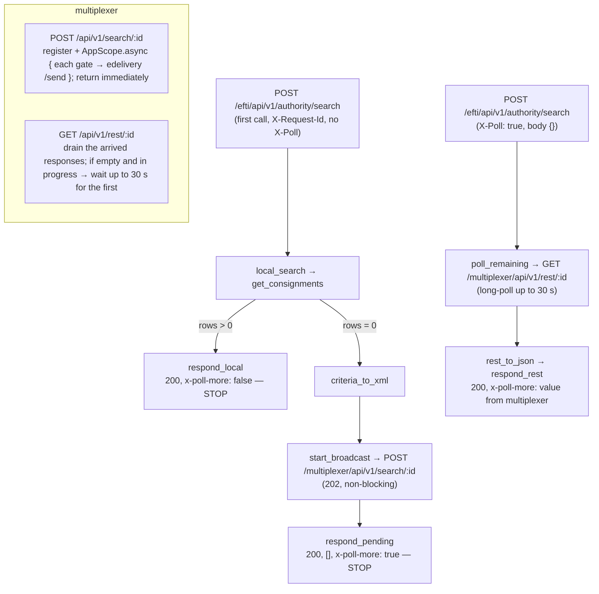

# ADR-010: Authority search does not block; guard dedup; DSL tools from the runtime image

**Decision (Sten Viljus, 10.09.2026):**

Three decisions made during the performance analysis
(`docs/performance/askend_perf_verification/analysis.md`) that change the `authority/search` flow,
the guard chain and CI.

> **Addendum (29.10.2026): the text below is the state as of 10.09.2026.** Changes in effect:
> - The multiplexer is retired, the cross-gate search fan-out is Ruuter's own (`parallel_http` +
>   `detach`, results in the `search_results` table): see [ADR-013](013-retire-multiplexer-ruuter-fanout.md).
>   The behaviour rules (the first response does not block, `x-poll-more`, up to 30 s long-poll)
>   still apply, the `/multiplexer/...` calls and `MULTIPLEXER_REST_POLL_SECONDS` do not.
> - `dsl-lint` / `dsl-test` still come from the runtime image, but the version is now
>   `turnerrainer/ruuter:0.12.1-rc` (`0.9.14-rc` below is only the version pinned at that time).
> - The `xroad` project is now in the `DSL/Ruuter-xroad/` directory and is served by a separate
>   `ruuter-xroad` (see [ADR-006](006-xroad-identity-and-subsets.md)).

## Decision

### 1. `authority/search` is "local-first, then broadcast" and does not block in any branch

- **A local hit** (`get_consignments` returns rows) → responds immediately,
  `x-poll-more: false`, other gates are not queried at all. This gate is authoritative for its own
  consignments.
- **No local match** → responds immediately with `[]` + `x-poll-more: true`, and the cross-gate
  broadcast is started **non-blockingly** in the background.
- The client collects other gates' results by repeating the same request with `X-Request-Id` +
  `X-Poll: true` and body `{}` (`GET /multiplexer/api/v1/rest/:id`).
- The multiplexer's `POST /api/v1/first/:id` (which blocked `poll(63s)`, timeout → `504`)
  is **removed**, replaced by `POST /api/v1/search/:id` (registers + fans out in
  `AppScope.async`, returns immediately).
- `GET /api/v1/rest/:id` is a bounded long-poll: it waits for the first gate response up to
  `MULTIPLEXER_REST_POLL_SECONDS` (default 30 s), then returns a partial result +
  `x-poll-more`. **It never returns `500` or `504`.**

### 2. Overlapping guards do not run twice

`efti/POST/api/v1/authority/.guard.yml` and `efti/GET/api/v1/authority/.guard.yml`
get `declaration.override_ancestors: true`. Their `X-Internal-Service-Token`
check is exactly identical to the ancestor guard (`efti/{POST,GET}/api/v1/.guard.yml`),
so re-running the ancestor was duplicate work on every `authority/*` request.

### 3. `dsl-lint` / `dsl-test` come from the runtime image

`docker/dsl-tools/Dockerfile` is **deleted**. From `turnerrainer/ruuter:0.9.14-rc`
(Ruuter #83) both binaries are in the image (`/usr/local/bin/`), built from exactly
the engine version they lint against. CI (`.github/workflows/e2e.yml`,
`.gitlab-ci.yml`) runs them directly:
`docker run --rm -v "$PWD:/workdir" -w /workdir turnerrainer/ruuter:0.9.14-rc dsl-lint --dsl DSL/Ruuter …`

## Rationale

**A blocking first response.** `forward_to_gates` did a blocking `POST /first`
(`timeout: 65000`); if no peer gate responded, Ruuter waited 65 s and, because of
`stop_in_case_of_exception: true`, gave a generic **HTTP 500** — after 65 s,
with no useful response at all. The local result (which was already in hand) was lost.
The authority must be able to know "exists / does not exist" immediately, not wait for
every remote gate's timeout.

**A local hit needs no broadcast.** If the searched identifier is present in this gate's
consignments, the response is authoritative immediately. Broadcasting on every search (including
a hit) would triple the AS4 load and add two HTTP hops to the hot path with no substantive gain.

**Double guard.** An `authority/*` route is covered by two overlapping directory guards whose
`check_service_token` is byte-identical. The performance analysis (§4j) showed that a guard step
is measurably expensive (expression evaluation per step); running the same check twice is pure
waste.

**The dsl-tools image.** We built `dsl-lint` / `dsl-test` ourselves from `docker/dsl-tools/`
from Ruuter source, pinned to the runtime tag. 0.9.14-rc makes that redundant —
the binaries are in the image, version alignment guaranteed.

## Schema

## Behaviour rules

- The first call **never blocks** behind a peer gate. The long-poll `/rest` is the only
  waiting step and even it is bounded (`MULTIPLEXER_REST_POLL_SECONDS`, default 30 s)
  and returns a partial result, not an error.
- An unknown `searchId` (or one past its TTL) on `/rest` → `[]` + `x-poll-more: false`.
- On a local hit `x-poll-more: false`; the client does not need to poll.
- `xroad/POST/provide/v1/search.yml`: `forward_to_core` timeout `70000 → 15000` (core no
  longer blocks); the `x-poll` header is carried from the body (`{"poll": true}`) to core's
  `check_poll`, a null value drops out in the http step (Ruuter #57).
- `override_ancestors: true` affects **only** the `authority/` subtree; the other `efti/api/v1/`
  routes (`dataset-xml`, `follow-up-xml`, `consignments/search-xml`, `ping`)
  still run the ancestor guard.
- A `template:` step in a route body still triggers the target's guard (Ruuter #79 concerns
  only a `template:` *inside* a guard), so the template steps of the `-xml` / `authority/*`
  routes still require `x-internal-service-token` to be forwarded.

## Applied changeset

- `DSL/Ruuter/efti/POST/api/v1/authority/search.yml` — rewritten (schema above)
- `DSL/Ruuter-xroad/xroad/POST/provide/v1/search.yml` — timeout + `x-poll` header
- `DSL/Ruuter/efti/POST/api/v1/authority/.guard.yml`,
  `DSL/Ruuter/efti/GET/api/v1/authority/.guard.yml` — `override_ancestors: true`
- `code/multiplexer/src/MultiplexerRoutes.kt` — `/first` → `/search` + long-poll `/rest`
- `code/multiplexer/test/MultiplexerRoutesTest.kt`, `code/multiplexer/test.http`
- `tests/authority/authority-api.http` — a new contract; `tests/admin/gates.http` —
  `EU-EE32` teardown
- `docker/dsl-tools/` — deleted; `.github/workflows/e2e.yml`, `.gitlab-ci.yml`,
  `AGENTS.md` — tools from the `turnerrainer/ruuter:0.9.14-rc` image
- `docker/ruuter/Dockerfile`, `docker/ruuter-xroad-mock/Dockerfile` — `0.9.12-rc → 0.9.14-rc`

Verified: `http-tests` 198/198, `dsl-lint` 74/74, `dsl-test` 9/9,
`multiplexer:test` green.

## Open points

- **Broadcast on a local hit too.** Currently a local hit ends the flow.
  If the interpretation of reg 2020/1056 requires that an authority see all consignments of the
  same identifier across all gates even when the local gate found one, `respond_local` must be
  replaced with `start_broadcast + respond` (the row + `x-poll-more: true`).
  A separate decision.
- **Ruuter's per-request overhead** (§6.7/§4j) — Ruuter's `http.post` already keeps a connection
  pool towards ReSql (checked in source); the remainder is in the DSL expression engine, which
  is on Ruuter's side. A separate issue for the Ruuter developers.
