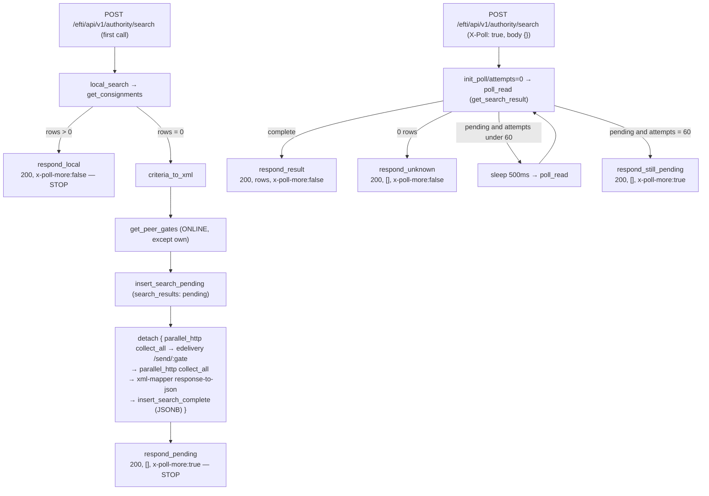

# ADR-013: Removing the klite multiplexer — fan-out and state in the Ruuter DSL

**Decision (K4, 07.10.2026):** The klite `multiplexer` service is **deleted**. Its message fan-out
(an identifier-search request to all `ONLINE` peer gates), response aggregation and
state are moved into the Ruuter DSL, using the Ruuter 0.11.0-rc primitives `parallel_http`
(issue #135/#136) and `detach` (issue #137) and DB-based state in a new `search_results`
table.

## Context

`code/multiplexer` (Kotlin/klite) held:
- an in-memory `Cache<UUID, PartyResponses>` (90 s TTL) that registered a broadcast query;
- the message fan-out with `AppScope.async` via `edelivery /api/v1/send/:gateId`;
- the bounded long-poll (30 s) of `GET /api/v1/rest/:id`, which **drained** the accumulated
  XMLs and joined them as an ad-hoc string with `⦀`.

The only consumer was `DSL/Ruuter/efti/POST/api/v1/authority/search.yml`. Drawbacks: a separate
JVM process (512 MiB), in-memory non-durable state, a single-replica limitation, the `⦀` string
join and the drain semantics (the poller lost the data if the xml-mapper step failed).

ADR-010 (authority search does not block) stays in force — only the **mechanism** changes.

## Decision

1. **Message fan-out in Ruuter.** The first call of `authority/search.yml` (a local miss) reads
   the `ONLINE` gates (except its own) via `get_gates`, inserts a `pending` row into
   `search_results` and starts the message fan-out in `detach` with `parallel_http`
   `aggregate: collect_all` to `[#EDELIVERY_URL]/api/v1/send/${peer.id}`. Each peer's FTI021 XML
   is converted with `xml-mapper /search/response-to-json` into `ConsignmentRow[]` and written as
   a `complete` row as **JSONB**. The response is immediately `[]` + `x-poll-more: true`.
2. **Structural aggregation.** The multiplexer's `⦀` string join is replaced by `parallel_http`'s
   structural `[{peer, response}]` array. The poll reads the stored JSONB row — **idempotent,
   does not drain** — so a mapper error no longer loses data.
3. **DB-based state.** A new append-only `search_results` table
   (`search_id`, `status` = `pending|complete`, `body JSONB`, `created_at`). The first call inserts
   `pending`, the detached task inserts `complete`; the poll reads the newest row.
4. **Poll.** On `X-Request-Id` + `X-Poll: true`, `authority/search.yml` reads the newest
   `search_results` row and sleeps+retries (bounded, ~30 s) until `pending` disappears.
   `complete` → the stored rows + `x-poll-more: false`; an unknown/purged id → `[]` +
   `x-poll-more: false` (like the old multiplexer).
5. **Retention.** `search_results` is ephemeral; CronManager calls
   `POST /ops/v1/purge-search-results` (`keepMinutes` default 10) every 5 minutes.
6. **`async_responses` is not used.** That table is for 1:1 handover of an AS4 response
   (claim/drain per request_key) and does not suit the multi-row, non-draining search state.

## Rationale

- **Fewer moving parts.** One JVM service and one network hop fewer; the message fan-out uses the
  same `edelivery` as before, but Ruuter orchestrates it, and it already owns HTTP orchestration and
  DB state.
- **Durability.** Postgres instead of an in-memory cache: the poll is idempotent and shared across
  multiple replicas. A mapper error during the poll does not lose results (previously `/rest`
  drained).
- **One tool.** `parallel_http`/`detach` are general-purpose primitives; the message fan-out is
  declarative DSL, not separate Kotlin code.

## Schema

## Behaviour rules

- The first call never blocks behind a peer gate; the message fan-out is `detach`ed.
- The meaning and values of `x-poll-more` are identical to the former multiplexer.
- Local-first stays: a local hit does not start a broadcast query (the ADR-010 open point remains).
- A poll may last up to ~30 s (`attempts<60` × `sleep: 500`), which fits within the core 35 s /
  xroad 40 s timeout chain.
- `detach.max_inflight` (default 256) protects the process; an overflow → a `detach` step error →
  `broadcast_unavailable` 502.

## Known trade-off

`parallel_http collect_all` waits for **all** peers before the shared write, so partial results
per poll are no longer streamed (the old multiplexer drained progressively). The polls are, in
exchange, idempotent and data-loss-free. A partial write can be added in the future if needed.

## Applied changeset

- `DSL/Ruuter/efti/POST/api/v1/authority/search.yml` — rewritten (the poll loop + the `detach`ed
  message fan-out)
- `DSL/Resql/efti/POST/{insert_search_pending,insert_search_complete,get_search_result,delete_expired_search_results}.sql`
- `DSL/Liquibase/changelog/20261007-search-results.sql`, `DSL/Liquibase/init.sql`
- `DSL/Ruuter/ops/POST/v1/purge-search-results.yml`, `DSL/CronManager/efti-ops.yaml`
- `code/multiplexer/` deleted; `code/settings.gradle.kts`, `docker/multiplexer/`,
  `compose.yml`, `compose.override.yml`, `constants.ini`, `tests/http-client.env.json`,
  `.gitlab-ci.yml` cleaned up
- `tests/http/runtime-components.http` — direct multiplexer tests removed;
  `DSL-tests/efti/authority-search-state.test.yml` added; `tests/sql/regression.py` extended

## Open points

- **Partial results.** See "Known trade-off".
- **The shared poll key.** `search_results` is `x-request-id`-based without an ownership check
  (as before); see `x_road_integration.md`.
- **The devops chart.** `multiplexer` must also be removed from the `efti` devops repo chart
  (the `.gitlab-ci.yml` `components:` list is the source).
