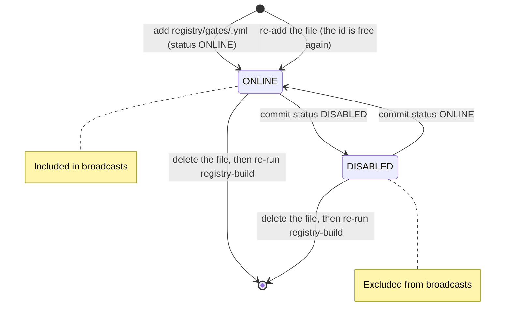

# Architecture: Gate Registry Management (Configuration-Driven, no database)

## Changes

- _Initial state. Change tracking begins at v1.0.0._
- **2026-10-08 — [ADR-011](../decisions/011-registries-as-signed-config.md):** the registry left the Admin API and the database. It is declared in the git folder `registry/gates/<id>.yml` (§1) and converted, with validation, into the JSON the `registry` service serves statically (§3; since 2026-11-10 converted by the one-shot `registry-build` on mounted sources, not at image build time) — so nginx re-reads nothing, an edit is applied with `docker compose up -d registry-build`, and the `gates` table, its read model and the `gate_status` type are **dropped** (§4).

> Sub-architecture for the Gate Registry Management surface. For overarching rules see [theme README](index.md). AC are in [`../../cfr/registry-management/gate_registry.md`](https://github.com/kemit-ee/efti-gate-ee/blob/dev/docs/cfr/registry-management/gate_registry.md).

## Gate lifecycle at a glance

There is no `OFFLINE` transition and no tombstone: `status` is a **commit**, and an unregistered gate
is simply absent. Nothing pings a peer any more.

## How a change reaches the consumers

1. A PR adds, edits or deletes a file under `registry/gates/`.
2. `registry-build` is re-run (`docker compose up -d registry-build`; in Kubernetes a pod restart re-runs the
   init container). `scripts/registry-to-json.py` **validates** every mounted source file and converts it to the
   JSON that nginx serves statically; no image is rebuilt.
3. Ruuter reads `GET /gates.json` (for the admin list and the peer fan-out) or
   `GET /gates/<id>.json` (for get-by-id and `gates/own`) and filters in the DSL;
   `edelivery` reads `/gates.json` into its AS4 party map.

A file that fails validation makes `registry-build` exit non-zero (read the `registry-build` container log) and
nothing new is published, so a broken gate entry cannot reach `edelivery` — fail-closed at start.

## Rationale

The gate registry is **contractual state**: a gate's AS4 URL and certificate decide where signed
messages go, so changing them is a signing act. Keeping the folder as the only store — rather than
projecting it into a table — removes the second copy entirely: there is no read model to refresh, no
append-only revision history to archive, no tombstone semantics, and no way for the database to
disagree with the repository.

The cost is explicit: the registry is now on the request path (every peer fan-out and every admin
read calls the service), and the append-only audit trail of gate changes is git rather than
`created_at`-ordered rows. See ADR-011 "Consequences and costs".
