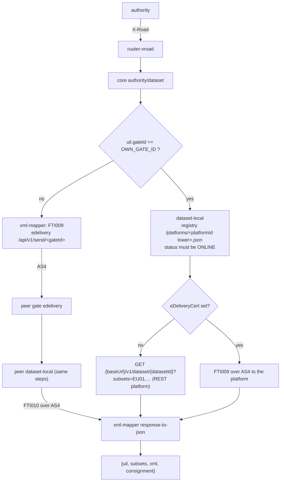

# UIL: the dataset address

The UIL (unique identifier link) says where a consignment dataset lives. It has three parts: the
gate that holds the identifiers, the platform that holds the data, and the platform's id for the
dataset. Platforms create UILs when they upload identifiers. Authorities get them from `search`
or `transport-means` and send them back to ask for the dataset.

## The three parts

| Part | JSON key | XML element | Format | Set by |
|---|---|---|---|---|
| gate | `gateId` | `GateID` | the gate's registry id, e.g. `G1`, `G2`. ASCII `A-Za-z0-9._-`, first character alphanumeric, max 64 (`registry/README.md`). | the gate that received the upload |
| platform | `platformId` | `PlatformID` | the platform's id in that gate's registry, e.g. `mock`, `mock-edelivery` | the gate, from the platform's credential |
| dataset | `datasetId` | `DatasetID schemeID="RFC 9562-4"` | a UUID | the platform |

Rules the gate applies:

- `datasetId` must be a UUID when the gate parses it: on upload and whenever an FTI message is
  built (xml-mapper's `UIL` has `datasetId: UUID`). The X-Road `dataset` route does not check it
  for a local UIL; see [Validation](#validation).
- `platformId` is looked up case-insensitively (`registry/platforms/<id lower>.json`).
- `gateId` is looked up case-insensitively by edelivery, but the local-or-remote decision is
  case-sensitive (see [Routing](#routing)).
- The pair `(platformId, datasetId)` identifies the dataset in the gate's database. A new upload
  with the same pair adds a row; the newest row is the current one
  ([Append-only data](../api/conventions.md#append-only-data)).

xml-mapper writes a UIL as `gateId/platformId/datasetId` in text form, e.g.
`G1/mock/11111111-0000-4000-8000-000000000001`. The APIs do not accept that form: a `uil`
string instead of an object is rejected (see [Validation](#validation)).

## Where the parts come from

A UIL is created when a platform uploads identifiers
([Upload identifiers (REST)](../api/platforms/upload-rest.md)).

| Upload form | `gateId` | `platformId` | `datasetId` |
|---|---|---|---|
| Short: `POST /platforms/v1/consignments/{datasetId}` with a `ParameterIDSetCriteria` body | this gate's own id (`OWN_GATE_ID`) | the platform the `X-Api-Key` belongs to | the path |
| Full: `POST /platforms/v1/consignments` with an `FTI004UploadIdentifierRequest` | `GateID` in the XML | `PlatformID` in the XML | `DatasetID` in the XML |

For the full form the gate checks, case-insensitively, that `PlatformID` is the authenticated
platform and `GateID` is this gate. Otherwise `403`.

### Short upload

```bash
curl -i -X POST "http://127.0.0.1:27086/platforms/v1/consignments/$(cat /proc/sys/kernel/random/uuid)" \
  -H 'Content-Type: text/xml' -H 'X-Api-Key: mock-secret-key' \
  --data-binary '<ParameterIDSetCriteria><MainCarriageTransportMeansIDParameterScope><ID>BOOK-F-UIL</ID></MainCarriageTransportMeansIDParameterScope></ParameterIDSetCriteria>'
```

```http
HTTP/1.1 201 Created
content-type: application/json
traceparent: 00-218e7430b16e7704e9215cdc13c4e719-f05ee90e7c12eb7d-01
x-trace-id: 218e7430b16e7704e9215cdc13c4e719

{"createdAt":"2026-11-03T16:27:40.279424Z","datasetId":"4423c7e2-2692-4417-bf11-5be1bd13e4c0","gateId":"G1","platformId":"mock","rowId":"1933ad39-471d-4ba9-b57a-d299e7891fcc","status":"ACTIVE"}
```

### Full FTI004 naming another gate → 403

`code/xml-mapper/xsd/FTI004/sample.xml` with `<GateID>G2</GateID>` and a new `DatasetID`,
sent to G1:

```bash
curl -i -X POST http://127.0.0.1:27086/platforms/v1/consignments \
  -H 'Content-Type: text/xml' -H 'X-Api-Key: mock-secret-key' --data-binary @/tmp/f-fti004-g2.xml
```

```http
HTTP/1.1 403 Forbidden
content-type: application/json
traceparent: 00-776dd4c7252ccc127e7d38f1946e0379-0baec7c5c121de3c-01
x-trace-id: 776dd4c7252ccc127e7d38f1946e0379

{"error":"Consignment UIL must belong to the authenticated platform and this gate","status":403}
```

The same file with `<PlatformID>other</PlatformID>` gets the same answer.

### datasetId that is not a UUID → 400

```bash
curl -i -X POST http://127.0.0.1:27086/platforms/v1/consignments/not-a-uuid \
  -H 'Content-Type: text/xml' -H 'X-Api-Key: mock-secret-key' --data-binary '<ParameterIDSetCriteria/>'
```

```http
HTTP/1.1 400 Bad Request
content-type: application/json
traceparent: 00-cd6b22a0eb0d1c5590d5af1e4cee0ea1-a88444e292e3ebad-01
x-trace-id: cd6b22a0eb0d1c5590d5af1e4cee0ea1

{"error":"Invalid consignment XML","status":400}
```

## The UIL in JSON

Always an object with three string members. The gate echoes the object it was sent, with the
case the caller used.

| Where | Form |
|---|---|
| X-Road `search` and `transport-means` rows | `"uil": {"datasetId": …, "gateId": …, "platformId": …}` |
| X-Road `dataset` and `follow-up` request bodies | `"uil": {…}` (required) |
| X-Road `dataset` answer | `"uil"` as sent |
| core `GET /efti/api/v1/authority/dataset/{gateId}/{platformId}/{datasetId}` | path segments ([Core authority API](../api/internal/core-authority.md)) |
| platform upload answer | flat: `datasetId`, `gateId`, `platformId` next to `rowId` |

A search row (G1, the dataset uploaded above):

```bash
curl -s -X POST http://127.0.0.1:27087/xroad/provide/v1/search \
  -H 'Content-Type: application/json' -H 'X-Road-Client: DEV/GOV/70000099/testSubsystem' \
  -H "X-Road-Id: $(cat /proc/sys/kernel/random/uuid)" \
  -d '{"transportMeansOrEquipmentId":{"operator":"EQ","id":"BOOK-F-UIL"}}'
```

```json
[{"acceptanceCountry":null,"acceptanceDate":null,"carriedEquipmentCategories":[],"carriedEquipmentIds":[],"createdAt":"2026-11-03T16:27:40.279424Z","dangerousGoods":null,…,"mainTransportId":"BOOK-F-UIL",…,"status":"ACTIVE",…,"uil":{"datasetId":"4423c7e2-2692-4417-bf11-5be1bd13e4c0","gateId":"G1","platformId":"mock"},…}]
```

## The UIL in FTI XML

Every FTI message that names a dataset carries one `UniqueIDSetUniqueIDSet` inside
`rsm:EFTIIDInformation`, with the children in this order:

```xml
<UniqueIDSetUniqueIDSet>
  <GateID>G2</GateID>
  <PlatformID>mock</PlatformID>
  <DatasetID schemeID="RFC 9562-4">22222222-0000-4000-8000-000000000001</DatasetID>
</UniqueIDSetUniqueIDSet>
```

| Message | `UniqueIDSetUniqueIDSet` |
|---|---|
| FTI004 upload | one, plus `ParameterIDSetCriteria` inside it |
| FTI029 upload answer | one |
| FTI009 dataset request, FTI010 dataset answer | one |
| FTI021 search answer | one per hit, each with its `ParameterIDSetCriteria` |
| FTI025 follow-up, FTI030 follow-up answer | one |

The element is built by `UniqueIDSetUniqueIDSet.render()` in
`code/xml-mapper/src/efti/xml/fti/ParameterIDSetCriteria.kt`. The FTI009 that G1 builds for a
dataset at G2 (whitespace as returned):

```bash
curl -s -X POST http://127.0.0.1:27082/api/v1/dataset/request-to-xml \
  -H 'Content-Type: application/json' \
  -H 'X-Internal-Service-Token: dev-internal-service-token-change-me' \
  -H 'X-Request-Id: 0b8f0c8e-6a55-4a58-9a1c-3f1d8a2b7c10' \
  -d '{"uil":{"gateId":"G2","platformId":"mock","datasetId":"22222222-0000-4000-8000-000000000001"},"subsets":["EU01","EE05b"]}'
```

```xml
<rsm:FTI009GetCmdsRequest xmlns:rsm="urn:eu:move:eFTI:data:standard:FTI009GetCmdsRequest:1" xmlns="urn:eu:move:eFTI:data:standard:ReusableAggregateBusinessInformationEntity:34" xmlns:udt="urn:eu:move:eFTI:data:standard:UnqualifiedDataType:34"><rsm:ExchangedDocumentContext><MessageStandardSpecifiedDocumentContextParameter><ID>eFTI</ID><SpecifiedDocumentVersion><ID>1.0</ID></SpecifiedDocumentVersion></MessageStandardSpecifiedDocumentContextParameter></rsm:ExchangedDocumentContext><rsm:ExchangedDocument><ID schemeID="RFC 9562-4">28e1275d-bcb1-4011-b463-83ddc39cd09a</ID><TypeCode>009</TypeCode><IssueDateTime><udt:DateTimeString format="207">20261103162602Z</udt:DateTimeString></IssueDateTime><RequestedSpecifiedQuery><ID schemeID="RFC 9562-4">0b8f0c8e-6a55-4a58-9a1c-3f1d8a2b7c10</ID></RequestedSpecifiedQuery></rsm:ExchangedDocument>
    <rsm:MessageInformation><SubsetID>EU01</SubsetID><SubsetID>EE05b</SubsetID></rsm:MessageInformation>
    <rsm:EFTIIDInformation><UniqueIDSetUniqueIDSet><GateID>G2</GateID><PlatformID>mock</PlatformID><DatasetID schemeID="RFC 9562-4">22222222-0000-4000-8000-000000000001</DatasetID></UniqueIDSetUniqueIDSet></rsm:EFTIIDInformation>
  </rsm:FTI009GetCmdsRequest>
```

When xml-mapper parses a message, a missing part or a non-UUID `DatasetID` is a `400` (see
[Validation](#validation)).

## Routing

The gate reads `uil.gateId` to decide who answers. Source:
`DSL/Ruuter/efti/POST/api/v1/authority/dataset.yml` (`check_gate`) and
`DSL/Ruuter/efti/POST/api/v1/dataset-local.yml`. Follow-ups use the same rule.



- Own gate: the platform is looked up in this gate's registry. A REST platform is called with
  its `baseUrl` and `headers` from the registry; a platform with `eDeliveryCert` gets an FTI009
  over AS4 instead.
- Other gate: the FTI009 goes to the party named `gateId` in edelivery's party map (the
  registry's `ONLINE` gates with a certificate). The peer gate does the "own gate" steps.
- The comparison with `OWN_GATE_ID` is an exact string match. edelivery's party lookup is not.

### Own gate, other case: G1 sends to itself over AS4

```bash
curl -s -X POST http://127.0.0.1:27087/xroad/provide/v1/dataset \
  -H 'Content-Type: application/json' -H 'X-Road-Client: DEV/GOV/70000093/ants' \
  -H "X-Road-Id: $(cat /proc/sys/kernel/random/uuid)" \
  -d '{"uil":{"gateId":"g1","platformId":"mock","datasetId":"11111111-0000-4000-8000-000000000001"},"subsets":["EU01"]}'
```

```http
HTTP/1.1 200 OK
content-type: application/json

{"consignment":{"grossWeightMeasure":"15000.00",…},"subsets":["EU01"],"uil":{"datasetId":"11111111-0000-4000-8000-000000000001","gateId":"g1","platformId":"mock"},"xml":"<SpecifiedSupplyChainConsignment xmlns:udt=\"urn:eu:move:eFTI:data:standard:UnqualifiedDataType:34\"><GrossWeightMeasure unitCode=\"KGM\">15000.00</GrossWeightMeasure>\n  …"}
```

It took 0.26 s. The `xml` starts with `xmlns:udt=` on the root, the mark of a fragment cut out of
an FTI010; with `"gateId":"G1"` the local answer starts with the platform's own namespace
declarations. `g2` sent to G1 also works (`200`, 0.17 s).

### Platform id in another case

`"platformId":"MOCK"` answers `200`, and the answer echoes `"platformId":"MOCK"`.

## Validation

The X-Road `dataset` route checks only that `uil` is present (`check_input`). The engine checks
that it is an object. The parts are checked later, by whichever component needs them, so the
error depends on the route the UIL takes.

| Input | Status | Body / `coreResponse` |
|---|---|---|
| no `uil` | `400 BAD_REQUEST_GENERAL` | "The request body is missing or malformed. …" |
| `uil` is a string | `400` (engine) | `{"error":"Field type mismatch in body: uil expected object, got string"}` |
| `gateId` unknown (`EU-XX`) | `502 GATEWAY_UNAVAILABLE`, `coreStatus` 400 | `{"error":"Remote gate dataset request failed","detail":{"detail":"Unknown party: EU-XX",…}}` |
| `gateId` missing | `502`, `coreStatus` 404 | `{"error":"Remote gate dataset request failed","detail":{"detail":"/api/v1/send/",…,"status":404,"title":"Not Found"}}` |
| `platformId` unknown at this gate (`nope`), or missing | `502`, `coreStatus` 404 | `{"error":"Platform lookup failed (data layer unavailable)"}` |
| `platformId` unknown at the other gate | `502`, `coreStatus` 504, after 60 s | `{"error":"Remote gate dataset request failed","detail":{"detail":"No data received after 1m",…}}` |
| `datasetId` not a UUID, local UIL | `200` | the mock platform answers any id |
| `datasetId` missing, local UIL | `200` | same; the answer's `uil` has no `datasetId` |
| `datasetId` not a UUID, remote UIL | `502`, `coreStatus` 500 | `{"error":"Remote gate dataset request failed","detail":{"detail":"eDelivery request failed with status 500: EBMS:0002 - UNSUPPORTED_MESSAGE",…}}` |

xml-mapper's own answers, when called directly
(`POST http://127.0.0.1:27082/api/v1/dataset/request-to-xml`):

| Input | Answer |
|---|---|
| `"datasetId":"not-a-uuid"` | `400 {"detail":"Invalid UUID string: not-a-uuid","instance":"/api/v1/dataset/request-to-xml",…}` |
| no `gateId` | `400 {"detail":"Cannot create UIL from {datasetId=22222222-0000-4000-8000-000000000001, platformId=mock}: missing gateId",…}` |

### Unknown gate

```bash
curl -i -X POST http://127.0.0.1:27087/xroad/provide/v1/dataset \
  -H 'Content-Type: application/json' -H 'X-Road-Client: DEV/GOV/70000093/ants' \
  -H "X-Road-Id: $(cat /proc/sys/kernel/random/uuid)" \
  -d '{"uil":{"gateId":"EU-XX","platformId":"mock","datasetId":"11111111-0000-4000-8000-000000000001"},"subsets":["EU01"]}'
```

```http
HTTP/1.1 502 Bad Gateway
content-type: application/json
traceparent: 00-0bca818ba53dbabfc91c671b047890db-037fe656ac7267d3-01
x-trace-id: 0bca818ba53dbabfc91c671b047890db

{"code":"GATEWAY_UNAVAILABLE","coreResponse":{"detail":{"detail":"Unknown party: EU-XX","instance":"/api/v1/send/EU-XX","message":"Unknown party: EU-XX","status":400,"title":"Bad Request"},"error":"Remote gate dataset request failed"},"coreStatus":400,"detail":"The gate's dataset request failed. The gate's own status and response are carried in coreStatus and coreResponse.","status":502,"title":"Bad Gateway","type":"https://api.efti.ee/errors/bad-gateway"}
```

### Unknown platform at this gate

```bash
curl -i -X POST http://127.0.0.1:27087/xroad/provide/v1/dataset \
  -H 'Content-Type: application/json' -H 'X-Road-Client: DEV/GOV/70000093/ants' \
  -H "X-Road-Id: $(cat /proc/sys/kernel/random/uuid)" \
  -d '{"uil":{"gateId":"G1","platformId":"nope","datasetId":"11111111-0000-4000-8000-000000000001"},"subsets":["EU01"]}'
```

```http
HTTP/1.1 502 Bad Gateway
content-type: application/json
traceparent: 00-6e59ff1ce4898a85b83bec92b2da3ca8-c11c834ff26571da-01
x-trace-id: 6e59ff1ce4898a85b83bec92b2da3ca8

{"code":"GATEWAY_UNAVAILABLE","coreResponse":{"error":"Platform lookup failed (data layer unavailable)"},"coreStatus":404,"detail":"The gate's dataset request failed. The gate's own status and response are carried in coreStatus and coreResponse.","status":502,"title":"Bad Gateway","type":"https://api.efti.ee/errors/bad-gateway"}
```

### Remote UIL with a non-UUID datasetId

```bash
curl -i -X POST http://127.0.0.1:27087/xroad/provide/v1/dataset \
  -H 'Content-Type: application/json' -H 'X-Road-Client: DEV/GOV/70000093/ants' \
  -H "X-Road-Id: $(cat /proc/sys/kernel/random/uuid)" \
  -d '{"uil":{"gateId":"G2","platformId":"mock","datasetId":"not-a-uuid"},"subsets":["EU01"]}'
```

```http
HTTP/1.1 502 Bad Gateway
content-type: application/json
traceparent: 00-bdd98f6ba1887c18db072eb7335de88d-46593dc2ac2a4a84-01
x-trace-id: bdd98f6ba1887c18db072eb7335de88d

{"code":"GATEWAY_UNAVAILABLE","coreResponse":{"detail":{"detail":"eDelivery request failed with status 500: EBMS:0002 - UNSUPPORTED_MESSAGE","message":"eDelivery request failed with status 500: EBMS:0002 - UNSUPPORTED_MESSAGE","status":500,"title":"Internal Server Error"},"error":"Remote gate dataset request failed"},"coreStatus":500,"detail":"The gate's dataset request failed. The gate's own status and response are carried in coreStatus and coreResponse.","status":502,"title":"Bad Gateway","type":"https://api.efti.ee/errors/bad-gateway"}
```

xml-mapper refused to build the FTI009 (`400 Invalid UUID string: not-a-uuid` in its log), and core
sent xml-mapper's error body to G2 as the AS4 payload.

## Notes

- Take UILs from `search` or `transport-means` rows and send them back unchanged. That avoids
  the case and format traps above.
- Unknown platform reads "Platform lookup failed (data layer unavailable)" with `coreStatus` 404.
  The registry answers 404 for an unknown id and `dataset-local.yml` treats every status ≥ 300 as
  a lookup failure, so the "Platform Not Found" branch is not reached for unknown ids.
- `authority/dataset.yml` checks only for a transport failure (status 0) after
  `request-to-xml`. A `400` from xml-mapper is not caught, which is why a bad remote `datasetId`
  ends as an AS4 `EBMS:0002`.
- The local path does not check the UIL against the database. The dataset content comes from the
  platform; the identifiers stored at the gate are not consulted.
- Related: [dataset](../api/authorities/dataset.md), [Dataset: FTI009 / FTI010](../api/gates/dataset-fti009.md),
  [eFTI subsets](./subsets.md), [Dataset content (FTI010)](./dataset-fields.md).
