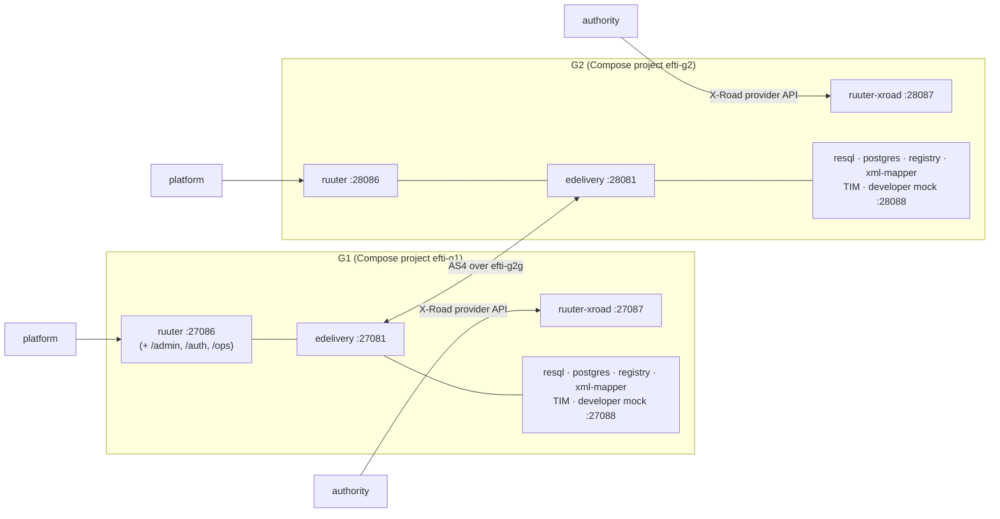

# eFTI Gate (EE)

The Estonian **eFTI Gate** connects freight platforms, competent authorities and the gates of other
EU member states, under the electronic Freight Transport Information Regulation (EU) 2020/1056.

- **Platforms** register consignment identifiers at their gate. The data itself stays at the
  platform.
- **Authorities** search those identifiers and ask for the datasets, over X-Road.
- **Gates** forward searches, dataset requests and follow-ups to each other over AS4 (eDelivery)
  when the data belongs to another member state.

This book is the complete reference for the gate's interfaces:
- every endpoint, for every audience, with its parameters and every status code it can return;
- real requests and the responses they produced;
- end-to-end use cases;
- the data and message formats.

Every example was run on a local network of **two gates**, G1 and G2, exchanging AS4 messages.
The network is plain Docker Compose, and a Postman collection lets you run every example yourself.
In `local/`:

```bash
docker compose --env-file gates/g1.env up -d --wait      # gate G1
docker compose --env-file gates/g2.env up -d --wait      # gate G2
docker compose --env-file gates/g1.env run --rm newman   # test G1, and AS4 to G2
docker compose --env-file gates/g2.env run --rm newman   # test G2, and AS4 to G1
```

```text
┌─────────────────────────┬───────────────────┬──────────────────┐
│                         │          executed │           failed │
├─────────────────────────┼───────────────────┼──────────────────┤
│                requests │               119 │                0 │
├─────────────────────────┼───────────────────┼──────────────────┤
│              assertions │               199 │                0 │
└─────────────────────────┴───────────────────┴──────────────────┘
```

More gates are more env files: every gate runs the same `local/compose.yaml`
([Adding a gate](./getting-started/run-locally.md#adding-a-gate)).

**Repository:** [kemit-ee/efti-gate-ee](https://github.com/kemit-ee/efti-gate-ee)

## Start here

Pick your role. [Find your path](./roles/index.md) gives each role a goal, an ordered reading list and
the facts that only matter to it.

| You are | Role page | Then |
|---|---|---|
| Deciding whether and how to run or join a gate | [Decision maker](./roles/decision-maker.md) | [Deployer](./roles/deployer.md) |
| A **competent authority** integrating its information system | [Competent authority](./roles/authority.md) | [search](./api/authorities/search.md), [dataset](./api/authorities/dataset.md), [use cases](./use-cases/authority-searches.md), [Developer mock](./api/authorities/developer-mock.md) |
| A **freight platform** | [Freight platform](./roles/platform-developer.md) | [Upload (REST)](./api/platforms/upload-rest.md), [What the gate calls on a platform](./api/platforms/platform-side-api.md) |
| Operator of **another member state's gate** | [Peer gate](./roles/peer-gate-operator.md) | [AS4 endpoint](./api/gates/as4-endpoint.md), the message pairs, [certificates](./getting-started/certificates.md) |
| A **gate administrator** | [Gate administrator](./roles/administrator.md) | [Admin UI guide](./roles/admin-ui.md), [Change the registry](./roles/registry-changes.md), [use case](./use-cases/administrator.md) |
| **Deploying** a gate | [Deployer](./roles/deployer.md) | [First administrator](./roles/first-admin.md) |
| **Operating** a gate | [Operator](./roles/operator.md) | [use case](./use-cases/operations.md), [Troubleshooting](./reference/troubleshooting.md) |
| A **developer of the gate** | [Gate developer](./roles/developer.md) | [Getting started](./getting-started/prerequisites.md), [Gate internals](./api/internal/index.md), [Known issues](./reference/known-issues.md) |

Every endpoint on one page: [Endpoint map](./api/index.md). Who may call what:
[Permissions matrix](./data/permissions.md).

## How the book is organised

| Part | What is in it |
|---|---|
| **By role** | One page per role: decision maker, authority, platform, peer gate, administrator, deployer, operator, developer. Each gives a goal and an ordered path through the rest of the book, plus the role-only procedures: the admin UI guide, changing the registry, the first administrator. |
| **Getting started** | Run two gates locally, load sample data, create and exchange gate certificates, verify everything with Postman and Newman. |
| **Business use cases** | Complete tasks grouped by actor — a platform upload, the competent-authority tasks, a cross-gate exchange, administration and operations — each run end to end with real requests and answers. |
| **Technical architecture** | How the gate is designed: the reference architecture, core flows, identity and access, integrations, registries, security, observability, infrastructure, and the decision records. Design documents — for exact current endpoints the API reference wins. |
| **API reference** | Every endpoint, by audience. One page per endpoint or group, built the same way: request headers, parameters and body; every response status; examples; notes. |
| **Data and messages** | The UIL, eFTI subsets, search criteria, the dataset content (FTI010), the error catalogue, the permissions matrix. |
| **Reference** | Ports and credentials, sample data, the Postman collection request by request, troubleshooting, known issues. |

## What runs where



- **One Compose file, one env file per gate.** Each gate is `local/compose.yaml` started as its own
  Compose project with `--env-file gates/<gate>.env`. The env files differ only in gate id, port
  prefix, AS4 key directory and sample data. A third gate is one more env file.
- **The only link is AS4.** The edelivery containers share one Docker network, `efti-g2g`; nothing
  else of one gate can reach the other.

## How to read the examples

- **Real output.** Every response block is what the local stack answered on 3 November 2026 (branch
  `dev` at PR #380), shortened with `…` where long. Ids and timestamps differ on your run.
- **Demo gates, no countries.** The local gates are G1 and G2, with registry country codes `XA` and
  `XB` (ISO 3166 user-assigned codes, which no country has). Most examples were first recorded with
  the gates named after countries and then renamed; the setup, sample-data, certificate and registry
  examples, and the full Postman run, were repeated on G1 and G2 on 4 November 2026. The dataset
  contents keep real country codes (`EE`, `LV`, `DE`, …), because the eFTI data model accepts only
  those.
- **Not run locally.** Some behaviours need a component to fail (a database down, a platform that
  times out) or something the stack doesn't have (an X-Road Security Server). The pages describe
  them from the code and say so.
- **Code over documents.** Where the DSL and an older document in the repository disagree, the book
  describes what the code does and notes the difference.
- **Defects are recorded, not hidden.** Behaviour that looks wrong is described as it is, and
  collected in [Known issues](./reference/known-issues.md).

> **Local only.** Every key, token and password in this book is a development value that is already
> public in the repository. Never use them in a deployed environment.
