# Admin UI guide

> **Goal:** you can use every view of the admin UI: log in, read the registries, manage users and
> browse consignments.

This is the English version of the Estonian user guide (`docs/user-guide`, published to Confluence).
The screenshots are from the UI's Estonian language setting. The UI has an **ET/EN** switch in the top
right.

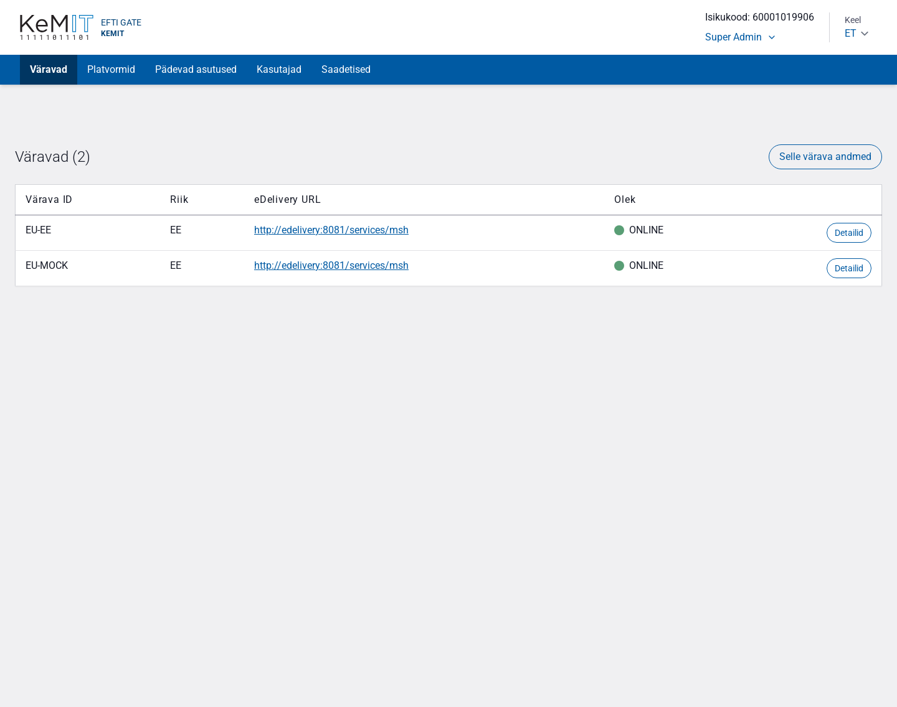

The top menu has five views: **Gates**, **Platforms**, **Authorities**, **Users** and
**Consignments**. The top right has the language switch and your user menu, with *Log out*.

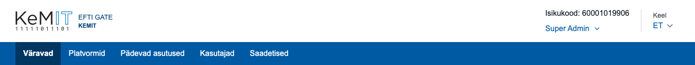

## Log in

1. Open the admin UI.
2. The application sends you to TARA. Choose a sign-in method and finish.
3. After a successful sign-in the **Gates** view opens.

You get in only if an administrator has registered your personal code in **Users** beforehand. A
valid TARA sign-in without a user row is refused. A local development environment uses a TARA test
service and test identities; production uses the real TARA. The very first administrator of a
production environment is inserted by hand: [First administrator](./first-admin.md).

To log out, open your name menu in the top right and choose *Log out*. This ends the session. On a
shared computer, close the browser window too.

## The three registry views are read-only

**Gates**, **Platforms** and **Authorities** show data that lives in the repository's `registry/`
folder. You cannot add, change, delete or ping an entry, and you cannot generate an API key. The
change path is a pull request and a registry build:
[Change the registry](./registry-changes.md).

### Gates

The gates view lists the other member states' gates that this gate talks to over AS4, and this
gate's own entry.

| State | Meaning |
|---|---|
| `ONLINE` | In use: messages are exchanged and the gate is part of cross-border search |
| `DISABLED` | Switched off in the registry: no messages, no searches sent to it |

The state comes only from the registry file. There is no ping, so it never changes by itself.

Choose *Details* at the end of a row to see the id, country, eDelivery URL and the eDelivery and TLS
certificates. The fields are locked. The *This gate's data* button shows your own entry. You need
those values (the URL and the certificate) when a partner configures their access point for you.

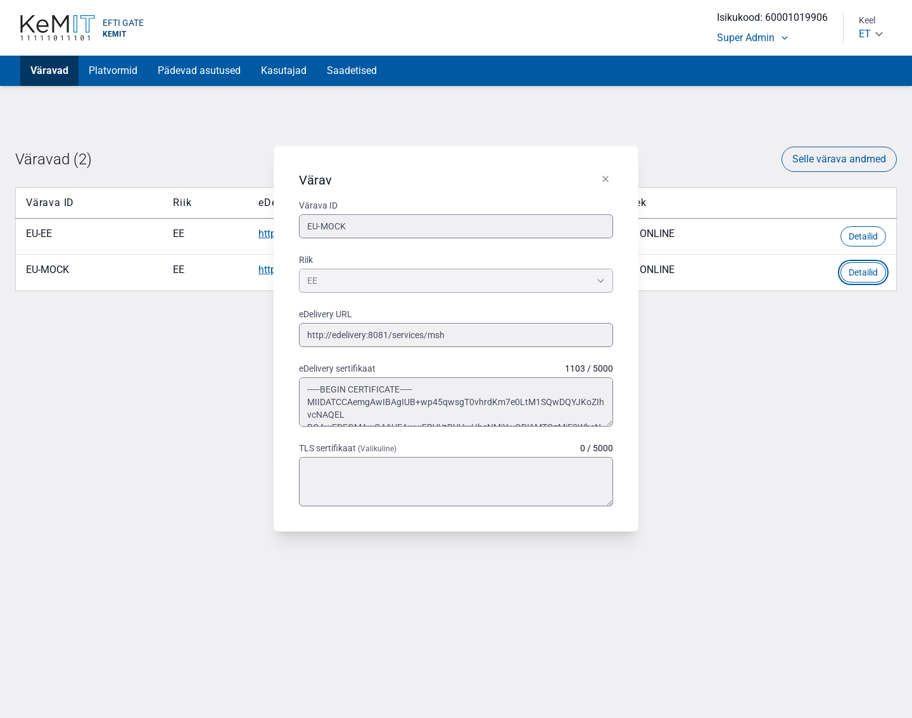

### Platforms

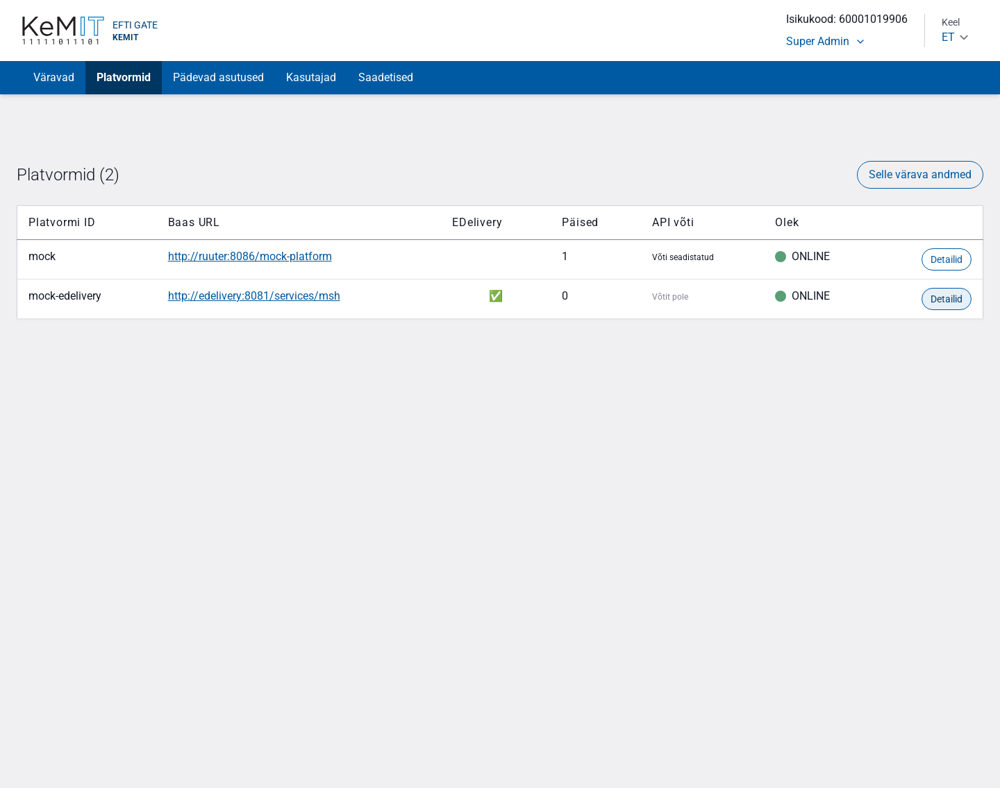

| Column | Meaning |
|---|---|
| Platform ID | The id in the registry |
| Base URL | The platform's REST address |
| EDelivery | A tick means the platform is reached over AS4; otherwise REST |
| Headers | How many extra headers the gate sends to the platform |
| API key | *Key configured* or *No key*. The key itself is never shown |
| Status | `ONLINE`: the platform can send, and data requests go to it. `DISABLED`: it does not authenticate, and requests behave as if the platform did not exist |

*Details* shows the base URL, certificates, headers and whether a key exists, all locked.

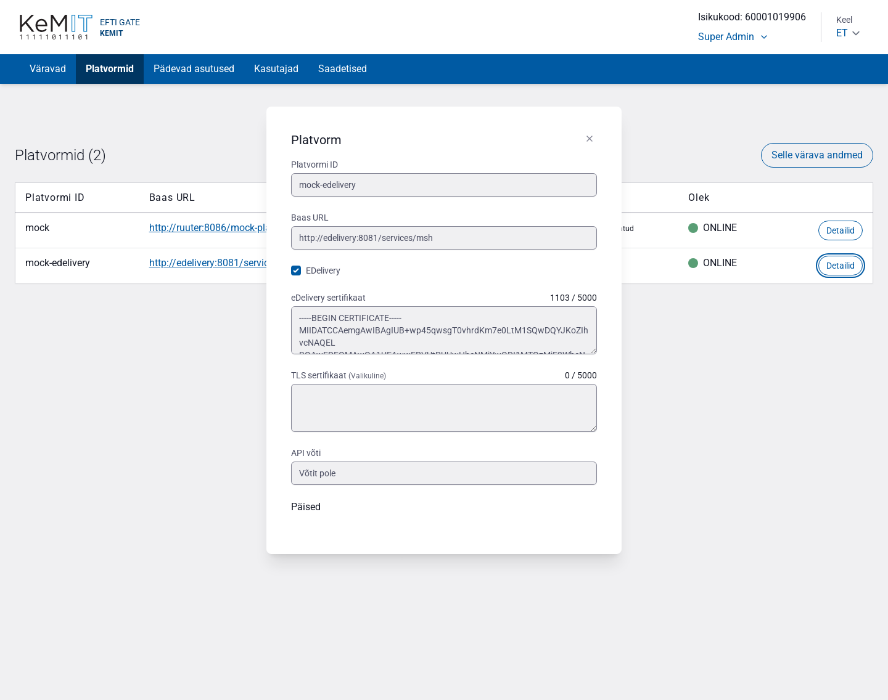

A lost or leaked key cannot be seen or regenerated here. Ask the technical team: a new key goes
into the registry, the registry is rebuilt, and the key reaches the platform operator securely. The
old key stops working when the change is applied.

### Authorities

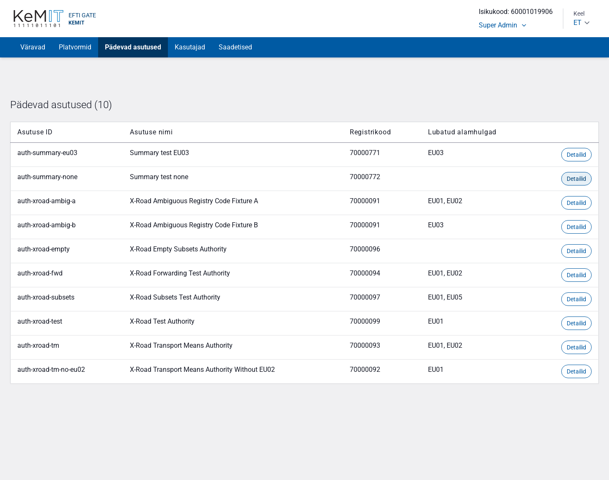

The list shows which authorities may query the gate over X-Road and which subsets of eFTI data each
may receive. An authority is active as long as its file exists; there is no status.

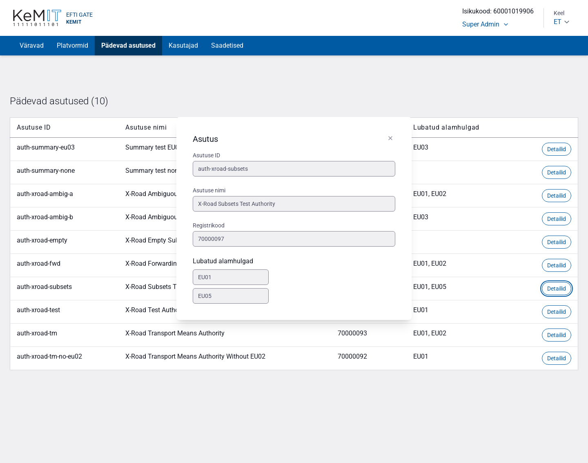

- **Registry code** ties the authority to an X-Road member code. A request whose member code does
  not match exactly one authority is refused.
- **Allowed subsets** (EU01 to EU07) say which parts of the data are released to the authority. An
  empty list releases none.

When you request a change, review the whole subset list, and grant only what the duties need.

## Users

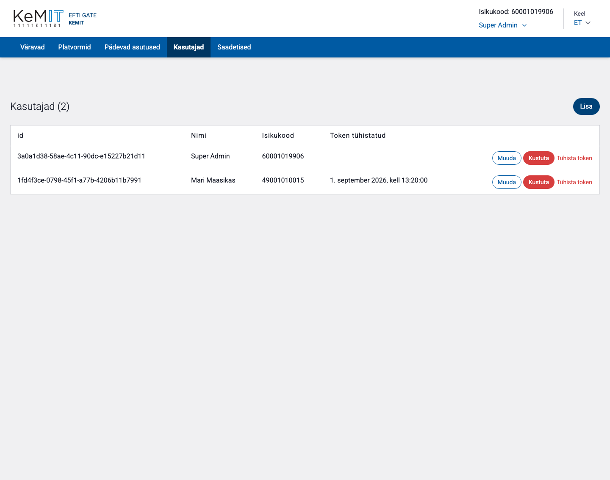

This view manages the people who may log in with TARA. Only a logged-in user can add another. The
first administrator of a production environment is added by hand ([First
administrator](./first-admin.md)).

**Add a user**

1. Choose *Add*.
2. Enter the person's personal code in **TARA Sub**.
3. Enter the name.
4. Choose *Save*.

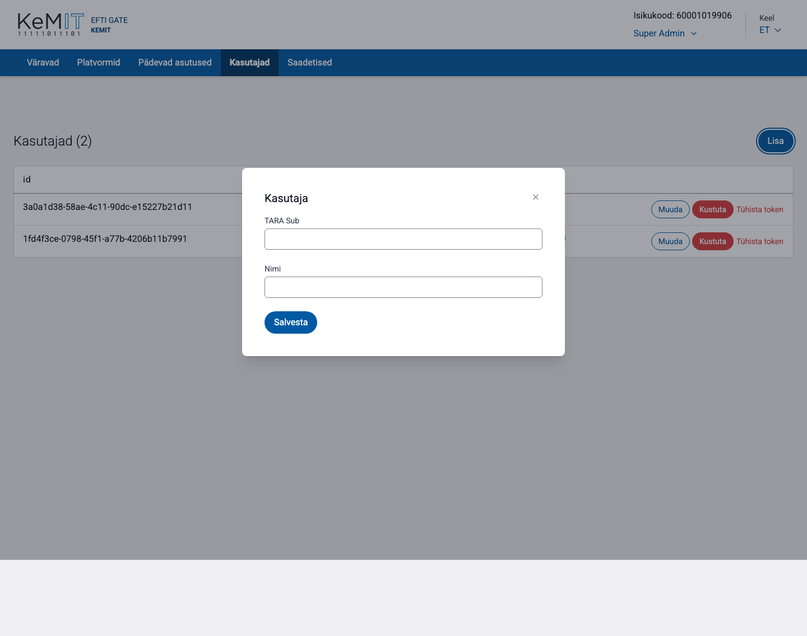

The personal code must equal the identifier TARA returns. There are no separate administrator
roles: every existing, authenticated user can use the whole UI.

**Rename a user** with *Edit*. The personal code of an existing user cannot be changed. For a wrong
code, delete the record and add the right one.

**Revoke a token:** find the user, choose *Revoke token* and confirm. Their active tokens stop
working and they must sign in again.

**Remove a user:** choose *Delete* and confirm. The person can no longer sign in.

## Consignments

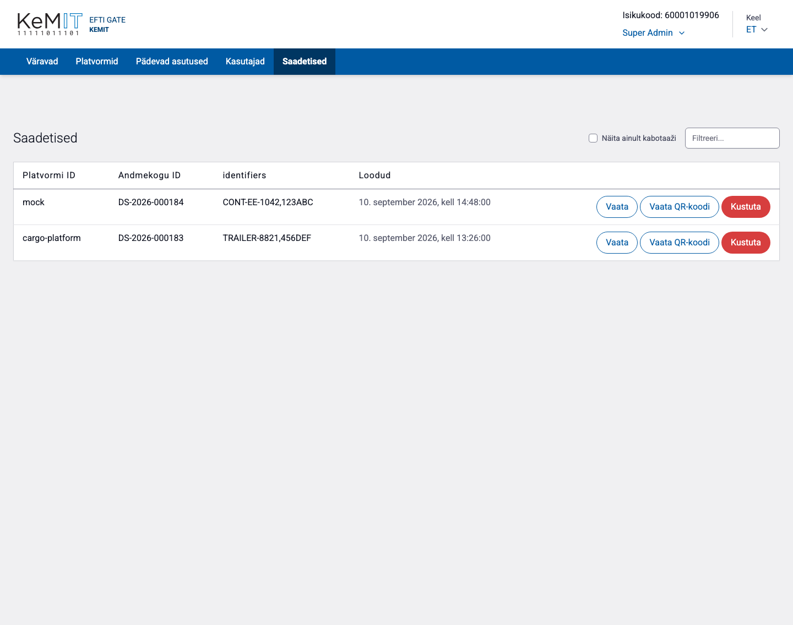

The list shows the consignment records platforms uploaded: platform id, dataset id, transport
identifiers and creation time.

- **Find one:** type part of a dataset id or identifier into *Filter…*. Tick *Show only cabotage* to
  limit the list to cabotage-related records. Click a column header to sort.
- **View the content:** choose *View*. The structured **UI** view opens by default; choose **XML**
  for the original XML, useful when investigating an error or copying the source data.

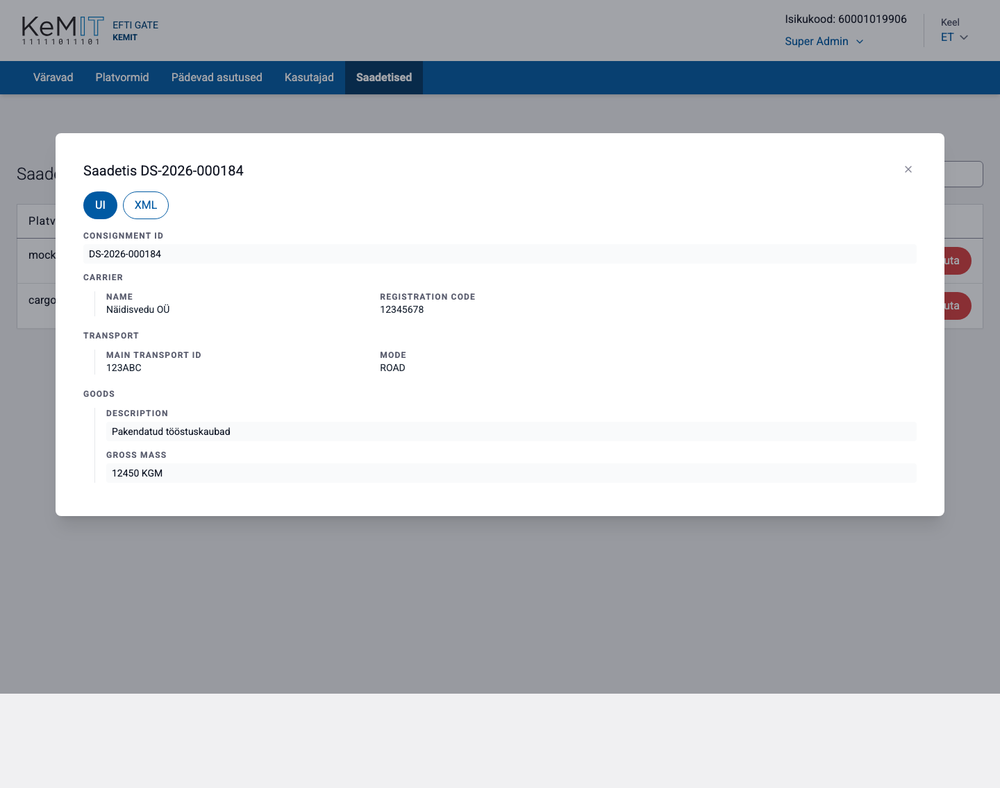

- **QR code:** choose *View QR code*. The code carries the consignment's UIL, built from the gate,
  platform and dataset identifiers ([UIL](../data/uil.md)).

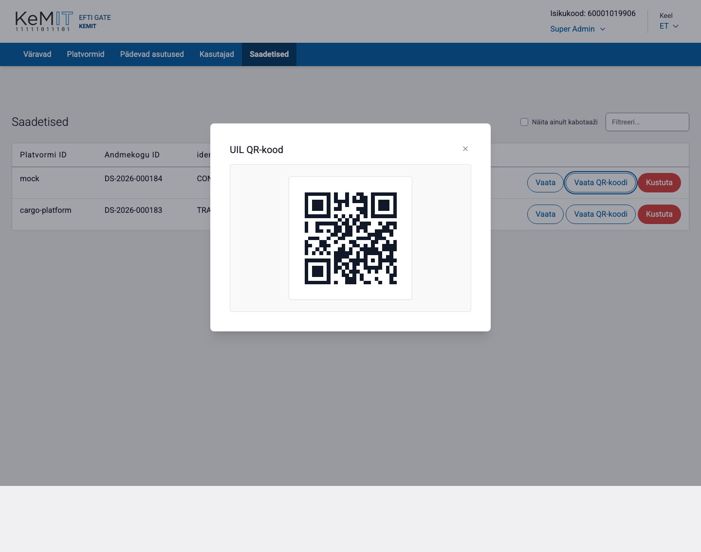

- **Delete:** choose *Delete* and confirm. The data model is append-only: deleting in the UI adds a
  new "deleted" version and does not overwrite history.

## Related

- The same actions on the API, with real responses: [Manage the gate](../use-cases/administrator.md).
- Design of the UI: [Admin UI](../architecture/user-interfaces/admin_ui.md).
- Next: [Gate administrator](./administrator.md).
