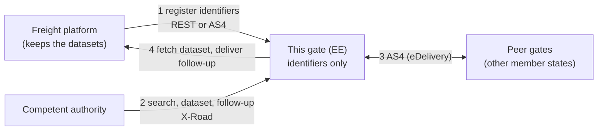

# Find your path

The rest of the book is organised by kind of document (use cases, architecture, API reference). This
part is organised by **who you are**. Each role page gives you a goal, the pages to read in order,
and the facts that only matter to that role. It does not repeat the reference: it points to it.

| You are | Your goal | Start here |
|---|---|---|
| **Deciding** whether and how to run or join a gate | Know what the gate is, what you still own, and what is not production-ready | [Decision maker](./decision-maker.md) |
| A **competent authority** integrating its information system | Search, retrieve datasets and send follow-ups over X-Road | [Competent authority](./authority.md) |
| A **freight platform** developer | Register consignments and answer the gate's calls | [Freight platform](./platform-developer.md) |
| The operator of **another member state's gate** | Exchange AS4 messages with this gate | [Peer gate](./peer-gate-operator.md) |
| A **gate administrator** | Manage users, read the registries, change them, check consignments and the audit log | [Gate administrator](./administrator.md) |
| **Deploying** a gate | Install it in an environment with real secrets | [Deployer](./deployer.md) |
| **Operating** a gate | Keep it healthy and recover from failures | [Operator](./operator.md) |
| A **developer of the gate** | Change the code with the checks green | [Gate developer](./developer.md) |

Terms such as UIL, subset, FTI004 and registry are defined in the [Glossary](../reference/glossary.md).

## The four corners, briefly

eFTI describes four parties. This gate sits in the middle of them.

1. A platform tells its gate which consignments it carries. The gate stores identifiers and a little
   searchable metadata. The dataset stays at the platform.
2. An authority asks its national gate. The gate answers from its own register.
3. When the identifier is not local, or the UIL names another country, the gate asks the peer gate
   over AS4.
4. The gate that owns the UIL fetches the dataset from the platform, filtered to the subsets the
   authority may see, and delivers follow-up messages to it.

## How the roles relate

| Role | Needs from | Gives to |
|---|---|---|
| Authority | A registry entry (`registryCode`, `subsets`) made by the gate administrator | Requests and `X-Road-Client` identity |
| Platform | A registry entry with an `apiKey`, a reachable `baseUrl` | Identifiers; datasets on demand |
| Peer gate | A registry entry with `eDeliveryUrl` and certificate, and our certificate in its registry | AS4 messages |
| Administrator | A first administrator inserted by the deployer | Registry changes, user management |
| Deployer | Secrets, keystore, registry content | A running gate for everyone above |

Nothing in this part replaces the [API reference](../api/index.md) or the
[Permissions matrix](../data/permissions.md). Where a role page and the reference disagree, the
reference wins; please report it.
