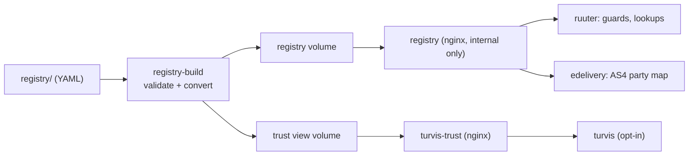

# Change the registry

> **Goal:** you can add, change, disable and remove a gate, a platform or an authority, and know the
> change is live.

The gate knows its partners from three folders of YAML files in `registry/`: `gates/`, `platforms/`
and `authorities/`. There is no admin API that writes them and no database table behind them. The
admin UI shows them read-only. Background and rationale:
[ADR-011](../architecture/decisions/011-registries-as-signed-config.md). The complete field
reference is [`registry/README.md`](https://github.com/kemit-ee/efti-gate-ee/blob/dev/registry/README.md).

## The procedure, for all three

1. **Write or edit the file** `registry/<type>/<id>.yml`. The file name minus `.yml` must equal the
   `id` field. The `id` is plain ASCII (`A-Za-z0-9._-`, at most 64 characters, first character a
   letter or digit).
2. **Quote anything YAML would turn into a number or boolean**: `registryCode: '70000099'`,
   `countryCode: 'NO'`. Every scalar must be a string, because the gate compares with `===`.
3. **Review it like code** (pull request). Platform files contain a live key; handle them as
   secrets ([Deployer](./deployer.md#registry-in-production)).
4. **Apply it** by re-running the one-shot `registry-build`. It validates every file and publishes
   the documents; nothing is rebuilt:

   ```bash
   docker compose up -d registry-build            # one gate
   # in local/:  docker compose --env-file gates/g1.env up -d registry-build
   ```

   In Kubernetes the same step is the init container: update the ConfigMap (gates, authorities,
   trust anchors) or Secret (platforms) and restart the pod. `docker compose restart registry`
   alone changes nothing.
5. **Check it took effect.** `registry` serves the change at once. `edelivery` picks up a gate or
   platform within `REGISTRY_REFRESH_SECONDS` (default 10). With the Turvis profile, also reload
   its trust view: `docker compose kill -s HUP turvis`.

> **Fail-closed.** If any file is invalid, `registry-build` names the file and field, exits
> non-zero and publishes nothing. `registry`, `ruuter` and `edelivery` then do not start on a fresh
> start. The previously published documents stay in place on a running system. Read the
> `registry-build` container log first. A gate certificate that has expired or is not yet valid also
> fails the build, even for a `DISABLED` gate.

## Gates

`registry/gates/<id>.yml`: a peer gate, or this gate's own entry.

```yaml
id: LV-EXAMPLE                # equals the file name
countryCode: LV               # ISO 3166-1 alpha-2, upper case
eDeliveryUrl: https://example.invalid/services/msh
eDeliveryCert: |
  -----BEGIN CERTIFICATE-----
  ...
  -----END CERTIFICATE-----
status: ONLINE                # or DISABLED
```

| Field | Required | Notes |
|---|---|---|
| `id`, `countryCode`, `eDeliveryUrl`, `status` | yes | |
| `eDeliveryCert` | no | Without it the gate is left out of the AS4 party map and the Turvis view |
| `tlsCert` | no | Needed only when the peer's HTTPS is not signed by a CA the JVM trusts |
| `allowedChainAnchors` | no | Turvis chain-of-trust mode: aliases of `registry/trust-anchors/<alias>.pem`. Absent means certificate pinning |

The step-by-step connection, including the certificate exchange, is in
[Peer gate](./peer-gate-operator.md#connect).

## Platforms

`registry/platforms/<id>.yml`: a freight platform.

```yaml
id: acme-freight
baseUrl: https://platform.example.invalid/api
headers:
  X-Api-Key: the-platforms-own-key-for-calls-from-the-gate
status: ONLINE
apiKey: the-key-the-platform-sends-to-the-gate     # plaintext, unique across platforms
```

| Field | Required | Notes |
|---|---|---|
| `id`, `baseUrl`, `status` | yes | |
| `apiKey` | no | The `X-Api-Key` the platform presents. Without it the platform cannot use the REST upload. A key shared by two files fails the build |
| `headers` | no | Headers the gate sends **to** the platform |
| `eDeliveryCert`, `tlsCert` | no | A platform with `eDeliveryCert` is called over AS4 instead of REST |

- **Rotate a key:** change `apiKey`, re-run `registry-build`, hand the new key to the operator
  out of band. The old key stops working at once. There is no endpoint that issues keys.
- **Pause a platform without losing its configuration:** `status: DISABLED`. Its key no longer
  authenticates and requests for its datasets are answered as "Platform Not Found".

The platform side of the agreement is in [Freight platform](./platform-developer.md#get-registered).

## Authorities

`registry/authorities/<id>.yml`: a competent authority. There is no `status`.

```yaml
id: auth-example
name: Example Transport Inspectorate
registryCode: '70000123'          # the X-Road memberCode, as a string
subsets:
  - EU01
  - EU02
```

- **Add:** create the file. **Revoke:** delete it. The authority then gets `403`.
- **Entitle to nothing:** `subsets: []`. An empty list is kept and means no subsets.
- **Two files with one `registryCode`** are denied as ambiguous. Do not do it.
- **Review the whole list when changing subsets**, not only the value you add or remove, and give
  only the subsets the authority needs. See [eFTI subsets](../data/subsets.md).

The authority side is in [Competent authority](./authority.md#get-registered-and-connected).

## Disable, remove, and what stays

| Want | Do | Effect |
|---|---|---|
| Stop a gate or platform temporarily | `status: DISABLED` | Excluded from search fan-out, cannot authenticate, forwarding answers not found, left out of the AS4 party map |
| Remove an entity | Delete the file | Lookups 404 and guards deny. The id can be reused. Only git history records it |
| Revoke an authority | Delete the file | Immediate `403` after the build |

## Common mistakes

| Symptom | Cause |
|---|---|
| `registry-build` exits non-zero | The log names the file and the field. Typical: an unquoted number, a file name that differs from `id`, a stray `.yaml` or `.json`, a duplicate `apiKey`, a bad PEM |
| An authority gets `403` after you added it | `registryCode` is not a string, or does not equal the `memberCode` of its X-Road client |
| A manual `GET /gates/EU-EE.json` returns 404 | Per-entity files use the lower-cased id: `/gates/eu-ee.json`. The gate itself matches any case |
| A peer is not used | `DISABLED`, or no `eDeliveryCert`, so it is not in the party map |

## Where the registry lives in the running system



The `registry` service serves plaintext platform keys, so it has no published port and must never be
exposed. See [Registry documents](../api/internal/registry.md) and
[Registry management](../architecture/registry-management/index.md).
