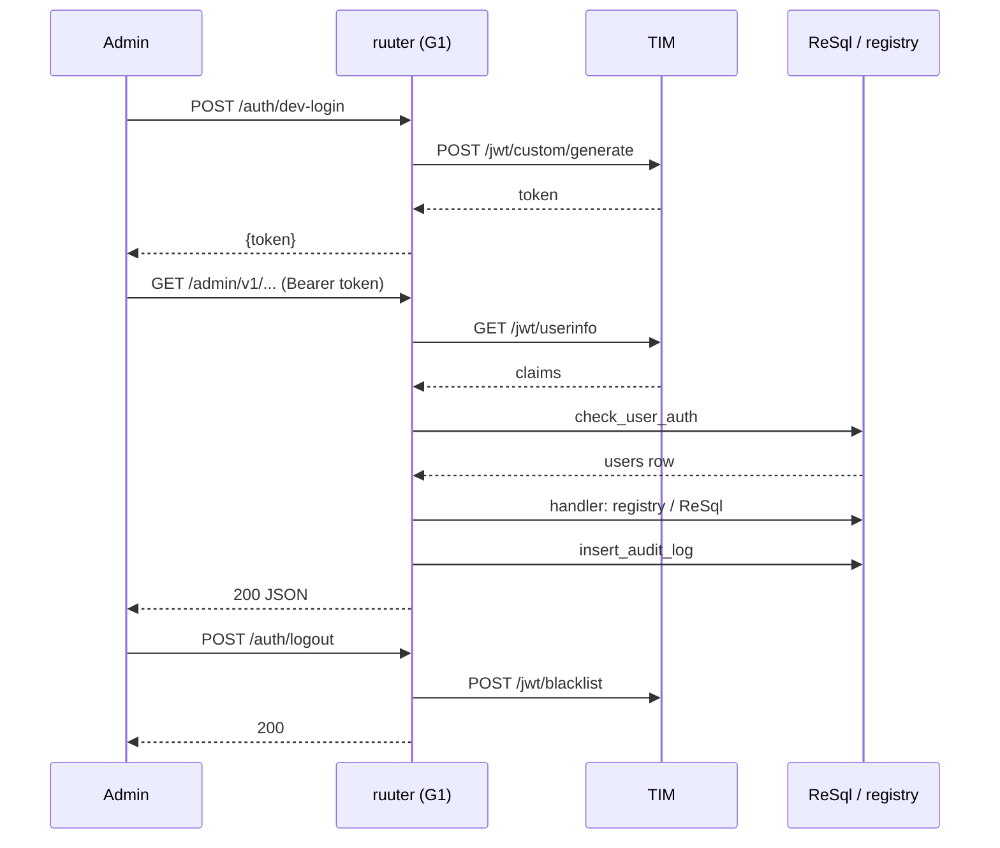

# An administrator manages the gate

**Goal:** an administrator of G1 logs in, checks the gate's own entry and the registries, gives
a colleague access, takes it away again, looks at the registered consignments and the audit log,
and logs out.

**Actors:**

- the administrator (dev admin, personal code `60001019906`, public in the repository)
- a colleague (personal code `38505050039`, created in step 5)
- the admin UI or, here, curl
- G1 ruuter (`http://127.0.0.1:27086`), with TIM and ReSql behind it

In a deployment the UI does step 1 through TARA ([`POST /auth/callback`](../api/admin/auth.md#post-authcallback)).
Locally [`POST /auth/dev-login`](../api/admin/auth.md#post-authdev-login) stands in for TARA. All
requests below were run in one sequence against the local stack.



Every admin call runs the same guard: TIM checks the token, ReSql checks the user row, then the
handler runs and writes an audit row. See [Administrators](../api/admin/index.md#identity-model).

## 1. Log in

```bash
curl -s -i -X POST http://127.0.0.1:27086/auth/dev-login \
  -H 'Content-Type: application/json' \
  -d '{"personalCode":"60001019906","firstName":"Super","lastName":"Admin"}'
```

```http
HTTP/1.1 200 OK
content-type: application/json
content-length: 723

{"token":"eyJ…"}
```

```bash
TOKEN=eyJ…   # the token from the response
```

## 2. Check who is logged in

```bash
curl -s -i http://127.0.0.1:27086/auth/user -H "Authorization: Bearer $TOKEN"
```

```http
HTTP/1.1 200 OK
content-type: application/json
content-length: 90

{"id":"11111111-1111-1111-1111-111111111111","name":"Super Admin","taraSub":"60001019906"}
```

## 3. Look at the own gate

```bash
curl -s -i http://127.0.0.1:27086/admin/v1/gates/own -H "Authorization: Bearer $TOKEN"
```

```http
HTTP/1.1 200 OK
content-type: application/json
content-length: 1234
{"countryCode":"XA","eDeliveryCert":"-----BEGIN CERTIFICATE-----\n…\n-----END CERTIFICATE-----\n","eDeliveryUrl":"http://g1-edelivery:8081/services/msh","id":"G1","status":"ONLINE"}
```

The certificate is the one peers check on AS4 messages from G1. See
[Gates, platforms, authorities](../api/admin/registries.md#get-adminv1gatesown).

## 4. Look at the registries

```bash
curl -s http://127.0.0.1:27086/admin/v1/gates -H "Authorization: Bearer $TOKEN"
curl -s http://127.0.0.1:27086/admin/v1/platforms -H "Authorization: Bearer $TOKEN"
curl -s http://127.0.0.1:27086/admin/v1/authorities/auth-xroad-test -H "Authorization: Bearer $TOKEN"
```

Reduced to the interesting fields:

```text
gates:      [('G1', 'ONLINE'), ('G2', 'ONLINE')]
platforms:  [('mock', 'ONLINE', hasApiKey=True), ('mock-edelivery', 'ONLINE', hasApiKey=False)]
```

```json
{"id":"auth-xroad-test","name":"X-Road Test Authority","registryCode":"70000099","subsets":["EU01"]}
```

The registries are read-only. A change means editing `registry/*.yml` and rebuilding the
`registry` image (ADR-011).

## 5. Give a colleague access

```bash
curl -s -i -X POST http://127.0.0.1:27086/admin/v1/users \
  -H "Authorization: Bearer $TOKEN" -H 'Content-Type: application/json' \
  -d '{"taraSub":"38505050039","name":"Mari Maasikas"}'
```

```http
HTTP/1.1 201 Created
content-type: application/json
content-length: 223

{"createdAt":"2026-11-03T16:05:45.667150Z","id":"da78ba38-1ac6-4b32-80eb-686484f6f304","isUserActive":true,"name":"Mari Maasikas","rowId":"0caab8e4-0e4f-4d65-a545-0bcc27a91e76","taraSub":"38505050039","tokenRevokedAt":null}
```

The colleague now has full admin access; there are no roles. See [Users](../api/admin/users.md).

## 6. The colleague logs in

```bash
COLLEAGUE=$(curl -s -X POST http://127.0.0.1:27086/auth/dev-login \
  -H 'Content-Type: application/json' \
  -d '{"personalCode":"38505050039","firstName":"Mari","lastName":"Maasikas"}' \
  | python3 -c 'import json,sys; print(json.load(sys.stdin)["token"])')
curl -s -o /dev/null -w '%{http_code}\n' http://127.0.0.1:27086/admin/v1/gates/own \
  -H "Authorization: Bearer $COLLEAGUE"
```

```text
200
```

## 7. Revoke the colleague's tokens

```bash
curl -s -i -X POST http://127.0.0.1:27086/admin/v1/users/revoke-token/da78ba38-1ac6-4b32-80eb-686484f6f304 \
  -H "Authorization: Bearer $TOKEN"
```

```http
HTTP/1.1 204 No Content
content-type: application/json
content-length: 2

```

The `content-length: 2` on a 204 is a [known issue](../reference/known-issues.md).

## 8. The colleague's token no longer works

```bash
curl -s -i http://127.0.0.1:27086/admin/v1/gates/own -H "Authorization: Bearer $COLLEAGUE"
```

```http
HTTP/1.1 401 Unauthorized
content-type: application/problem+json
content-length: 173

{"detail":"Token is missing, invalid, expired, or the user has no active gate account.","status":401,"title":"Unauthorized","type":"https://api.efti.ee/errors/unauthorized"}
```

The user row now carries the revocation time:

```bash
curl -s http://127.0.0.1:27086/admin/v1/users/da78ba38-1ac6-4b32-80eb-686484f6f304 \
  -H "Authorization: Bearer $TOKEN"
```

```json
{"createdAt":"2026-11-03T16:05:45.923473Z","id":"da78ba38-1ac6-4b32-80eb-686484f6f304","isUserActive":true,"name":"Mari Maasikas","rowId":"93261b0a-7151-4338-888a-a2829df6b443","taraSub":"38505050039","tokenRevokedAt":"2026-11-03T16:05:45.923473Z"}
```

The colleague is still an administrator and can log in again. To remove the access for good, use
[`DELETE /admin/v1/users/{id}`](../api/admin/users.md#delete-adminv1usersid).

## 9. Look at the consignments

```bash
curl -s "http://127.0.0.1:27086/admin/v1/consignments?limit=1" -H "Authorization: Bearer $TOKEN"
```

Shortened (`xml` cut):

```json
[{"acceptanceCountry":null,"acceptanceDate":null,"carriedEquipmentCategories":[],"carriedEquipmentIds":[],"carriedEquipmentSeq":[],"createdAt":"2026-11-03T16:04:03.528827Z","dangerousGoods":null,"datasetId":"f8e61aaf-ad38-4875-935d-b155dc47c6e7","deliveryCountry":null,"deliveryDate":null,"gateId":"G1","loadingCountry":null,"loadingDate":null,"mainTransportId":"DOC-E-001","mainTransportType":null,"platformId":"mock","rowId":"aa400902-8fcf-4388-8a56-2d8dfb1e6307","status":"ACTIVE","transportMode":null,"transportRegCountry":null,"unloadingCountry":null,"unloadingDate":null,"usedEquipmentCategories":[],"usedEquipmentCountries":[],"usedEquipmentIds":[],"usedEquipmentSeq":[],"xml":"<ParameterIDSetCriteria><MainCarriageTransportMeansIDParamet…"}]
```

And the counts (from the read model, refreshed by the `refresh-read-models` job):

```bash
curl -s http://127.0.0.1:27086/admin/v1/consignment-counts -H "Authorization: Bearer $TOKEN"
```

```json
[{"consignmentCount":39,"createdAt":"2026-11-03T16:02:37.038267Z","gateId":"G1","generation":5,"platformId":"mock","status":"ACTIVE"}]
```

The counts are only as fresh as the last refresh; before the first refresh they are `[]`. See
[Consignments](../api/admin/consignments.md#read-models-counts-and-summary).

## 10. Check the audit log

Everything that happened to the colleague's user:

```bash
curl -s "http://127.0.0.1:27086/admin/v1/audit?resource=user&resourceId=da78ba38-1ac6-4b32-80eb-686484f6f304" \
  -H "Authorization: Bearer $TOKEN"
```

```json
[{"action":"user.read","details":{"user_id":"da78ba38-1ac6-4b32-80eb-686484f6f304"},"ipAddress":null,"recordedAt":"2026-11-03T16:05:46.062056Z","resource":"user","resourceId":"da78ba38-1ac6-4b32-80eb-686484f6f304","rowId":"3506a110-3436-411b-bd44-bc8a7ca218c2","userId":"11111111-1111-1111-1111-111111111111"},{"action":"user.revoke_token","details":{"user_id":"da78ba38-1ac6-4b32-80eb-686484f6f304"},"ipAddress":null,"recordedAt":"2026-11-03T16:05:45.943212Z","resource":"user","resourceId":"da78ba38-1ac6-4b32-80eb-686484f6f304","rowId":"c301d439-2568-4b53-be91-d8057a8f85cd","userId":"11111111-1111-1111-1111-111111111111"},{"action":"user.create","details":{"after":{"createdAt":"2026-11-03T16:05:45.667150Z","id":"da78ba38-1ac6-4b32-80eb-686484f6f304","isUserActive":true,"name":"Mari Maasikas","rowId":"0caab8e4-0e4f-4d65-a545-0bcc27a91e76","taraSub":"38505050039","tokenRevokedAt":null},"before":null,"user_id":"da78ba38-1ac6-4b32-80eb-686484f6f304"},"ipAddress":null,"recordedAt":"2026-11-03T16:05:45.676650Z","resource":"user","resourceId":"da78ba38-1ac6-4b32-80eb-686484f6f304","rowId":"e486b496-49f1-4ac3-8e18-7510aaf9be6c","userId":"11111111-1111-1111-1111-111111111111"}]
```

Newest first: the read in step 8, the revocation in step 7, the creation in step 5, each with the
acting admin in `userId`. See [Audit log](../api/admin/audit.md).

## 11. Log out

```bash
curl -s -i -X POST http://127.0.0.1:27086/auth/logout -H "Authorization: Bearer $TOKEN"
```

```http
HTTP/1.1 200 OK
content-type: application/json
content-length: 24

{"message":"logged out"}
```

## 12. The token is dead

```bash
curl -s -i http://127.0.0.1:27086/auth/user -H "Authorization: Bearer $TOKEN"
```

```http
HTTP/1.1 401 Unauthorized
content-type: application/problem+json
content-length: 173

{"detail":"Token is missing, invalid, expired, or the user has no active gate account.","status":401,"title":"Unauthorized","type":"https://api.efti.ee/errors/unauthorized"}
```

## Notes

- The colleague's personal code must be unique among active users: a second `POST` with
  `38505050039` answers 409.
- The admin cannot delete their own account (400) but can revoke their own tokens.
- All other admin endpoints: [Administrators](../api/admin/index.md#all-endpoints). Who may call
  what: [Permissions matrix](../data/permissions.md).
