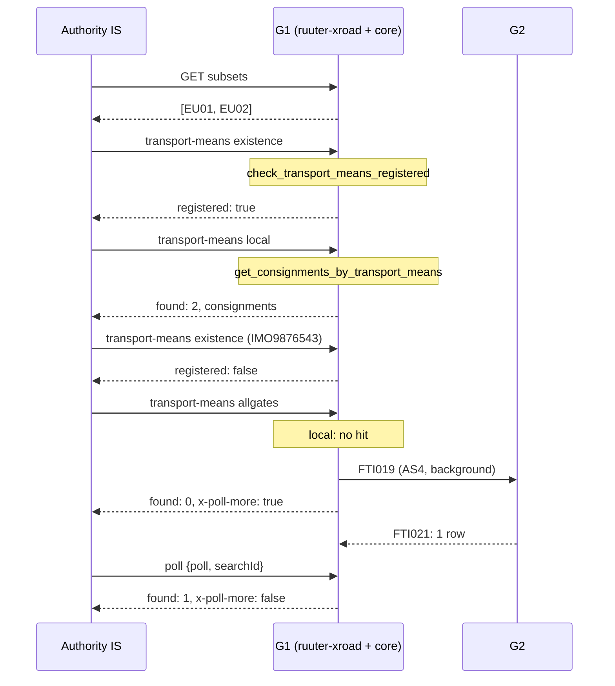

# An authority checks a transport means

**Goal.** An officer at the roadside or at a port has a plate, an IMO number or a container
number. The authority's system asks the gate: is it known, and which consignments does it carry?
Then it asks the other gates for an identifier this gate does not hold.

**Actors.**

| Actor | Here |
|---|---|
| Competent authority | `auth-xroad-tm`, `X-Road-Client: DEV/GOV/70000093/ants`, subsets `EU01`, `EU02` (dev fixture, public in the repo) |
| The gate asked | G1, `http://127.0.0.1:27087/xroad` |
| Peer gate | G2, asked over AS4 by G1 |

The route is [`transport-means`](../api/authorities/transport-means.md). It needs `EU02`.



## Steps

### 1. Check the entitlement

```bash
curl -i http://127.0.0.1:27087/xroad/provide/v1/subsets \
  -H 'X-Road-Client: DEV/GOV/70000093/ants' \
  -H "X-Road-Id: $(cat /proc/sys/kernel/random/uuid)"
```

```http
HTTP/1.1 200 OK
content-type: application/json

{"authorityId":"auth-xroad-tm","registryCode":"70000093","subsets":["EU01","EU02"]}
```

`EU02` is in the list, so `transport-means` is allowed. Cache this answer.

### 2. Is the plate known? (existence)

The cheapest question: one boolean, nothing else.

```bash
curl -i -X POST http://127.0.0.1:27087/xroad/provide/v1/transport-means \
  -H 'Content-Type: application/json' \
  -H 'X-Road-Client: DEV/GOV/70000093/ants' \
  -H "X-Road-Id: $(cat /proc/sys/kernel/random/uuid)" \
  -d '{"identifier":"TST-001","scope":"existence"}'
```

```http
HTTP/1.1 200 OK
content-type: application/json

{"countryCode":"","identifier":"TST-001","registered":true,"scope":"existence"}
```

### 3. What does it carry? (local)

```bash
curl -i -X POST http://127.0.0.1:27087/xroad/provide/v1/transport-means \
  -H 'Content-Type: application/json' \
  -H 'X-Road-Client: DEV/GOV/70000093/ants' \
  -H "X-Road-Id: $(cat /proc/sys/kernel/random/uuid)" \
  -d '{"identifier":"TST-001","scope":"local"}'
```

```http
HTTP/1.1 200 OK
content-type: application/json

{"consignments":[{"acceptanceCountry":"EE","acceptanceDate":"2026-11-03T00:00:00Z",…,"mainTransportId":"TST-001","mainTransportType":"31","status":"ACTIVE","transportMode":"3","transportRegCountry":"EE","uil":{"datasetId":"11111111-0000-4000-8000-000000000005","gateId":"G1","platformId":"mock"},"unloadingCountry":"FI",…},{"acceptanceCountry":"EE","acceptanceDate":"2026-11-01T00:00:00Z",…,"dangerousGoods":"1","deliveryCountry":"LV",…,"uil":{"datasetId":"11111111-0000-4000-8000-000000000001","gateId":"G1","platformId":"mock"},…}],"countryCode":"","found":2,"identifier":"TST-001","scope":"local"}
```

Two trips of the same truck. Each `uil` can be passed to
[`dataset`](../api/authorities/dataset.md); see
[An authority retrieves a dataset](./authority-retrieves-dataset.md). The same works for a
container number (`CONT-100`, `CONT-200`): the gate also matches used and carried equipment.

### 4. A vessel this gate does not know

```bash
curl -i -X POST http://127.0.0.1:27087/xroad/provide/v1/transport-means \
  -H 'Content-Type: application/json' \
  -H 'X-Road-Client: DEV/GOV/70000093/ants' \
  -H "X-Road-Id: $(cat /proc/sys/kernel/random/uuid)" \
  -d '{"identifier":"IMO9876543","scope":"existence"}'
```

```http
HTTP/1.1 200 OK
content-type: application/json

{"countryCode":"","identifier":"IMO9876543","registered":false,"scope":"existence"}
```

`existence` and `local` never leave the gate. To ask the other gates, use `allgates`.

### 5. Ask all gates

Keep the `X-Road-Id`: it is the `searchId`.

```bash
SID=$(cat /proc/sys/kernel/random/uuid)
curl -i -X POST http://127.0.0.1:27087/xroad/provide/v1/transport-means \
  -H 'Content-Type: application/json' \
  -H 'X-Road-Client: DEV/GOV/70000093/ants' \
  -H "X-Road-Id: $SID" \
  -d '{"identifier":"IMO9876543","scope":"allgates"}'
```

```http
HTTP/1.1 200 OK
content-type: application/json
x-poll-more: true
x-search-id: c94010e9-3c0b-4a00-a631-c2baf67faab2

{"consignments":[],"countryCode":"","found":0,"identifier":"IMO9876543","scope":"allgates"}
```

The gate found nothing locally, sent FTI019 to G2 in the background, and answered at once.

### 6. Collect the answer

A new `X-Road-Id`, the `searchId` from step 5. Repeating `identifier` keeps it in the answer
(otherwise it comes back as `""`, a [known issue](../reference/known-issues.md)).

```bash
curl -i -X POST http://127.0.0.1:27087/xroad/provide/v1/transport-means \
  -H 'Content-Type: application/json' \
  -H 'X-Road-Client: DEV/GOV/70000093/ants' \
  -H "X-Road-Id: $(cat /proc/sys/kernel/random/uuid)" \
  -d "{\"poll\":true,\"searchId\":\"$SID\",\"identifier\":\"IMO9876543\"}"
```

```http
HTTP/1.1 200 OK
content-type: application/json
x-poll-more: false

{"consignments":[{"acceptanceCountry":null,"acceptanceDate":null,"carriedEquipmentCategories":[],"carriedEquipmentIds":[],"createdAt":null,"dangerousGoods":null,"deliveryCountry":null,"deliveryDate":null,"loadingCountry":null,"loadingDate":null,"mainTransportId":"IMO9876543","mainTransportType":null,"status":null,"transportMode":null,"transportRegCountry":null,"uil":{"datasetId":"22222222-0000-4000-8000-000000000004","gateId":"G2","platformId":"mock"},"unloadingCountry":null,"unloadingDate":null,"usedEquipmentCategories":[],"usedEquipmentCountries":[],"usedEquipmentIds":[]}],"countryCode":"","found":1,"identifier":"IMO9876543","scope":"allgates"}
```

`x-poll-more: false`: all gates have answered. The row from G2 carries only `uil` and
`mainTransportId`. For the content, call `dataset` with this `uil`; G1 fetches it from G2.

If `x-poll-more` had been `true`, the next poll would wait up to about 30 s for the result.

### 7. An authority without EU02

```bash
curl -i -X POST http://127.0.0.1:27087/xroad/provide/v1/transport-means \
  -H 'Content-Type: application/json' \
  -H 'X-Road-Client: DEV/GOV/70000099/testSubsystem' \
  -H "X-Road-Id: $(cat /proc/sys/kernel/random/uuid)" \
  -d '{"identifier":"TST-001","scope":"existence"}'
```

```http
HTTP/1.1 403 Forbidden
content-type: application/json

{"authorityId":"auth-xroad-test","code":"FORBIDDEN_SUBSET","deniedSubsets":["EU02"],"detail":"A transport-means lookup returns means-of-transport data (EU02), which this authority is not permitted to access.","permittedSubsets":["EU01"],"status":403,"title":"Subset Access Denied","type":"https://api.efti.ee/errors/forbidden-subset"}
```

Even the bare boolean is EU02 data. Such an authority can still use
[`search`](../api/authorities/search.md), which has no subset check.

## The other direction

The same steps work at G2 (`http://127.0.0.1:28087/xroad`) with `IMO9321483`, which only G1
holds; the poll returns the G1 row `11111111-0000-4000-8000-000000000003`
([transport-means](../api/authorities/transport-means.md#allgates-g2-asks-g1)).

## Notes

- With `allgates`, a local hit answers at once and the other gates are not asked: `TST-001` with
  `allgates` at G1 returns G1's two rows only, although G2 holds a third trip.
- A container id found in `allgates` is matched on other gates only as a main transport means
  (FTI019 has no OR criterion), so `CONT-400`, carried at G2, is not found from G1.
- Postman: folder **1. CA -> Gate / Transport means (EU02)**.
