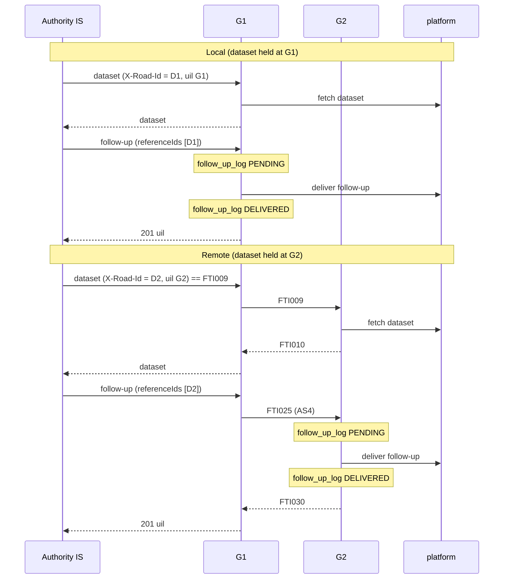

# An authority sends a follow-up

**Goal.** After reading a dataset, the authority has a question for the platform that holds it
("please send the air waybill number"). It sends a follow-up through the gate, referring to its
dataset request. The gate delivers it to the platform, or to the gate that holds the dataset.

**Actors.**

| Actor | Here |
|---|---|
| Competent authority | `auth-xroad-tm`, `X-Road-Client: DEV/GOV/70000093/ants` (dev fixture, public in the repo). No subset is needed for a follow-up. |
| Gates | G1 (`127.0.0.1:27087`), G2 (`127.0.0.1:28087`) |
| Platform | `mock` on each gate |

Routes: [`dataset`](../api/authorities/dataset.md), [`follow-up`](../api/authorities/follow-up.md).



## Steps

### 1. Request the dataset and keep its X-Road-Id

```bash
D1=$(cat /proc/sys/kernel/random/uuid)
curl -i -X POST http://127.0.0.1:27087/xroad/provide/v1/dataset \
  -H 'Content-Type: application/json' \
  -H 'X-Road-Client: DEV/GOV/70000093/ants' \
  -H "X-Road-Id: $D1" \
  -d '{"uil":{"datasetId":"11111111-0000-4000-8000-000000000004","gateId":"G1","platformId":"mock"},"subsets":["EU01"]}'
```

```http
HTTP/1.1 200 OK
content-type: application/json

{"consignment":{"grossWeightMeasure":"15000.00",…},"subsets":["EU01"],"uil":{"datasetId":"11111111-0000-4000-8000-000000000004","gateId":"G1","platformId":"mock"},"xml":"<SpecifiedSupplyChainConsignment\n    xmlns:rsm=\"urn:eu:move:eFTI:data:standard:FTI010GetCmdsRe…"}
```

`D1` was `4e14c998-2580-4d2d-bf22-f4b86ff20509` in this run.

### 2. Send the follow-up (local)

Same `uil`, `referenceIds` = `[D1]`, a new `X-Road-Id`.

```bash
curl -i -X POST http://127.0.0.1:27087/xroad/provide/v1/follow-up \
  -H 'Content-Type: application/json' \
  -H 'X-Road-Client: DEV/GOV/70000093/ants' \
  -H "X-Road-Id: $(cat /proc/sys/kernel/random/uuid)" \
  -d "{\"uil\":{\"datasetId\":\"11111111-0000-4000-8000-000000000004\",\"gateId\":\"G1\",\"platformId\":\"mock\"},
       \"referenceIds\":[\"$D1\"],
       \"message\":\"Please send the air waybill number.\"}"
```

```http
HTTP/1.1 201 Created
content-type: application/json

{"datasetId":"11111111-0000-4000-8000-000000000004","gateId":"G1","platformId":"mock"}
```

### 3. See what the gate recorded

The `X-Road-Id` of step 2 (`3a3e60a9-…` in this run) is the `query_id`:

```bash
docker exec efti-g1-database psql -U efti efti -c \
  "select requesting_gate_id, destination_platform_id, dataset_request_id, status, payload
     from follow_up_log where query_id='3a3e60a9-37b3-453b-b504-a2fbff44ebcf' order by revision"
```

```text
 requesting_gate_id | destination_platform_id |          dataset_request_id          |  status   |               payload
--------------------+-------------------------+--------------------------------------+-----------+-------------------------------------
 G1              | mock                    | 11111111-0000-4000-8000-000000000004 | PENDING   | Please send the air waybill number.
 G1              | mock                    | 11111111-0000-4000-8000-000000000004 | DELIVERED | Please send the air waybill number.
```

### 4. A dataset at another gate

```bash
D2=$(cat /proc/sys/kernel/random/uuid)
curl -i -X POST http://127.0.0.1:27087/xroad/provide/v1/dataset \
  -H 'Content-Type: application/json' \
  -H 'X-Road-Client: DEV/GOV/70000093/ants' \
  -H "X-Road-Id: $D2" \
  -d '{"uil":{"datasetId":"22222222-0000-4000-8000-000000000004","gateId":"G2","platformId":"mock"},"subsets":["EU01"]}'
```

```http
HTTP/1.1 200 OK
content-type: application/json

{"consignment":{"grossWeightMeasure":"15000.00",…},"subsets":["EU01"],"uil":{"datasetId":"22222222-0000-4000-8000-000000000004","gateId":"G2","platformId":"mock"},"xml":"<SpecifiedSupplyChainConsignment xmlns:udt=\"urn:eu:move:eFTI:data:standard:UnqualifiedDataType:…"}
```

### 5. Send the follow-up (remote)

```bash
FID=$(cat /proc/sys/kernel/random/uuid)
curl -i -X POST http://127.0.0.1:27087/xroad/provide/v1/follow-up \
  -H 'Content-Type: application/json' \
  -H 'X-Road-Client: DEV/GOV/70000093/ants' \
  -H "X-Road-Id: $FID" \
  -d "{\"uil\":{\"datasetId\":\"22222222-0000-4000-8000-000000000004\",\"gateId\":\"G2\",\"platformId\":\"mock\"},
       \"referenceIds\":[\"$D2\"],
       \"message\":\"Please confirm the container seal numbers.\"}"
```

```http
HTTP/1.1 201 Created
content-type: application/json

{"datasetId":"22222222-0000-4000-8000-000000000004","gateId":"G2","platformId":"mock"}
```

G1 sent FTI025 to G2. G2's edelivery log for this id (`b5b5dc9c-…` in this run):

```text
"message":"Handling 'FTI025LodgeFollowUpCommRequest' from G1:b5b5dc9c-e185-4b0c-a8f3-bf2ec6805fa9:G2"
"message":"POST http://ruuter:8086/efti/api/v1/follow-up-xml in 125ms - 201"
```

G2 recorded it (`docker exec efti-g2-database psql …`, same query as step 3):

```text
 requesting_gate_id | destination_platform_id |          dataset_request_id          |  status   |                  payload
--------------------+-------------------------+--------------------------------------+-----------+--------------------------------------------
 G2              | mock                    | 22222222-0000-4000-8000-000000000004 | PENDING   | Please confirm the container seal numbers.
 G2              | mock                    | 22222222-0000-4000-8000-000000000004 | DELIVERED | Please confirm the container seal numbers.
```

G1 keeps no `follow_up_log` row for a follow-up it forwarded.

### 6. A retry with the same X-Road-Id

```bash
curl -i -X POST http://127.0.0.1:27087/xroad/provide/v1/follow-up \
  -H 'Content-Type: application/json' \
  -H 'X-Road-Client: DEV/GOV/70000093/ants' \
  -H "X-Road-Id: $FID" \
  -d "{\"uil\":{\"datasetId\":\"22222222-0000-4000-8000-000000000004\",\"gateId\":\"G2\",\"platformId\":\"mock\"},
       \"referenceIds\":[\"$D2\"],
       \"message\":\"Please confirm the container seal numbers.\"}"
```

```http
HTTP/1.1 409 Conflict
content-type: application/problem+json

{"code":"DUPLICATE_REQUEST_ID","detail":"This X-Road-Id has already been processed. Retry with a new request id if this is a new request.","status":409,"title":"Duplicate Request ID","type":"https://api.efti.ee/errors/duplicate-request-id"}
```

The message is not sent twice. A new follow-up needs a new `X-Road-Id`.

## The other direction

From G2 to G1 the calls are the same with base `http://127.0.0.1:28087/xroad` and an
G1 `uil`; the answer is `201` with the G1 `uil`
([follow-up](../api/authorities/follow-up.md#remote-follow-up-g2--g1)).

## Notes

- Check a `201` body for an `error` key: a failure at this gate's platform (unknown platform,
  platform unreachable, log write failed) is also answered `201`
  ([follow-up](../api/authorities/follow-up.md#notes)).
- `requesting_gate_id` holds the destination gate (`uil.gateId`), and `dataset_request_id` holds
  the dataset id, not `referenceIds`. The authority is not recorded.
- The receiving side of step 5 is described in [A peer gate asks this gate](./peer-gate-request.md).
- Postman: **1. CA -> Gate / Dataset and follow-up / follow-up - remote (peer gate, AS4 FTI025)**
  and **… - local**.
