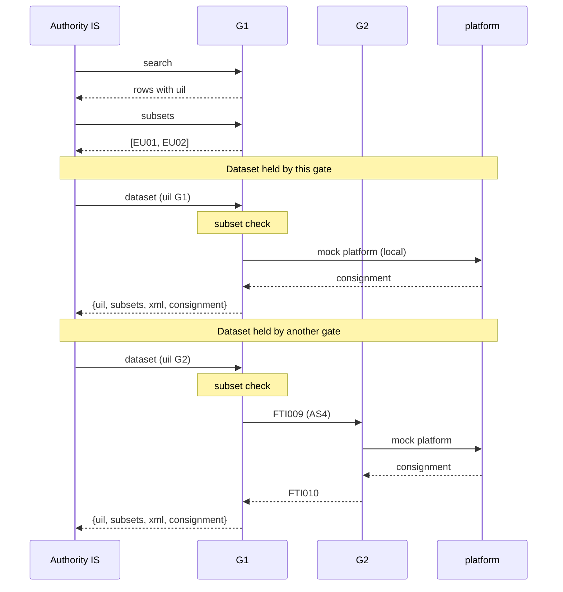

# An authority retrieves a dataset

**Goal.** An authority has found a consignment and wants its content: weights, parties, goods.
It takes the `uil` from a search result and asks for the subsets it is entitled to. The gate that
holds the dataset asks the platform; if that is another gate, the request travels over AS4.

**Actors.**

| Actor | Here |
|---|---|
| Competent authority | `auth-xroad-tm`, `X-Road-Client: DEV/GOV/70000093/ants`, subsets `EU01`, `EU02`; and `auth-xroad-test`, `DEV/GOV/70000099/testSubsystem`, subset `EU01` (dev fixtures, public in the repo) |
| Gates | G1 (`127.0.0.1:27087`), G2 (`127.0.0.1:28087`) |
| Platform | `mock` on each gate (`DSL/Ruuter/mock-platform`), which serves one fixed dataset for every id |

Routes: [`search`](../api/authorities/search.md), [`subsets`](../api/authorities/subsets.md),
[`dataset`](../api/authorities/dataset.md).



## Steps

### 1. Find the consignment

A container number seen on a truck:

```bash
curl -i -X POST http://127.0.0.1:27087/xroad/provide/v1/search \
  -H 'Content-Type: application/json' \
  -H 'X-Road-Client: DEV/GOV/70000093/ants' \
  -H "X-Road-Id: $(cat /proc/sys/kernel/random/uuid)" \
  -d '{"usedEquipmentId":{"operator":"EQ","id":"CONT-100"}}'
```

```http
HTTP/1.1 200 OK
content-type: application/json
x-poll-more: false

[{"acceptanceCountry":"DE","acceptanceDate":"2026-11-01T00:00:00Z","carriedEquipmentCategories":null,"carriedEquipmentIds":null,"createdAt":"2026-11-03T12:03:37.807711Z","dangerousGoods":"0","deliveryCountry":"EE","deliveryDate":"2026-11-03T00:00:00Z","loadingCountry":"DE","loadingDate":"2026-11-01T00:00:00Z","mainTransportId":"TST-002","mainTransportType":"31","status":"ACTIVE","transportMode":"3","transportRegCountry":"DE","uil":{"datasetId":"11111111-0000-4000-8000-000000000002","gateId":"G1","platformId":"mock"},"unloadingCountry":"EE","unloadingDate":"2026-11-03T00:00:00Z","usedEquipmentCategories":["T10"],"usedEquipmentCountries":["DE"],"usedEquipmentIds":["CONT-100"]}]
```

Pick the `uil`: `{"datasetId":"11111111-0000-4000-8000-000000000002","gateId":"G1","platformId":"mock"}`.

### 2. Check which subsets you may ask for

```bash
curl -i http://127.0.0.1:27087/xroad/provide/v1/subsets \
  -H 'X-Road-Client: DEV/GOV/70000093/ants' \
  -H "X-Road-Id: $(cat /proc/sys/kernel/random/uuid)"
```

```http
HTTP/1.1 200 OK
content-type: application/json

{"authorityId":"auth-xroad-tm","registryCode":"70000093","subsets":["EU01","EU02"]}
```

### 3. Request the dataset (held by this gate)

Keep the `X-Road-Id`: a [follow-up](./authority-follow-up.md) refers to it.

```bash
DSID=$(cat /proc/sys/kernel/random/uuid)
curl -i -X POST http://127.0.0.1:27087/xroad/provide/v1/dataset \
  -H 'Content-Type: application/json' \
  -H 'X-Road-Client: DEV/GOV/70000093/ants' \
  -H "X-Road-Id: $DSID" \
  -d '{"uil":{"datasetId":"11111111-0000-4000-8000-000000000002","gateId":"G1","platformId":"mock"},"subsets":["EU01","EU02"]}'
```

```http
HTTP/1.1 200 OK
content-type: application/json

{"consignment":{"grossWeightMeasure":"15000.00","grossWeightMeasure@unitCode":"KGM","mainCarriageLogisticsTransportMovement":{"modeCode":"3","usedLogisticsTransportMeans":{"Id":"MOCK-PLATE-1","Id@schemeAgencyId":"5","registrationTradeCountry":{"Id":"EE"}}},"packageQuantity":"120"},"subsets":["EU01","EU02"],"uil":{"datasetId":"11111111-0000-4000-8000-000000000002","gateId":"G1","platformId":"mock"},"xml":"<SpecifiedSupplyChainConsignment\n    xmlns:rsm=\"urn:eu:move:eFTI:data:standard:FTI010GetCmdsResponse:1\"\n    xmlns=\"urn:eu:move:eFTI:data:standard:ReusableAggregateBusinessInformationEntity:34\"\n    xmlns:udt=\"urn:eu:move:eFTI:data:standard:UnqualifiedDataType:34\">\n  <GrossWeightM…"}
```

`xml` is the FTI010 consignment fragment from the platform; `consignment` is the same content as
JSON ([Dataset content (FTI010)](../data/dataset-fields.md)). The plate reads `MOCK-PLATE-1`
because the mock platform serves one fixture for every dataset; a real platform returns the
consignment's own data, filtered to the subsets.

### 4. A consignment held by another gate

`G2-XY987` is only at G2. Search at G1 and poll ([An authority searches](./authority-searches.md)):

```bash
SID=$(cat /proc/sys/kernel/random/uuid)
curl -i -X POST http://127.0.0.1:27087/xroad/provide/v1/search \
  -H 'Content-Type: application/json' \
  -H 'X-Road-Client: DEV/GOV/70000093/ants' \
  -H "X-Road-Id: $SID" \
  -d '{"mainTransportId":{"operator":"EQ","id":"G2-XY987"}}'
```

```http
HTTP/1.1 200 OK
content-type: application/json
x-search-id: af3cb4fd-2807-4a99-85ec-c0685ba52a97
x-poll-more: true

[]
```

```bash
curl -i -X POST http://127.0.0.1:27087/xroad/provide/v1/search \
  -H 'Content-Type: application/json' \
  -H 'X-Road-Client: DEV/GOV/70000093/ants' \
  -H "X-Road-Id: $(cat /proc/sys/kernel/random/uuid)" \
  -d "{\"poll\":true,\"searchId\":\"$SID\"}"
```

```http
HTTP/1.1 200 OK
content-type: application/json
x-poll-more: false

[{"acceptanceCountry":null,…,"mainTransportId":"G2-XY987",…,"uil":{"datasetId":"22222222-0000-4000-8000-000000000003","gateId":"G2","platformId":"mock"},…}]
```

### 5. Request the remote dataset

The same call to G1; the `uil` names G2, so G1 sends FTI009 to G2.

```bash
curl -i -X POST http://127.0.0.1:27087/xroad/provide/v1/dataset \
  -H 'Content-Type: application/json' \
  -H 'X-Road-Client: DEV/GOV/70000093/ants' \
  -H "X-Road-Id: $(cat /proc/sys/kernel/random/uuid)" \
  -d '{"uil":{"datasetId":"22222222-0000-4000-8000-000000000003","gateId":"G2","platformId":"mock"},"subsets":["EU02"]}'
```

```http
HTTP/1.1 200 OK
content-type: application/json

{"consignment":{"grossWeightMeasure":"15000.00","grossWeightMeasure@unitCode":"KGM","mainCarriageLogisticsTransportMovement":{"modeCode":"3","usedLogisticsTransportMeans":{"Id":"MOCK-PLATE-1","Id@schemeAgencyId":"5","registrationTradeCountry":{"Id":"EE"}}},"packageQuantity":"120"},"subsets":["EU02"],"uil":{"datasetId":"22222222-0000-4000-8000-000000000003","gateId":"G2","platformId":"mock"},"xml":"<SpecifiedSupplyChainConsignment xmlns:udt=\"urn:eu:move:eFTI:data:standard:UnqualifiedDataType:34\"><GrossWeightMeasure unitCode=\"KGM\">15000.00</GrossWeightMeasure>\n  <PackageQuantity>120</PackageQuantity>\n  <MainCarriageLogisticsTransportMovement>\n    <ModeCode>3</ModeCode>\n    <UsedLogi…"}
```

The subset check ran at G1, the gate the authority called. The remote `xml` is cut out of the
FTI010 message and has no default namespace declaration; `consignment` is the same.

The other direction works the same way: G2 asked for G1's `…0002` with `"subsets":["EU01"]`
(client `DEV/GOV/70000099/testSubsystem`) and got `200` with the same `consignment`.

### 6. A subset the authority does not hold

`auth-xroad-test` holds only `EU01`.

```bash
curl -i -X POST http://127.0.0.1:27087/xroad/provide/v1/dataset \
  -H 'Content-Type: application/json' \
  -H 'X-Road-Client: DEV/GOV/70000099/testSubsystem' \
  -H "X-Road-Id: $(cat /proc/sys/kernel/random/uuid)" \
  -d '{"uil":{"datasetId":"11111111-0000-4000-8000-000000000002","gateId":"G1","platformId":"mock"},"subsets":["EU01","EU02"]}'
```

```http
HTTP/1.1 403 Forbidden
content-type: application/json

{"authorityId":"auth-xroad-test","code":"FORBIDDEN_SUBSET","deniedSubsets":["EU02"],"detail":"The requesting authority is not permitted to access one or more of the requested eFTI subsets.","permittedSubsets":["EU01"],"status":403,"title":"Subset Access Denied","type":"https://api.efti.ee/errors/forbidden-subset"}
```

The whole request is denied, not narrowed to `EU01`. Ask again with `"subsets":["EU01"]`.

## Notes

- Every `dataset` call needs a new `X-Road-Id`; a repeat answers `409 DUPLICATE_REQUEST_ID`.
- The gate does not check that the `uil` belongs to a consignment it registered; it passes the
  request to the platform. Errors for unknown gates and platforms are listed on
  [dataset](../api/authorities/dataset.md#responses).
- The receiving side of step 5 is described in [A peer gate asks this gate](./peer-gate-request.md).
- Postman: **1. CA -> Gate / Dataset and follow-up / dataset - …**.
