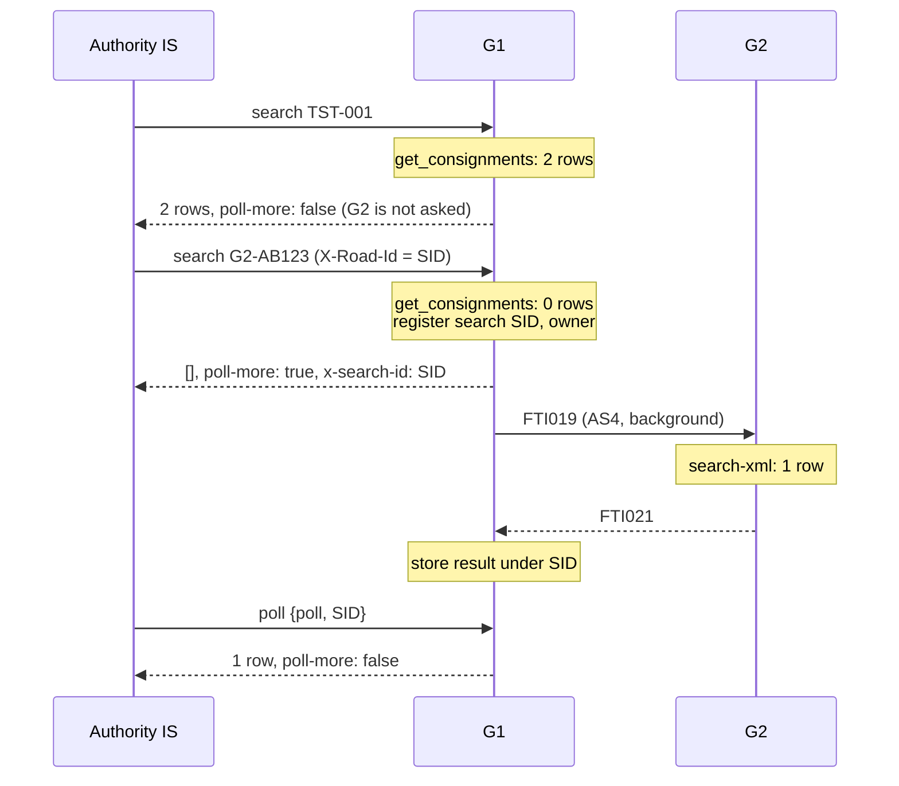

# An authority searches for consignments

**Goal.** An authority looks for consignments by identifier criteria, here the main transport
means. It asks its own gate. If that gate holds matches, it answers at once. If not, the gate asks
every other gate and the authority collects their answer with a poll.

**Actors.**

| Actor | Here |
|---|---|
| Competent authority | `auth-xroad-test`, `X-Road-Client: DEV/GOV/70000099/testSubsystem` (dev fixture, public in the repo). No subset is needed for `search`. |
| Gates | G1 (`http://127.0.0.1:27087/xroad`) and G2 (`http://127.0.0.1:28087/xroad`) |

The route is [`search`](../api/authorities/search.md); the criteria are described in
[Search criteria](../data/search-criteria.md).



## Steps

### 1. A local hit

`TST-001` is a truck that both gates know.

```bash
curl -i -X POST http://127.0.0.1:27087/xroad/provide/v1/search \
  -H 'Content-Type: application/json' \
  -H 'X-Road-Client: DEV/GOV/70000099/testSubsystem' \
  -H "X-Road-Id: $(cat /proc/sys/kernel/random/uuid)" \
  -d '{"mainTransportId":{"operator":"EQ","id":"TST-001"}}'
```

```http
HTTP/1.1 200 OK
content-type: application/json
x-poll-more: false

[{"acceptanceCountry":"EE","acceptanceDate":"2026-11-03T00:00:00Z",…,"mainTransportId":"TST-001",…,"uil":{"datasetId":"11111111-0000-4000-8000-000000000005","gateId":"G1","platformId":"mock"},…},{"acceptanceCountry":"EE","acceptanceDate":"2026-11-01T00:00:00Z",…,"dangerousGoods":"1","deliveryCountry":"LV",…,"uil":{"datasetId":"11111111-0000-4000-8000-000000000001","gateId":"G1","platformId":"mock"},…}]
```

G1 answers with its own two rows and `x-poll-more: false`. It does not ask G2, although
G2 holds a third `TST-001` trip (`22222222-…-000000000002`). The gate is authoritative for its
own consignments; to see G2's row, ask G2.

### 2. A local miss starts the fan-out (G1 → G2)

`G2-AB123` is only at G2. Keep the `X-Road-Id` of this call.

```bash
SID=$(cat /proc/sys/kernel/random/uuid)
curl -i -X POST http://127.0.0.1:27087/xroad/provide/v1/search \
  -H 'Content-Type: application/json' \
  -H 'X-Road-Client: DEV/GOV/70000099/testSubsystem' \
  -H "X-Road-Id: $SID" \
  -d '{"mainTransportId":{"operator":"EQ","id":"G2-AB123"}}'
```

```http
HTTP/1.1 200 OK
content-type: application/json
x-poll-more: true
x-search-id: 0da16694-ecff-403e-b11b-0e5d36d6ecf8

[]
```

`x-search-id` is the `X-Road-Id` just sent. The gate stored the search, recorded
`auth-xroad-test` as its owner, and sent FTI019 to every `ONLINE` peer in the registry (here
G2) without waiting.

### 3. Poll for the other gates' answer

A new `X-Road-Id`; the body names the search.

```bash
curl -i -X POST http://127.0.0.1:27087/xroad/provide/v1/search \
  -H 'Content-Type: application/json' \
  -H 'X-Road-Client: DEV/GOV/70000099/testSubsystem' \
  -H "X-Road-Id: $(cat /proc/sys/kernel/random/uuid)" \
  -d "{\"poll\":true,\"searchId\":\"$SID\"}"
```

```http
HTTP/1.1 200 OK
content-type: application/json
x-poll-more: false

[{"acceptanceCountry":null,"acceptanceDate":null,"carriedEquipmentCategories":[],"carriedEquipmentIds":[],"createdAt":null,"dangerousGoods":null,"deliveryCountry":null,"deliveryDate":null,"loadingCountry":null,"loadingDate":null,"mainTransportId":"G2-AB123","mainTransportType":null,"status":null,"transportMode":null,"transportRegCountry":null,"uil":{"datasetId":"22222222-0000-4000-8000-000000000001","gateId":"G2","platformId":"mock"},"unloadingCountry":null,"unloadingDate":null,"usedEquipmentCategories":[],"usedEquipmentCountries":[],"usedEquipmentIds":[]}]
```

The row comes from G2 and carries only `uil` and `mainTransportId`. Use the `uil` with
[`dataset`](../api/authorities/dataset.md) to read the content
([An authority retrieves a dataset](./authority-retrieves-dataset.md)).

When to stop polling:

| Poll answer | Meaning | Next |
|---|---|---|
| rows, `x-poll-more: false` | all gates answered | stop |
| `[]`, `x-poll-more: true` | the gate waited ~30 s and nothing came yet | poll again with a new `X-Road-Id` |
| `[]`, `x-poll-more: false` | no gate had a match, or the `searchId` is unknown, expired or not yours | stop |

### 4. The other direction (G2 → G1)

`TST-002` is only at G1. The same two calls, sent to G2:

```bash
SID=$(cat /proc/sys/kernel/random/uuid)
curl -i -X POST http://127.0.0.1:28087/xroad/provide/v1/search \
  -H 'Content-Type: application/json' \
  -H 'X-Road-Client: DEV/GOV/70000099/testSubsystem' \
  -H "X-Road-Id: $SID" \
  -d '{"mainTransportId":{"operator":"EQ","id":"TST-002"}}'
```

```http
HTTP/1.1 200 OK
content-type: application/json
x-search-id: eea1babe-7852-4af6-9ca5-6e7b578db74c
x-poll-more: true

[]
```

```bash
curl -i -X POST http://127.0.0.1:28087/xroad/provide/v1/search \
  -H 'Content-Type: application/json' \
  -H 'X-Road-Client: DEV/GOV/70000099/testSubsystem' \
  -H "X-Road-Id: $(cat /proc/sys/kernel/random/uuid)" \
  -d "{\"poll\":true,\"searchId\":\"$SID\"}"
```

```http
HTTP/1.1 200 OK
content-type: application/json
x-poll-more: false

[{"acceptanceCountry":null,"acceptanceDate":null,"carriedEquipmentCategories":[],"carriedEquipmentIds":[],"createdAt":null,"dangerousGoods":null,"deliveryCountry":null,"deliveryDate":null,"loadingCountry":null,"loadingDate":null,"mainTransportId":"TST-002","mainTransportType":null,"status":null,"transportMode":null,"transportRegCountry":null,"uil":{"datasetId":"11111111-0000-4000-8000-000000000002","gateId":"G1","platformId":"mock"},"unloadingCountry":null,"unloadingDate":null,"usedEquipmentCategories":[],"usedEquipmentCountries":[],"usedEquipmentIds":[]}]
```

## Notes

- The order of `x-poll-more` and `x-search-id` in the headers varies between calls.
- On the local stack the peer answers within a fraction of a second, so the first poll already
  has the result. Between real gates, expect to poll more than once.
- Only criteria that FTI019 can carry reach the other gates. Date criteria, `LT`… on text fields
  and unknown country codes match nothing remotely and the poll returns `[]` without an error
  ([Pitfalls](../data/search-criteria.md#pitfalls)).
- The receiving side of step 2 is described in [A peer gate asks this gate](./peer-gate-request.md).
- Postman: folder **1. CA -> Gate / Search**, with the G1 and the G2 environment.
