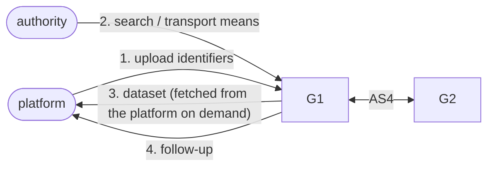

# Use cases

Each use case is one complete task, run end to end on the local gate network (G1 and G2). Every step
shows the exact request and the real response, and links to the reference page of the endpoint. They
are grouped by actor, the same way as the [API reference](../api/index.md).

### Freight platform

- [Register a consignment](./platform-registers-consignment.md) — uploads identifiers (short form,
  full FTI004), sends a new version, and an authority then finds it at both gates (G1, G2).

### Competent authority

The roadside and back-office tasks, in the order an authority meets them:

- [Check a transport means](./authority-checks-transport-means.md) — is this plate / vessel /
  container known: existence, local, all gates (G1, G2).
- [Search for consignments](./authority-searches.md) — search by criteria: a local hit, then a miss
  that fans out to the other gate, the poll, and the other direction (G1 ⇄ G2).
- [Retrieve a dataset](./authority-retrieves-dataset.md) — pick a UIL from a search, fetch the
  dataset locally and from the other gate; a denied subset (G1 ⇄ G2).
- [Send a follow-up](./authority-follow-up.md) — ask the platform a question about a dataset it
  fetched, locally and at the other gate (G1 ⇄ G2).

### Peer gate

- [Answer an incoming request](./peer-gate-request.md) — FTI019, FTI009 and FTI025 over AS4, with
  the log lines on both sides (G1 → G2).

### Administrator

- [Manage the gate](./administrator.md) — log in, check the registries, add a user, revoke their
  token, look at consignments and the audit log, log out (G1).

### Operations

- [Health and scheduled jobs](./operations.md) — check that a gate is healthy, trace a failed
  request through the logs, run a scheduled job by hand (G1).

## How the parts fit

1. A **platform** registers what it carries (identifiers only; the data stays at the platform).
2. An **authority** looks for a vehicle or a consignment. Its own gate answers from its register;
   on a miss it asks the other gates over AS4.
3. With a UIL from the answer, the authority asks for the **dataset**. The gate that owns the UIL
   fetches it from the platform, filtered to the authority's subsets.
4. Optionally the authority sends the platform a **follow-up** message about that dataset.

Administrators and operators keep this running: [administrator](./administrator.md),
[operations](./operations.md).

## Before you start

- Both gates are running: [Run two gates locally](../getting-started/run-locally.md).
- The sample data is loaded: [Load the sample data](../getting-started/sample-data.md). Identifiers
  that exist at only one gate are listed in [Sample data](../reference/sample-data.md).
- Ids in the examples (search ids, new dataset ids, request ids, timestamps) differ on your run. Use
  fresh UUIDs for every `X-Road-Id`, `X-Request-Id` and uploaded dataset.
