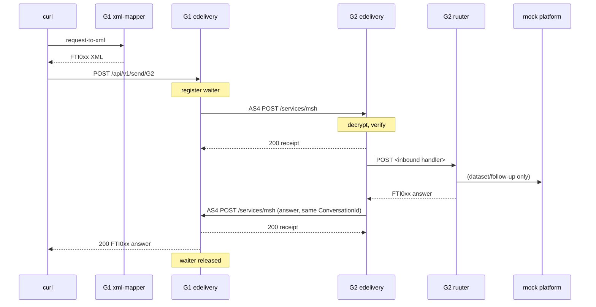

# A peer gate asks this gate

Goal: G1 needs data that is registered at G2. It searches G2's register for an
identifier, fetches the dataset it found, and sends a follow-up about it. All three go over AS4
between the two gates' edelivery services.

Actors:

| Actor | Here |
|---|---|
| Requesting gate | G1: its xml-mapper builds the FTI request, its edelivery sends it and waits |
| Answering gate | G2: its edelivery receives, its Ruuter answers through the inbound handlers |
| Platform | `mock` at G2, the REST mock platform inside G2's Ruuter |

In normal operation G1's Ruuter makes the calls of steps 1 and 2 itself, inside an authority
request ([search](../api/authorities/search.md), [dataset](../api/authorities/dataset.md),
[follow-up](../api/authorities/follow-up.md)). Here they are made by hand with curl, so every hop
can be seen. The token is the public dev value.



Set up the shell once:

```bash
T='X-Internal-Service-Token: dev-internal-service-token-change-me'
```

## 1. Search G2 for G2-AB123 (FTI019 → FTI021)

1. Build the FTI019 with G1's xml-mapper. The `X-Request-Id` becomes the query id.

   ```bash
   RID=$(cat /proc/sys/kernel/random/uuid)      # here: 78ce1c60-05ca-4708-a022-7504a9f82a05
   curl -s http://127.0.0.1:27082/api/v1/search/request-to-xml -H "$T" -H "X-Request-Id: $RID" \
     -H 'Content-Type: application/json' -d '{"mainTransportId":{"id":"G2-AB123","operator":"EQ"}}' > fti019.xml
   ```

   The XML is shown element by element in [Identifier search](../api/gates/search-fti019.md).

2. Send it to G2 with the same id.

   ```bash
   curl -s -i http://127.0.0.1:27081/api/v1/send/G2 -H "$T" -H "X-Request-Id: $RID" \
     -H 'Content-Type: text/xml' --data-binary @fti019.xml
   ```

   ```http
   HTTP/1.1 200 OK
   Date: Tue, 03 Nov 2026 15:59:57 GMT
   Content-type: text/xml; charset=UTF-8
   Content-length: 1313

   <rsm:FTI021SearchIdentifierResponse xmlns:rsm="urn:eu:move:eFTI:data:standard:FTI021SearchIdentifierResponse:1" …><rsm:ExchangedDocumentContext>…</rsm:ExchangedDocumentContext><rsm:ExchangedDocument><ID schemeID="RFC 9562-4">1dc7d177-cd49-4168-acc9-d70eb741d9c9</ID><TypeCode>021</TypeCode><StatusCode>C</StatusCode><IssueDateTime><udt:DateTimeString format="207">20261103155957Z</udt:DateTimeString></IssueDateTime><RequestedSpecifiedQuery><ID schemeID="RFC 9562-4">78ce1c60-05ca-4708-a022-7504a9f82a05</ID></RequestedSpecifiedQuery></rsm:ExchangedDocument>
       <rsm:EFTIIDInformation><UniqueIDSetUniqueIDSet><GateID>G2</GateID><PlatformID>mock</PlatformID><DatasetID schemeID="RFC 9562-4">22222222-0000-4000-8000-000000000001</DatasetID><ParameterIDSetCriteria><MainCarriageTransportMeansIDParameterScope><ID>G2-AB123</ID></MainCarriageTransportMeansIDParameterScope></ParameterIDSetCriteria></UniqueIDSetUniqueIDSet></rsm:EFTIIDInformation>
     </rsm:FTI021SearchIdentifierResponse>
   ```

   The UIL of the hit is `G2 / mock / 22222222-0000-4000-8000-000000000001`.

3. What the two edelivery containers logged (`docker logs efti-g1-edelivery`,
   `docker logs efti-g2-edelivery`; JSON lines, shown as timestamp, logger and message):

   ```text
   G1 15:59:57.164 EDeliveryClient  Sending message to http://g2-edelivery:8081/services/msh: conversationId=G2:78ce1c60-05ca-4708-a022-7504a9f82a05:G1 payload_size_bytes=1134
   G2 15:59:57.178 EDeliveryRoutes  Handling 'FTI019SearchIdentifierRequest' from G1:78ce1c60-05ca-4708-a022-7504a9f82a05:G2
   G2 15:59:57.183 RequestLogger    <G1> 172.23.0.2 POST /services/msh: 200 in 13 ms - Java-http-client/25.0.4.1
   G1 15:59:57.185 HttpClient       POST http://g2-edelivery:8081/services/msh in 18ms - 200
   G1 15:59:57.185 EDeliveryClient  eDelivery accepted message to http://g2-edelivery:8081/services/msh: status=200, conversationId=G2:78ce1c60-05ca-4708-a022-7504a9f82a05:G1
   G2 15:59:57.210 HttpClient       POST http://ruuter:8086/efti/api/v1/consignments/search-xml?gateId=G2 in 27ms - 200
   G2 15:59:57.211 EDeliveryClient  Sending message to http://g1-edelivery:8081/services/msh: conversationId=G1:78ce1c60-05ca-4708-a022-7504a9f82a05:G2 payload_size_bytes=1313
   G1 15:59:57.226 EDeliveryRoutes  Handling 'FTI021SearchIdentifierResponse' from G2:78ce1c60-05ca-4708-a022-7504a9f82a05:G1
   G1 15:59:57.229 RequestLogger    <G2> 172.23.0.3 POST /services/msh: 200 in 10 ms - Java-http-client/25.0.4.1
   G2 15:59:57.230 EDeliveryClient  eDelivery accepted message to http://g1-edelivery:8081/services/msh: status=200, conversationId=G1:78ce1c60-05ca-4708-a022-7504a9f82a05:G2
   G1 15:59:57.230 RequestLogger    <null> 172.24.0.1 POST /api/v1/send/G2: 200 in 66 ms - curl/8.5.0
   ```

   Two AS4 exchanges, one in each direction, 66 ms in total. G2's inbound handler was called
   with `gateId=G2`, its own id ([Inbound handlers](../api/gates/inbound-handlers.md)). The
   `trace.id` of every line is the request id; on G2 the background part has the suffix
   `handler` (`78ce1c60-…handler`).

4. The inbound handler call can be repeated by hand on G2's Ruuter:

   ```bash
   curl -s -i "http://127.0.0.1:28086/efti/api/v1/consignments/search-xml?gateId=G2" -H "$T" \
     -H 'Content-Type: text/xml' -H "x-request-id: $(cat /proc/sys/kernel/random/uuid)" --data-binary @fti019.xml
   ```

   It returns the same FTI021 (`HTTP/1.1 200 OK`, `content-length: 1313`), with this call's
   request id in `RequestedSpecifiedQuery`.

An identifier G2 does not have (`TST-002`) gives `200` with an empty FTI021 and the note
`No consignments found` ([example](../api/gates/search-fti019.md#no-consignments-found)).

## 2. Fetch the dataset (FTI009 → FTI010)

1. Build the FTI009 for the UIL found in step 1, with subsets `EU01` and `EU02`:

   ```bash
   RID=$(cat /proc/sys/kernel/random/uuid)      # here: ffea4bfa-e49a-46cd-9c3b-153b7fb73ada
   curl -s http://127.0.0.1:27082/api/v1/dataset/request-to-xml -H "$T" -H "X-Request-Id: $RID" \
     -H 'Content-Type: application/json' \
     -d '{"uil":{"gateId":"G2","platformId":"mock","datasetId":"22222222-0000-4000-8000-000000000001"},"subsets":["EU01","EU02"]}' \
     > fti009.xml
   ```

2. Send it:

   ```bash
   curl -s -i http://127.0.0.1:27081/api/v1/send/G2 -H "$T" -H "X-Request-Id: $RID" \
     -H 'Content-Type: text/xml' --data-binary @fti009.xml
   ```

   ```http
   HTTP/1.1 200 OK
   Date: Tue, 03 Nov 2026 16:00:49 GMT
   Content-type: text/xml; charset=UTF-8
   Content-length: 1721

   <rsm:FTI010GetCmdsResponse xmlns:rsm="urn:eu:move:eFTI:data:standard:FTI010GetCmdsResponse:1" …>…<rsm:ExchangedDocument><ID schemeID="RFC 9562-4">4aad9ef7-06cb-4438-bcae-e8e2ef63f61e</ID><TypeCode>010</TypeCode><StatusCode>C</StatusCode><IssueDateTime><udt:DateTimeString format="207">20261103160049Z</udt:DateTimeString></IssueDateTime><RequestedSpecifiedQuery><ID schemeID="RFC 9562-4">ffea4bfa-e49a-46cd-9c3b-153b7fb73ada</ID></RequestedSpecifiedQuery></rsm:ExchangedDocument>
       <rsm:MessageInformation><SubsetID>EU01</SubsetID><SubsetID>EU02</SubsetID></rsm:MessageInformation>
       <rsm:EFTIIDInformation><UniqueIDSetUniqueIDSet><GateID>G2</GateID><PlatformID>mock</PlatformID><DatasetID schemeID="RFC 9562-4">22222222-0000-4000-8000-000000000001</DatasetID></UniqueIDSetUniqueIDSet></rsm:EFTIIDInformation>
       <rsm:SpecifiedSupplyChainConsignment><GrossWeightMeasure unitCode="KGM">15000.00</GrossWeightMeasure>
     <PackageQuantity>120</PackageQuantity>
     <MainCarriageLogisticsTransportMovement>
       <ModeCode>3</ModeCode>
       <UsedLogisticsTransportMeans>
         <ID schemeAgencyID="5">MOCK-PLATE-1</ID>
         <RegistrationTradeCountry><ID>EE</ID></RegistrationTradeCountry>
       </UsedLogisticsTransportMeans>
     </MainCarriageLogisticsTransportMovement></rsm:SpecifiedSupplyChainConsignment>
     </rsm:FTI010GetCmdsResponse>
   ```

   The consignment is what the mock platform returned for this id (its minimal fixture), see
   [Dataset](../api/gates/dataset-fti009.md).

3. The logs:

   ```text
   G1 16:00:49.546 EDeliveryClient  Sending message to http://g2-edelivery:8081/services/msh: conversationId=G2:ffea4bfa-e49a-46cd-9c3b-153b7fb73ada:G1 payload_size_bytes=1206
   G2 16:00:49.566 EDeliveryRoutes  Handling 'FTI009GetCmdsRequest' from G1:ffea4bfa-e49a-46cd-9c3b-153b7fb73ada:G2
   G2 16:00:49.570 RequestLogger    <G1> 172.23.0.2 POST /services/msh: 200 in 12 ms - Java-http-client/25.0.4.1
   G1 16:00:49.571 EDeliveryClient  eDelivery accepted message to http://g2-edelivery:8081/services/msh: status=200, conversationId=G2:ffea4bfa-e49a-46cd-9c3b-153b7fb73ada:G1
   G2 16:00:49.621 HttpClient       POST http://ruuter:8086/efti/api/v1/dataset-xml in 51ms - 200
   G2 16:00:49.621 EDeliveryClient  Sending message to http://g1-edelivery:8081/services/msh: conversationId=G1:ffea4bfa-e49a-46cd-9c3b-153b7fb73ada:G2 payload_size_bytes=1721
   G1 16:00:49.623 HttpClient       POST http://resql:8090/efti/claim_async_response in 2ms - 200
   G1 16:00:49.633 EDeliveryRoutes  Handling 'FTI010GetCmdsResponse' from G2:ffea4bfa-e49a-46cd-9c3b-153b7fb73ada:G1
   G1 16:00:49.637 RequestLogger    <G2> 172.23.0.3 POST /services/msh: 200 in 9 ms - Java-http-client/25.0.4.1
   G2 16:00:49.638 EDeliveryClient  eDelivery accepted message to http://g1-edelivery:8081/services/msh: status=200, conversationId=G1:ffea4bfa-e49a-46cd-9c3b-153b7fb73ada:G2
   G1 16:00:49.637 RequestLogger    <null> 172.24.0.1 POST /api/v1/send/G2: 200 in 94 ms - curl/8.5.0
   ```

   The `claim_async_response` line is the waiting call polling the database for an answer that
   might have reached another node.

4. The inbound handler by hand:

   ```bash
   curl -s -i http://127.0.0.1:28086/efti/api/v1/dataset-xml -H "$T" -H 'Content-Type: text/xml' \
     -H "x-request-id: $(cat /proc/sys/kernel/random/uuid)" --data-binary @fti009.xml
   ```

   Answer: `HTTP/1.1 200 OK`, `content-length: 1721`, the same FTI010.

## 3. Send a follow-up (FTI025 → FTI030)

A follow-up is stored and forwarded to the platform, so this step uses a new random dataset id
instead of the seeded one. The gate does not check its register before forwarding.

1. Build the FTI025 with a message and one file:

   ```bash
   RID=$(cat /proc/sys/kernel/random/uuid)      # here: aa05bd78-6d75-4987-9078-f957b7cba762
   DS=$(cat /proc/sys/kernel/random/uuid)       # here: 0404186e-d4c2-4ba8-bfbc-b31af49154e2
   REF=$(cat /proc/sys/kernel/random/uuid)
   B64=$(printf 'Photo of seal 4711' | base64)
   curl -s http://127.0.0.1:27082/api/v1/followup/request-to-xml -H "$T" -H "X-Request-Id: $RID" \
     -H 'Content-Type: application/json' \
     -d '{"uil":{"gateId":"G2","platformId":"mock","datasetId":"'$DS'"},"referenceIds":["'$REF'"],"message":"Seal number differs from the CMR. Please check.","files":[{"fileName":"seal.txt","base64Content":"'$B64'"}]}' \
     > fti025.xml
   ```

2. Send it:

   ```bash
   curl -s -i http://127.0.0.1:27081/api/v1/send/G2 -H "$T" -H "X-Request-Id: $RID" \
     -H 'Content-Type: text/xml' --data-binary @fti025.xml
   ```

   ```http
   HTTP/1.1 200 OK
   Date: Tue, 03 Nov 2026 16:01:21 GMT
   Content-type: text/xml; charset=UTF-8
   Content-length: 1161

   <rsm:FTI030LodgeFollowUpCommResponse xmlns:rsm="urn:eu:move:eFTI:data:standard:FTI030LodgeFollowUpCommResponse:1" …>…<rsm:ExchangedDocument><ID schemeID="RFC 9562-4">a1053cef-34b1-411b-b387-367755b80922</ID><TypeCode>030</TypeCode><StatusCode>C</StatusCode><IssueDateTime><udt:DateTimeString format="207">20261103160120Z</udt:DateTimeString></IssueDateTime><RequestedSpecifiedQuery><ID schemeID="RFC 9562-4">aa05bd78-6d75-4987-9078-f957b7cba762</ID></RequestedSpecifiedQuery></rsm:ExchangedDocument>
       <rsm:EFTIIDInformation><UniqueIDSetUniqueIDSet><GateID>G2</GateID><PlatformID>mock</PlatformID><DatasetID schemeID="RFC 9562-4">0404186e-d4c2-4ba8-bfbc-b31af49154e2</DatasetID></UniqueIDSetUniqueIDSet></rsm:EFTIIDInformation>
     </rsm:FTI030LodgeFollowUpCommResponse>
   ```

3. The logs:

   ```text
   G1 16:01:20.918 EDeliveryClient  Sending message to http://g2-edelivery:8081/services/msh: conversationId=G2:aa05bd78-6d75-4987-9078-f957b7cba762:G1 payload_size_bytes=1574
   G2 16:01:20.930 EDeliveryRoutes  Handling 'FTI025LodgeFollowUpCommRequest' from G1:aa05bd78-6d75-4987-9078-f957b7cba762:G2
   G2 16:01:20.933 RequestLogger    <G1> 172.23.0.2 POST /services/msh: 200 in 8 ms - Java-http-client/25.0.4.1
   G1 16:01:20.934 EDeliveryClient  eDelivery accepted message to http://g2-edelivery:8081/services/msh: status=200, conversationId=G2:aa05bd78-6d75-4987-9078-f957b7cba762:G1
   G2 16:01:21.001 HttpClient       POST http://ruuter:8086/efti/api/v1/follow-up-xml in 68ms - 201
   G2 16:01:21.001 EDeliveryClient  Sending message to http://g1-edelivery:8081/services/msh: conversationId=G1:aa05bd78-6d75-4987-9078-f957b7cba762:G2 payload_size_bytes=1161
   G1 16:01:21.014 EDeliveryRoutes  Handling 'FTI030LodgeFollowUpCommResponse' from G2:aa05bd78-6d75-4987-9078-f957b7cba762:G1
   G1 16:01:21.017 RequestLogger    <G2> 172.23.0.3 POST /services/msh: 200 in 9 ms - Java-http-client/25.0.4.1
   G2 16:01:21.017 EDeliveryClient  eDelivery accepted message to http://g1-edelivery:8081/services/msh: status=200, conversationId=G1:aa05bd78-6d75-4987-9078-f957b7cba762:G2
   G1 16:01:21.017 RequestLogger    <null> 172.24.0.1 POST /api/v1/send/G2: 200 in 99 ms - curl/8.5.0
   ```

4. What G2 stored (a read-only query):

   ```bash
   docker exec efti-g2-database psql -U efti -d efti -c "SELECT requesting_gate_id, destination_platform_id, status, query_id FROM follow_up_log WHERE dataset_request_id='0404186e-d4c2-4ba8-bfbc-b31af49154e2' ORDER BY created_at"
   ```

   ```text
    requesting_gate_id | destination_platform_id |  status   |               query_id
   --------------------+-------------------------+-----------+--------------------------------------
    G2              | mock                    | PENDING   | aa05bd78-6d75-4987-9078-f957b7cba762
    G2              | mock                    | DELIVERED | aa05bd78-6d75-4987-9078-f957b7cba762
   (2 rows)
   ```

   (Columns cut from the query on the [Follow-up](../api/gates/follow-up-fti025.md) page.) Sending
   the same `fti025.xml` again with the same `X-Request-Id` returned another FTI030 and added no
   rows: the platform got the follow-up once.

## When G2 cannot answer

| Situation | What G1's caller gets | Page |
|---|---|---|
| Unknown party id in the send call | `400 Unknown party: …` at once | [send API](../api/gates/send-api.md) |
| G2 rejects the AS4 message (bad key, bad signature, unknown message) | `500 eDelivery request failed with status 500: EBMS:… - …` at once | [AS4 endpoint](../api/gates/as4-endpoint.md) |
| G2 accepts but its handler fails (e.g. unknown platform) | `504 No data received after 1m` after 60 s | [Dataset](../api/gates/dataset-fti009.md#unknown-platform--504-after-60-s) |

## Related

- [Peer gates (AS4)](../api/gates/index.md): the message model and the security profile.
- [AS4 endpoint](../api/gates/as4-endpoint.md): a captured AS4 message and receipt of this kind of
  exchange.
- Postman folders 2a, 2b, 3a, 3b ([The Postman collection](../reference/collection.md)).
