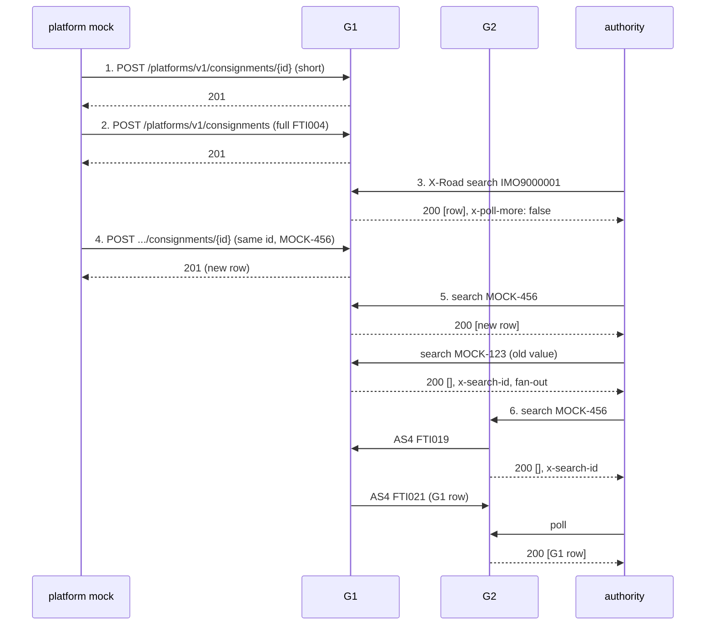

# A platform registers a consignment

## Goal

A freight platform tells its gate that a consignment exists and how it can be found. Afterwards an
authority finds it: at the same gate, and through the other gate.

## Actors

| Actor | Here |
|---|---|
| Platform | `mock`, key `X-Api-Key: mock-secret-key` (dev value, public in the repository) |
| Gate of the platform | G1, ruuter `127.0.0.1:27086`, X-Road provider `127.0.0.1:27087` |
| Other gate | G2, X-Road provider `127.0.0.1:28087` |
| Authority | X-Road client `DEV/GOV/70000099/testSubsystem` (`auth-xroad-test`) |

## Sequence



## Steps

### 1. Register with the short form

The platform picks the dataset id and puts it in the path. The body holds only the search
criteria. Reference: [Upload identifiers (REST)](../api/platforms/upload-rest.md).

```bash
curl -i -X POST http://127.0.0.1:27086/platforms/v1/consignments/803dab72-dc75-4879-8386-50127588196b \
  -H 'Content-Type: text/xml' -H 'X-Api-Key: mock-secret-key' \
  --data-binary @docs/developer/examples/platforms/short-upload.xml
```

```http
HTTP/1.1 201 Created
content-type: application/json
content-length: 193
{"createdAt":"2026-11-03T16:01:34.661681Z","datasetId":"803dab72-dc75-4879-8386-50127588196b","gateId":"G1","platformId":"mock","rowId":"135a4065-4bb6-44e3-8d75-a7b7605fc495","status":"ACTIVE"}
```

`short-upload.xml` registers road transport means `MOCK-123`, accepted in `DE` on 2026-09-24. The
gate filled in `gateId` (`G1`) and `platformId` (`mock`) itself. Use a fresh UUID when you
repeat this.

### 2. Register with a full FTI004

The full form carries the UIL inside the XML. Here `full-upload.xml` with a fresh `DatasetID` and
the vessel id changed to `IMO9000001`:

```bash
sed -e "s/550e8400-e29b-41d4-a716-446655440000/83c51c22-1bbf-4d47-9312-64ecc20aa202/" \
    -e "s/17022113-89b5-11f1-bec0-3c9c0f2eb459/$(cat /proc/sys/kernel/random/uuid)/" \
    -e 's#VESSEL-001#IMO9000001#' \
    docs/developer/examples/platforms/full-upload.xml > /tmp/uc-full.xml
curl -i -X POST http://127.0.0.1:27086/platforms/v1/consignments \
  -H 'Content-Type: text/xml' -H 'X-Api-Key: mock-secret-key' --data-binary @/tmp/uc-full.xml
```

```http
HTTP/1.1 201 Created
content-type: application/json
content-length: 193
{"createdAt":"2026-11-03T16:09:57.742760Z","datasetId":"83c51c22-1bbf-4d47-9312-64ecc20aa202","gateId":"G1","platformId":"mock","rowId":"91ab36a4-3cc7-4dca-bfed-1214a4cc1514","status":"ACTIVE"}
```

`GateID` must be `G1` and `PlatformID` must be `mock`. With `<GateID>G2</GateID>` the answer
is `403` `Consignment UIL must belong to the authenticated platform and this gate`.

### 3. The authority finds it at G1

Reference: [search](../api/authorities/search.md), criteria: [Search criteria](../data/search-criteria.md).

```bash
curl -i -X POST http://127.0.0.1:27087/xroad/provide/v1/search \
  -H 'Content-Type: application/json' -H 'X-Road-Client: DEV/GOV/70000099/testSubsystem' \
  -H "X-Road-Id: $(cat /proc/sys/kernel/random/uuid)" \
  -d '{"mainTransportId":{"operator":"EQ","id":"IMO9000001"}}'
```

```http
HTTP/1.1 200 OK
content-type: application/json
x-poll-more: false
content-length: 731
[{"acceptanceCountry":"DE","acceptanceDate":"2021-09-24T00:00:00Z","carriedEquipmentCategories":["BPR","BPR"],"carriedEquipmentIds":["TE-003","TE-004"],"createdAt":"2026-11-03T16:09:57.742760Z","dangerousGoods":"2","deliveryCountry":"EE","deliveryDate":"2026-09-24T00:00:00Z","loadingCountry":"FI","loadingDate":"2021-09-24T00:00:00Z","mainTransportId":"IMO9000001","mainTransportType":"1513","status":"ACTIVE","transportMode":"1","transportRegCountry":"DE","uil":{"datasetId":"83c51c22-1bbf-4d47-9312-64ecc20aa202","gateId":"G1","platformId":"mock"},"unloadingCountry":"AE","unloadingDate":"2021-09-24T00:00:00Z","usedEquipmentCategories":["T10","T10"],"usedEquipmentCountries":["DE","DE"],"usedEquipmentIds":["TE-001","TE-002"]}]
```

A local hit: `x-poll-more: false`, no fan-out.

### 4. Update: a new version of the first dataset

The truck changed. The platform sends the same dataset id again with the full, new set of
criteria. The gate appends a row; the latest row is the current state.

```bash
curl -i -X POST http://127.0.0.1:27086/platforms/v1/consignments/803dab72-dc75-4879-8386-50127588196b \
  -H 'Content-Type: text/xml' -H 'X-Api-Key: mock-secret-key' --data-binary '<ParameterIDSetCriteria xmlns:udt="urn:eu:move:eFTI:data:standard:UnqualifiedDataType:34">
  <CarrierAcceptanceDateParameterScope>
    <SpecifiedDateTime><udt:DateTimeString format="102">20260924</udt:DateTimeString></SpecifiedDateTime>
  </CarrierAcceptanceDateParameterScope>
  <CarrierAcceptanceCountryParameterScope><CountryID>DE</CountryID></CarrierAcceptanceCountryParameterScope>
  <MainCarriageTransportMeansIDParameterScope><ID>MOCK-456</ID></MainCarriageTransportMeansIDParameterScope>
  <MainCarriageModeCodeParameterScope><TransportModeParameterCode>3</TransportModeParameterCode></MainCarriageModeCodeParameterScope>
</ParameterIDSetCriteria>'
```

```http
HTTP/1.1 201 Created
content-type: application/json
content-length: 193
{"createdAt":"2026-11-03T16:02:57.379687Z","datasetId":"803dab72-dc75-4879-8386-50127588196b","gateId":"G1","platformId":"mock","rowId":"874e84c9-f7b9-4ea2-821b-713f0d77fc2b","status":"ACTIVE"}
```

Both rows are in the table:

```text
                row_id                | status | main_transport_id |          created_at           | revision
--------------------------------------+--------+-------------------+-------------------------------+----------
 135a4065-4bb6-44e3-8d75-a7b7605fc495 | ACTIVE | MOCK-123          | 2026-11-03 16:01:34.661681+00 |       27
 874e84c9-f7b9-4ea2-821b-713f0d77fc2b | ACTIVE | MOCK-456          | 2026-11-03 16:02:57.379687+00 |       43
```

### 5. Search sees only the latest version

New value:

```bash
curl -i -X POST http://127.0.0.1:27087/xroad/provide/v1/search \
  -H 'Content-Type: application/json' -H 'X-Road-Client: DEV/GOV/70000099/testSubsystem' \
  -H "X-Road-Id: $(cat /proc/sys/kernel/random/uuid)" \
  -d '{"mainTransportId":{"operator":"EQ","id":"MOCK-456"}}'
```

```http
HTTP/1.1 200 OK
content-type: application/json
x-poll-more: false
content-length: 609
[{"acceptanceCountry":"DE","acceptanceDate":"2026-09-24T00:00:00Z","carriedEquipmentCategories":[],"carriedEquipmentIds":[],"createdAt":"2026-11-03T16:02:57.379687Z","dangerousGoods":null,"deliveryCountry":null,"deliveryDate":null,"loadingCountry":null,"loadingDate":null,"mainTransportId":"MOCK-456","mainTransportType":null,"status":"ACTIVE","transportMode":"3","transportRegCountry":null,"uil":{"datasetId":"803dab72-dc75-4879-8386-50127588196b","gateId":"G1","platformId":"mock"},"unloadingCountry":null,"unloadingDate":null,"usedEquipmentCategories":[],"usedEquipmentCountries":[],"usedEquipmentIds":[]}]
```

Old value, `-d '{"mainTransportId":{"operator":"EQ","id":"MOCK-123"}}'`:

```http
HTTP/1.1 200 OK
content-type: application/json
x-poll-more: true
x-search-id: 4b4c111d-1454-472d-b902-91725f109230
content-length: 2

[]
```

No local row matches any more, so the gate asks G2. The poll finds nothing there either:

```bash
curl -i -X POST http://127.0.0.1:27087/xroad/provide/v1/search \
  -H 'Content-Type: application/json' -H 'X-Road-Client: DEV/GOV/70000099/testSubsystem' \
  -H "X-Road-Id: $(cat /proc/sys/kernel/random/uuid)" \
  -d '{"poll":true,"searchId":"4b4c111d-1454-472d-b902-91725f109230"}'
```

```http
HTTP/1.1 200 OK
content-type: application/json
x-poll-more: false
content-length: 2

[]
```

### 6. The authority finds it through G2

The same authority asks G2. G2 has no local row, sends an FTI019 over AS4 to G1 and
returns a search id. Reference: [Identifier search: FTI019 / FTI021](../api/gates/search-fti019.md).

```bash
curl -i -X POST http://127.0.0.1:28087/xroad/provide/v1/search \
  -H 'Content-Type: application/json' -H 'X-Road-Client: DEV/GOV/70000099/testSubsystem' \
  -H "X-Road-Id: $(cat /proc/sys/kernel/random/uuid)" \
  -d '{"mainTransportId":{"operator":"EQ","id":"MOCK-456"}}'
```

```http
HTTP/1.1 200 OK
content-type: application/json
x-search-id: e149a9d7-5f8b-4ab3-b68e-374d88af8b8d
x-poll-more: true
content-length: 2

[]
```

A few seconds later:

```bash
curl -i -X POST http://127.0.0.1:28087/xroad/provide/v1/search \
  -H 'Content-Type: application/json' -H 'X-Road-Client: DEV/GOV/70000099/testSubsystem' \
  -H "X-Road-Id: $(cat /proc/sys/kernel/random/uuid)" \
  -d '{"poll":true,"searchId":"e149a9d7-5f8b-4ab3-b68e-374d88af8b8d"}'
```

```http
HTTP/1.1 200 OK
content-type: application/json
x-poll-more: false
content-length: 580
[{"acceptanceCountry":"DE","acceptanceDate":"2026-09-24T00:00:00Z","carriedEquipmentCategories":[],"carriedEquipmentIds":[],"createdAt":null,"dangerousGoods":null,"deliveryCountry":null,"deliveryDate":null,"loadingCountry":null,"loadingDate":null,"mainTransportId":"MOCK-456","mainTransportType":null,"status":null,"transportMode":"3","transportRegCountry":null,"uil":{"datasetId":"803dab72-dc75-4879-8386-50127588196b","gateId":"G1","platformId":"mock"},"unloadingCountry":null,"unloadingDate":null,"usedEquipmentCategories":[],"usedEquipmentCountries":[],"usedEquipmentIds":[]}]
```

The row comes from G1: `uil.gateId` is `G1`. `createdAt` and `status` are `null` because
FTI021 does not carry them.

## What next

- The authority fetches the dataset with this UIL; the gate then calls the platform:
  [An authority retrieves a dataset](./authority-retrieves-dataset.md),
  [What the gate calls on a platform](../api/platforms/platform-side-api.md).
- The same upload over AS4: [Upload identifiers (eDelivery)](../api/platforms/upload-edelivery.md).
- A platform cannot remove a dataset. See
  [Removing a dataset](../api/platforms/upload-rest.md#removing-a-dataset).

## Notes

- Postman: folder **5. Platform -> Gate** with the G1 environment, then the searches in folder
  **1**.
- The dataset ids above were created for this page. Use your own fresh UUIDs; never upload to the
  seeded ids in [Sample data](../reference/sample-data.md).
