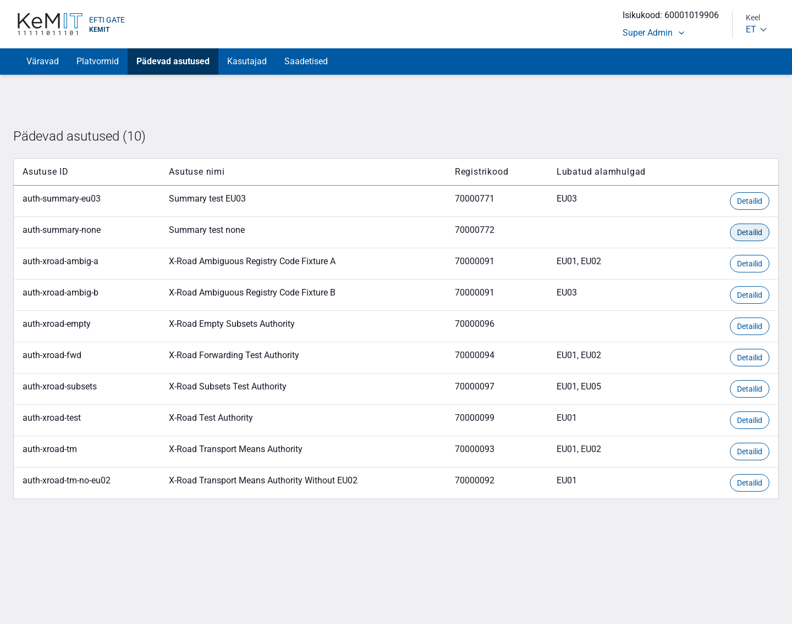
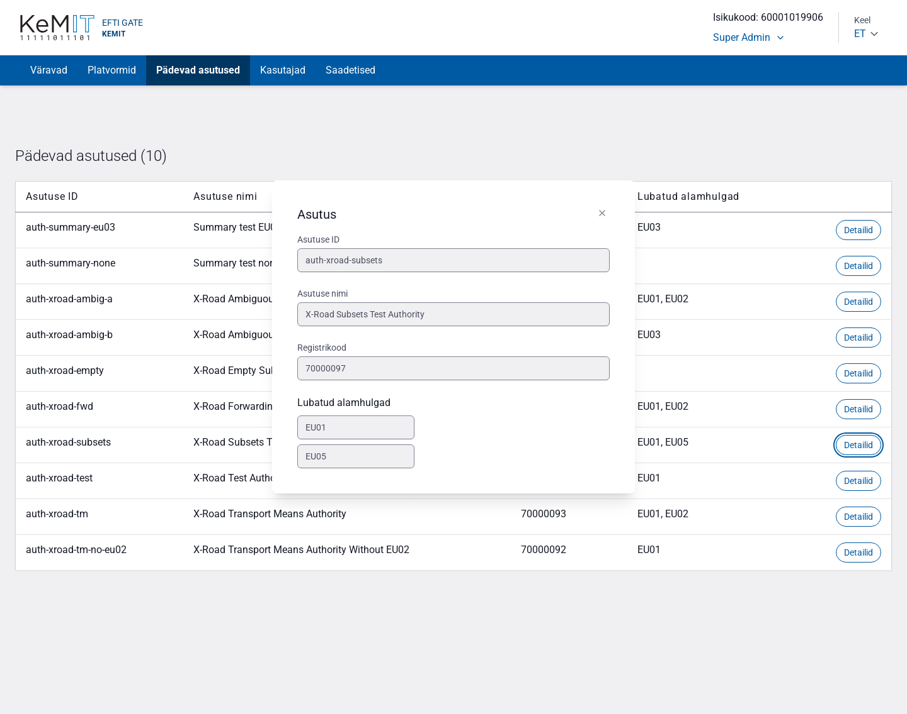

# Pädevad asutused

Vaade **Pädevad asutused** näitab, millised asutused võivad X-Roadi kaudu värava andmeid pärida ja millistele eFTI andmete alamhulkadele neil on ligipääs. Vaade on **ainult lugemiseks**.

## Kust asutuste andmed tulevad?

Asutuste register on repositooriumi kaustas `registry/authorities/` — üks YAML-fail asutuse kohta. Asutus on aktiivne seni, kuni tema fail on olemas; eraldi olekut ei ole. Asutuse lisamine, alamhulkade muutmine ja ligipääsu äravõtmine (faili kustutamine) käivad muudatustaotluse ja uue versiooni paigaldamise kaudu. Pöördu tehnilise meeskonna poole.

## Asutuse andmete vaatamine

Vajuta rea lõpus **Detailid**. Aknas on asutuse ID, nimi, registrikood ja lubatud alamhulgad. Väljad on lukus.

- **Registrikood** seob asutuse X-Roadi liikmekoodiga. Päring, mille X-Roadi liikmekood ei vasta täpselt ühele asutusele, lükatakse tagasi.
- **Lubatud alamhulgad** määravad, milliseid andmeosi (EU01–EU07) asutusele väljastatakse. Tühi loend tähendab, et asutusele ei väljastata ühtegi alamhulka.

Õiguste muutmise taotlemisel kontrolli üle kogu alamhulkade loend, mitte ainult lisatav või eemaldatav väärtus. Anna asutusele ainult tööülesannete täitmiseks vajalikud alamhulgad.
