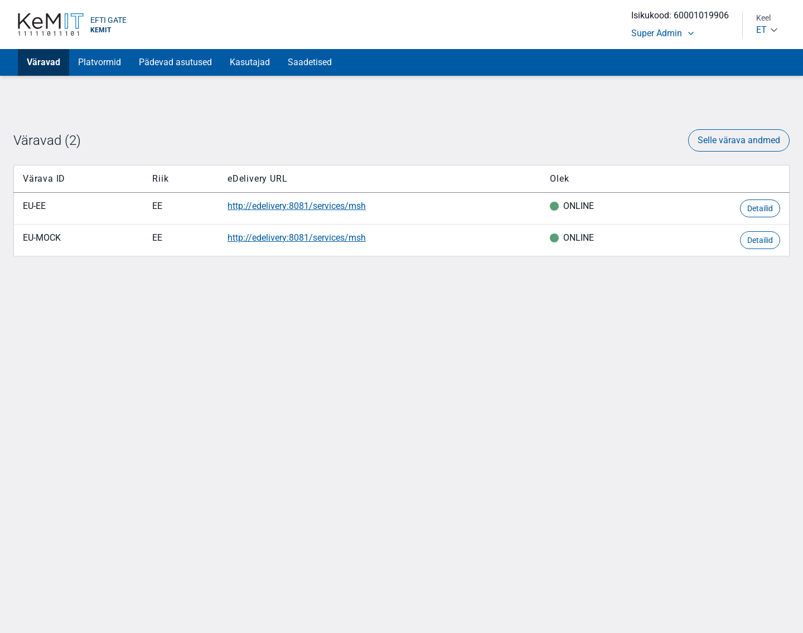
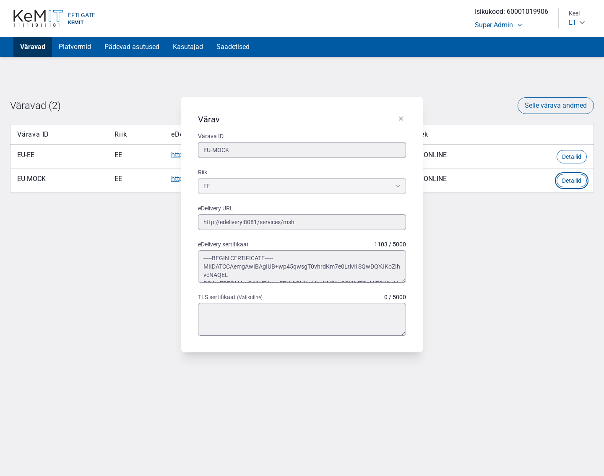

# Väravad

Vaade **Väravad** näitab teiste liikmesriikide väravaid, millega Eesti värav eDelivery (AS4) kaudu suhtleb, ning Eesti värava enda andmeid. Vaade on **ainult lugemiseks**: väravaid ei lisata, muudeta ega kustutata haldusliidese kaudu.

## Kust väravate andmed tulevad?

Väravate register on värava lähtekoodi repositooriumis kaustas `registry/gates/` — üks YAML-fail iga värava kohta. Faili muudetakse muudatustaotluse (pull request) kaudu ning muudatus jõuab väravasse alles uue versiooni paigaldamisega. Nii jääb igast registrimuudatusest jälg (kes, millal, miks) ja see läbib ülevaatuse. Taust: [ADR-011](https://github.com/kemit-ee/efti-gate-ee/blob/dev/docs/architecture/decisions/011-registries-as-signed-config.md), failivorming: [registry/README.md](https://github.com/kemit-ee/efti-gate-ee/blob/dev/registry/README.md).

Kui partnerriigi värav tuleb lisada, selle URL või sertifikaat muutub või see tuleb välja lülitada, pöördu tehnilise meeskonna poole.

## Oleku tähendus

| Olek | Tähendus |
|---|---|
| ONLINE | Värav on kasutusel: sellega vahetatakse sõnumeid ja see on kaasatud piiriülesesse otsingusse. |
| KEELATUD | Värav on registris välja lülitatud. Sellega ei vahetata sõnumeid ega saadeta sinna otsinguid. |

Olekut määrab ainult registrifail. Automaatset ühenduse kontrolli (ping) ei ole, seega olek ei muutu iseenesest.

## Värava andmete vaatamine

Vajuta rea lõpus **Detailid**. Avanevas aknas on värava ID, riik, eDelivery URL ning eDelivery ja TLS sertifikaadid. Väljad on lukus.

Nupp **Selle värava andmed** näitab Eesti värava enda kirjet. Neid andmeid (eDelivery URL ja sertifikaat) on vaja partneri eDelivery pääsupunkti seadistamisel.
