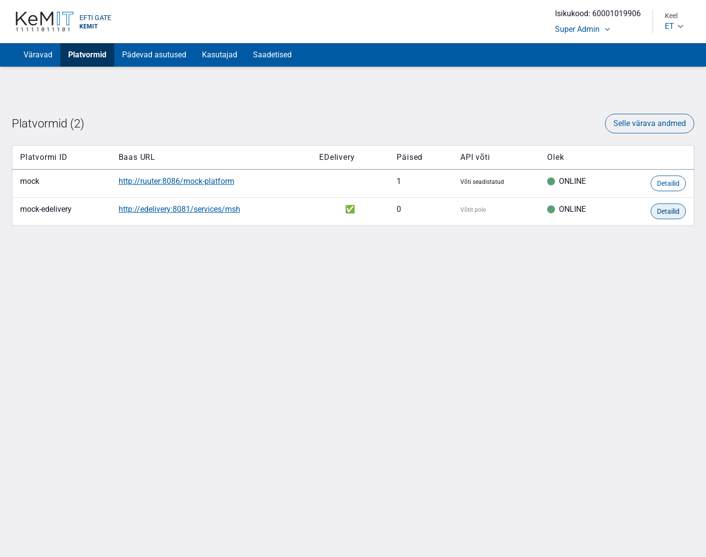
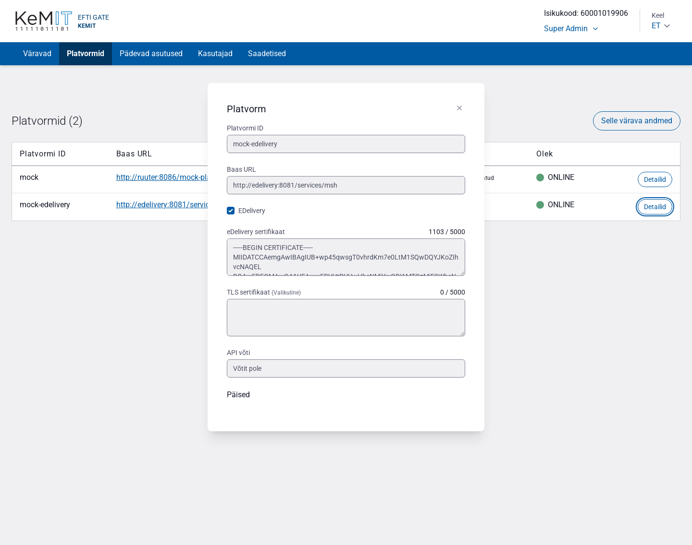

# Platvormid

Vaade **Platvormid** näitab väravaga liidestatud eFTI platvorme ja nende ühendusandmeid. Vaade on **ainult lugemiseks**: platvorme ei lisata, muudeta ega kustutata haldusliidese kaudu ning API võtmeid haldusliideses ei genereerita.

## Kust platvormide andmed tulevad?

Platvormide register on repositooriumi kaustas `registry/platforms/` — üks YAML-fail platvormi kohta. Uue platvormi liitmine, ühendusandmete muutmine, API võtme vahetus ja platvormi välja lülitamine käivad muudatustaotluse ja uue versiooni paigaldamise kaudu. Pöördu tehnilise meeskonna poole.

## Veerud

| Veerg | Tähendus |
|---|---|
| Platvormi ID | Platvormi tunnus registris. |
| Baas URL | Platvormi REST-liidese aadress. |
| EDelivery | ✅ tähendab, et platvormiga suheldakse eDelivery (AS4) kaudu; muidu REST-i kaudu. |
| Päised | Väravast platvormi saadetavate lisapäiste arv. |
| API võti | **Võti seadistatud**, kui platvormil on väravale saatmiseks API võti; **Võtit pole**, kui ei ole. Võtit ennast ei kuvata kunagi. |
| Olek | **ONLINE** — platvorm saab andmeid saata ja andmepäringud suunatakse sinna. **KEELATUD** — platvorm ei autendi ja andmepäringutele vastatakse, nagu platvormi ei oleks. |

## Platvormi andmete vaatamine

Vajuta rea lõpus **Detailid**. Aknas on baas-URL, sertifikaadid, päised ja API võtme olemasolu. Väljad on lukus.

## API võti

Platvormi API võti on registrifailis ning seda ei saa haldusliidesest vaadata ega uuesti genereerida. Kui võti läheb kaduma või lekib, pöördu tehnilise meeskonna poole: uus võti lisatakse registrisse, värav paigaldatakse uuesti ja võti edastatakse platvormi operaatorile turvalist kanalit pidi.
